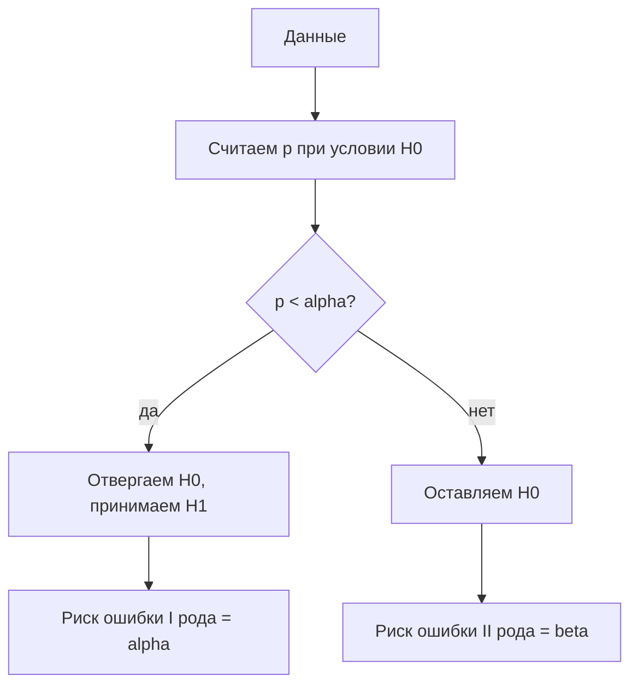

# 5. Гипотезы, p-value, матрица ошибок

Проверка гипотез решает: «эффект есть или это случайность». Для домахи это главный
инструмент: каждое значение проверяется гипотезой «это обычное значение» против
«это выброс».

## H₀ и H₁: суд

Аналогия: суд начинает с презумпции невиновности. Обвинение доказывает вину, а не
наоборот.

- `H₀` (H0) — нулевая гипотеза. Эффекта нет,
  значение лежит в норме.
- `H₁` (H1) — альтернатива, обратное
  утверждение.

По умолчанию принимают `H₀`. Отвергают только при сильном противоречии данных.

!!! note "Определение"
    **p-value** — вероятность увидеть такие или более экстремальные данные, **если
    H₀ верна**. Чем меньше `p`, тем хуже данные сочетаются с `H₀`.

Правило решения: если `p < α`, отвергаем `H₀` в пользу `H₁`. Иначе оставляем `H₀`.



!!! warning "Ошибка"
    `p` — это **не** вероятность, что `H₀` верна. Это вероятность данных при
    условии `H₀`. Фраза «p = 0.03, значит H₀ верна с вероятностью 3%» неверна.

## Как получить p для значения

Для нормального распределения `p` считается по `z`-оценке:

$$z = \frac{x - \mu}{\sigma}, \qquad p = 2 \cdot \text{sf}(|z|)$$

Расшифровка: `x` — проверяемое значение, `μ` — среднее, `σ` — СКО,
`z` — на сколько σ значение отстоит от среднего. Множитель `2` делает проверку
двусторонней, `|z|` — модуль, чтобы поймать хвосты с обеих сторон.

**Откуда числа:** порог `p = 0.001` соответствует `|z| = 3.29`. Проверка на примере:
значение с `z = 3.3` даёт `p = 2 × sf(3.3) = 0.00097 < 0.001`.

!!! question "Проверь себя"
    Значение дало `z = 2.0`. Отвергаем ли гипотезу при `α = 0.05`?

??? success "Ответ"
    Да, отвергаем. `p = 2 × sf(2.0) = 0.0455`, а это меньше `α = 0.05`. Проверь сам
    через `ss.norm.sf`. Здесь важна не интуиция, а сравнение с `α`.

## Матрица ошибок

Решение принимаем по случайным данным, поэтому ошибаться неизбежно. Два типа ошибок:

|  | H₀ верна | H₁ верна |
| --- | --- | --- |
| **приняли H₀** | верно (TN) | ошибка II рода (FN) |
| **отвергли H₀** | ошибка I рода (FP) | верно (TP) |

- **Ошибка I рода** (`FP`) — отвергли верную `H₀`. Вероятность равна `α`.
  Аналогия: признали здорового больным.
- **Ошибка II рода** (`FN`) — не заметили эффект. Вероятность `β`. Аналогия:
  пропустили болезнь.

`α` задаём сами. Уменьшая `α`, делаем ошибку I рода реже, а II рода — чаще.

## Пример: 1000 человек

```python
tp, fn, fp, tn = 10, 2, 8, 980
total = tp + tn + fp + fn
accuracy = (tp + tn) / total
print(accuracy)   # 0.99
```

**Что здесь что:**

| Элемент | Что означает |
| --- | --- |
| `tp, fn, fp, tn` | счётчики четырёх исходов |
| `total` | всего наблюдений; здесь `1000` |
| `accuracy` | доля верных решений; здесь `0.99` |

**Откуда числа:** `980 + 8 + 2 + 10 = 1000`. Верно `10 + 980 = 990`, точность
`990 / 1000 = 0.99`.

!!! warning "Ошибка"
    Ориентироваться только на точность. При `988` невиновных из `1000` можно никого
    не осуждать и получить `98.8%`. Смотри на `FP` и `FN` отдельно.

## Наивные вопросы

!!! question "Почему `p` не равен вероятности, что H₀ верна?"
    `p` считается при условии, что `H₀` **уже верна**. Это вероятность данных, а не
    гипотезы. Вероятность самой `H₀` из `p` не выводится.

!!! question "Чем ошибка I рода отличается от II?"
    I — ложная тревога: отвергли верную `H₀`. II — пропуск: не отвергли неверную.
    Первая связана с `α`, вторая — с `β`.

## Сделай сам

Тест дал `FP = 20`, `FN = 5`, `TP = 45`, `TN = 430`. Посчитай точность и назови
ошибку I и II рода. **Сначала сам.**

!!! question "Сделай сам"
    Найди `accuracy` и определи, какие числа отвечают за ложные тревоги и пропуски.

??? tip "Подсказка 1"
    Точность — доля верных решений среди всех. Верные — это `TP` и `TN`.

??? tip "Подсказка 2"
    ```python
    accuracy = (___ + ___) / (tp + tn + fp + fn)
    # FP — это ___, FN — это ___
    ```

??? success "Ответ"
    `accuracy = 0.95`. Ложные тревоги (ошибка I рода) — `FP = 20`, пропуски
    (ошибка II рода) — `FN = 5`.

## Что дальше

Мы получили механизм: для каждого значения считать `z`, потом `p`, сравнивать с
`α`. Дальше — как применить это к файлу в домашке.
