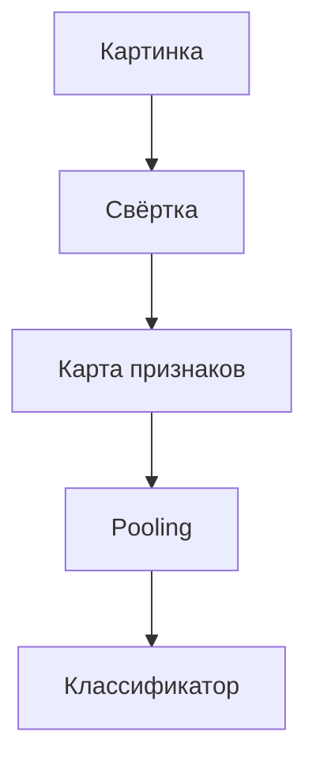

<div class="mission" data-mission="learn-ai-cnn" data-subtopic="learn-ai-cnn" data-title="CNN: что видит свёртка" data-review="1,3,7,14,30" data-review-url="../../../review/" data-skills="cnn" data-strict="1" data-hint-default="Сначала попытка. Потом проверка. Решение — после третьей попытки." markdown="1">

<div class="mission-top">
  <span class="mission-kicker">ИИ · CNN: что видит свёртка · 3–5 заходов</span>
  <span class="mission-track"><span data-progress></span></span>
  <span class="mission-count" data-count>1 / 7</span>
</div>

<section class="mission-step" data-step="1" markdown="1">

<span class="mission-label">Шаг 1 · жизненный пример · 5 минут</span>

## Зачем это

Полносвязная сеть на картинке 224×224 имеет миллионы весов уже на первом слое. CNN использует **локальные фильтры**, которые скользят по изображению и ищут один и тот же признак в разных местах. Это уменьшает число параметров и использует структуру картинки.

**Артефакт:** разбор своего кода по теме и одна задача без готового ответа.

</section>

<section class="mission-step" data-step="2" markdown="1">

<span class="mission-label">Шаг 2 · теория · 12 минут</span>

## Ключевые идеи

- Свёртка — скользящее окно `kernel_size`: каждое окно даёт одно число, каналы смешиваются весами, пространство сохраняется.
- `stride` уменьшает карту, `padding` сохраняет размер; `pooling` берёт максимум или среднее и снижает чувствительность к сдвигу.
- Размер выхода: `(H + 2p - k) / s + 1`; число фильтров задаёт `out_channels`, а не размер входа.

### Схема



### По шагам

1. Примени фильтры.
2. Посчитай размер выхода.
3. Уменьши карту.
4. Собери признаки и классифицируй.

### Пример

```python
import torch.nn as nn
conv = nn.Conv2d(in_channels=3, out_channels=16, kernel_size=3, padding=1)
```

### Типичные ошибки

- Путать `in_channels` (каналы входа) с `out_channels` (число фильтров).
- Забыть `padding` и удивляться, что карта уменьшилась.
- Считать, что pooling «учится»: у него нет весов.

### Как проверить себя

- Объясни схему и шаги без конспекта.
- Назови, где метод ломается.
- Реши задачу и сверь с критерием, а не с ответом.

</section>

<section class="mission-step" data-step="3" data-require-check markdown="1">

<span class="mission-label">Шаг 3 · диагностика · 8 минут</span>

## Проверь модель

Нужно **80%**. Если меньше — вернись к теории.

```quiz
{
  "title": "Диагностика · CNN: что видит свёртка",
  "min": 80,
  "questions": [
    {
      "type": "choice",
      "q": "Что верно про «CNN: что видит свёртка»?",
      "options": [
        "Это ключевая идея модуля.",
        "Pooling имеет обучаемые веса.",
        "Stride не влияет на размер выхода.",
        "Достаточно accuracy на обучении."
      ],
      "answer": 0,
      "explain": "Это ключевая идея модуля."
    },
    {
      "type": "truefalse",
      "q": "Верно ли: Нужна практика и защита своими словами.",
      "answer": true,
      "explain": "Нужна практика и защита своими словами."
    },
    {
      "type": "truefalse",
      "q": "Верно ли: Нужна практика: объяснить код, решить задачу и защитить результат.",
      "answer": true,
      "explain": "Нужна практика: объяснить код, решить задачу и защитить результат."
    },
    {
      "type": "truefalse",
      "q": "Верно ли: Pooling имеет обучаемые веса.",
      "answer": false,
      "explain": "Это типичное заблуждение; проверь по теории."
    },
    {
      "type": "truefalse",
      "q": "Верно ли: Stride не влияет на размер выхода.",
      "answer": false,
      "explain": "Это типичное заблуждение; проверь по теории."
    },
    {
      "type": "truefalse",
      "q": "Достаточно посмотреть разбор, чтобы считать «CNN: что видит свёртка» освоенной.",
      "answer": false,
      "explain": "Без своей попытки и защиты тема не освоена."
    }
  ]
}
```

</section>

<section class="mission-step" data-step="4" data-require-check data-require-all markdown="1">

<span class="mission-label">Шаг 4 · практика с каркасом · 30 минут</span>

## Посчитай и почини

### 4.1. Размер выхода

in=32, padding=1, kernel=3, stride=1. Напечатай out.

```pyplay
# @mode write
# @expect 32
# @hint Формула выхода свёртки.
# Размер выхода: in=32, padding=1, kernel=3, stride=1. Напечатай out.
size, padding, kernel, stride = 32, 1, 3, 1
# твой код: посчитай размер выхода и напечатай
```

### 4.2. Accuracy

Посчитай accuracy.

```pyplay
# @mode write
# @expect 448
# @hint Веса + bias на каждый фильтр.
# Параметры Conv2d: Посчитай число параметров.
cin, cout, k = 3, 16, 3
# твой код: параметры свёртки
```

### 4.3. Dot product

Посчитай скалярное произведение.

```pyplay
# @mode write
# @expect 16
# @hint Pooling делит размер.
# Pooling: Посчитай выход после pooling.
size, pool = 32, 2
# твой код: размер после pooling
```

### 4.4. Объясни

Напиши 2–3 предложения: где этот метод ломается и что проверить на новых данных.

</section>

<section class="mission-step" data-step="5" data-require-check data-require-all markdown="1">

<span class="mission-label">Шаг 5 · куски задачи · 20 минут</span>

## Перенеси в свой разбор

### 5.1. Данные

Возьми свой ноутбук или таблицу. Запиши, какой признак был бы утечкой.

### 5.2. Метод

Запусти метод на своих данных. Сравни с простым baseline.

### 5.3. Вывод

Объясни, что получилось и где результат может обмануть.

</section>

<section class="mission-step" data-step="6" data-require-check markdown="1">

<span class="mission-label">Шаг 6 · половина модуля · 25 минут</span>

## Собери половину

Соедини 4.1 и 4.3: посчитай результат и объясни, что изменится на других данных.

<textarea data-save="ai-cnn-half" rows="5" placeholder="Моё объяснение: результат, ограничения, что проверю."></textarea>

</section>

<section class="mission-step" data-step="7" data-require-check markdown="1">

<span class="mission-label">Шаг 7 · полный артефакт и защита · 20 минут</span>

## Что сдать

- [ ] Свой результат по теме.
- [ ] Сравнение с baseline.
- [ ] Объяснение, где метод ломается.
- [ ] Ответ на вопрос «почему так».

**Защита:** объясни каждую строку своего кода и назови проверку.

<textarea data-save="ai-cnn-mistake" rows="4" placeholder="Где я ошибся и как это заметить в следующий раз"></textarea>

</section>

<div class="mission-controls">
  <button type="button" class="mission-btn mission-btn--ghost" data-prev>Назад</button>
  <span class="mission-spacer"></span>
  <button type="button" class="mission-btn mission-btn--primary" data-next>Дальше</button>
</div>

<p class="mission-hint" data-hint>Сначала попытка. Потом проверка.</p>

<div class="mission-done" data-complete hidden>
  <strong>Подтема собрана</strong>
  <p>Вернись через 1–3–7 дней и объясни тему без подсказок.</p>
</div>

</div>
