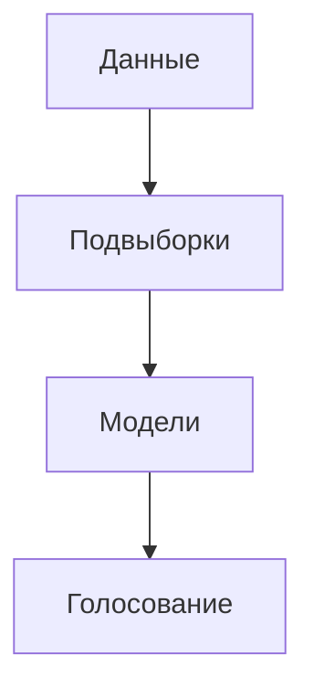

<div class="mission" data-mission="learn-ai-ensembles" data-subtopic="learn-ai-ensembles" data-title="Ансамбли" data-review="1,3,7,14,30" data-review-url="../../../review/" data-skills="ensembles" data-strict="1" data-hint-default="Сначала попытка. Потом проверка. Решение — после третьей попытки." markdown="1">

<div class="mission-top">
  <span class="mission-kicker">ИИ · Ансамбли · 3–5 заходов</span>
  <span class="mission-track"><span data-progress></span></span>
  <span class="mission-count" data-count>1 / 7</span>
</div>

<section class="mission-step" data-step="1" markdown="1">

<span class="mission-label">Шаг 1 · жизненный пример · 5 минут</span>

## Зачем это

Одна модель ошибается; несколько разных моделей могут ошибаться по-разному. Ансамбль использует это, но не бесплатно.

**Артефакт:** разбор своего кода по теме и одна задача без готового ответа.

</section>

<section class="mission-step" data-step="2" markdown="1">

<span class="mission-label">Шаг 2 · теория · 12 минут</span>

## Ключевые идеи

- Bagging уменьшает дисперсию: обучает модели на бутстрап-выборках и усредняет.
- Random forest — bagging деревьев плюс случайный выбор признаков в узлах.
- Boosting строит модели последовательно, каждая исправляет ошибки предыдущих.
- Stacking обучает мета-модель на предсказаниях базовых моделей.

### Как это работает

Bagging снижает дисперсию: модели обучаются на разных подвыборках и усредняются, поэтому случайные ошибки частично гасятся. Random forest добавляет случайность в выбор признаков, чтобы деревья были менее похожи. Boosting строит модели последовательно: каждая следующая фокусируется на ошибках предыдущих, поэтому снижает смещение, но чувствителен к шуму и переобучению.

Stacking — отдельный уровень: базовые модели дают предсказания, мета-модель учится их комбинировать. Здесь легко получить утечку, если мета-модель обучать на тех же данных, где базовые модели уже видели ответ. Для честной оценки нужны out-of-fold предсказания.

### Схема



### По шагам

1. Сделай подвыборки.
2. Обучи модели.
3. Собери голоса.
4. Сравни с одной.

### Пример

```python
from sklearn.ensemble import RandomForestClassifier
model = RandomForestClassifier(n_estimators=300, max_depth=None, random_state=0)
model.fit(X_train, y_train)
```

### Типичные ошибки

- Считать, что ансамбль всегда лучше одной модели.
- Обучать мета-модель на train без out-of-fold.
- Не следить за временем и стоимостью инференса.

### Как проверить себя

- Объясни схему и шаги без конспекта.
- Назови, где метод ломается.
- Реши задачу и сверь с критерием, а не с ответом.

</section>

<section class="mission-step" data-step="3" data-require-check markdown="1">

<span class="mission-label">Шаг 3 · диагностика · 8 минут</span>

## Проверь модель

Нужно **80%**. Если меньше — вернись к теории.

```quiz
{
  "title": "Диагностика · Ансамбли",
  "min": 80,
  "questions": [
    {
      "type": "choice",
      "q": "Что верно про «Ансамбли»?",
      "options": [
        "Bagging уменьшает дисперсию: обучает модели на бутстрап-выборках и усредняет.",
        "Boosting обучает модели параллельно.",
        "Ансамбль всегда лучше одной модели.",
        "Достаточно accuracy на обучении."
      ],
      "answer": 0,
      "explain": "Bagging уменьшает дисперсию: обучает модели на бутстрап-выборках и усредняет."
    },
    {
      "type": "truefalse",
      "q": "Верно ли: Random forest — bagging деревьев плюс случайный выбор признаков в узлах.",
      "answer": true,
      "explain": "Random forest — bagging деревьев плюс случайный выбор признаков в узлах."
    },
    {
      "type": "truefalse",
      "q": "Верно ли: Boosting строит модели последовательно, каждая исправляет ошибки предыдущих.",
      "answer": true,
      "explain": "Boosting строит модели последовательно, каждая исправляет ошибки предыдущих."
    },
    {
      "type": "truefalse",
      "q": "Верно ли: Boosting обучает модели параллельно.",
      "answer": false,
      "explain": "Это типичное заблуждение; проверь по теории."
    },
    {
      "type": "truefalse",
      "q": "Верно ли: Ансамбль всегда лучше одной модели.",
      "answer": false,
      "explain": "Это типичное заблуждение; проверь по теории."
    },
    {
      "type": "truefalse",
      "q": "Достаточно посмотреть разбор, чтобы считать «Ансамбли» освоенной.",
      "answer": false,
      "explain": "Без своей попытки и защиты тема не освоена."
    }
  ]
}
```

</section>

<section class="mission-step" data-step="4" data-require-check data-require-all markdown="1">

<span class="mission-label">Шаг 4 · практика с каркасом · 30 минут</span>

## Посчитай и почини

### 4.1. Голосование

Три модели предсказали 0,1,1. Напечатай итог большинства.

```pyplay
# @mode write
# @expect 1
# @hint Выбери самое частое значение.
# Голосование: Три модели предсказали 0,1,1. Напечатай итог большинства.
votes = [0, 1, 1]
# твой код: выбери самое частое и напечатай
```

### 4.2. Accuracy

Посчитай accuracy.

```pyplay
# @mode write
# @expect 0.53
# @hint Среднее по моделям.
# Средняя вероятность: Посчитай среднее.
probs = [0.2, 0.8, 0.6]
# твой код: средняя вероятность
```

### 4.3. Dot product

Посчитай скалярное произведение.

```pyplay
# @mode write
# @expect 2
# @hint Сравни каждую вероятность с 0.5.
# Голоса: Посчитай, сколько моделей за класс 1.
probs = [0.4, 0.6, 0.7]
# твой код: сколько моделей за класс 1
```

### 4.4. Объясни

Напиши 2–3 предложения: где этот метод ломается и что проверить на новых данных.

</section>

<section class="mission-step" data-step="5" data-require-check data-require-all markdown="1">

<span class="mission-label">Шаг 5 · куски задачи · 20 минут</span>

## Перенеси в свой разбор

### 5.1. Данные

Возьми свой ноутбук или таблицу. Запиши, какой признак был бы утечкой.

### 5.2. Метод

Запусти метод на своих данных. Сравни с простым baseline.

### 5.3. Вывод

Объясни, что получилось и где результат может обмануть.

</section>

<section class="mission-step" data-step="6" data-require-check markdown="1">

<span class="mission-label">Шаг 6 · половина модуля · 25 минут</span>

## Собери половину

Соедини 4.1 и 4.3: посчитай результат и объясни, что изменится на других данных.

<textarea data-save="ai-ensembles-half" rows="5" placeholder="Моё объяснение: результат, ограничения, что проверю."></textarea>

</section>

<section class="mission-step" data-step="7" data-require-check markdown="1">

<span class="mission-label">Шаг 7 · полный артефакт и защита · 20 минут</span>

## Что сдать

- [ ] Свой результат по теме.
- [ ] Сравнение с baseline.
- [ ] Объяснение, где метод ломается.
- [ ] Ответ на вопрос «почему так».

**Защита:** объясни каждую строку своего кода и назови проверку.

<textarea data-save="ai-ensembles-mistake" rows="4" placeholder="Где я ошибся и как это заметить в следующий раз"></textarea>

</section>

<div class="mission-controls">
  <button type="button" class="mission-btn mission-btn--ghost" data-prev>Назад</button>
  <span class="mission-spacer"></span>
  <button type="button" class="mission-btn mission-btn--primary" data-next>Дальше</button>
</div>

<p class="mission-hint" data-hint>Сначала попытка. Потом проверка.</p>

<div class="mission-done" data-complete hidden>
  <strong>Подтема собрана</strong>
  <p>Вернись через 1–3–7 дней и объясни тему без подсказок.</p>
</div>

</div>
