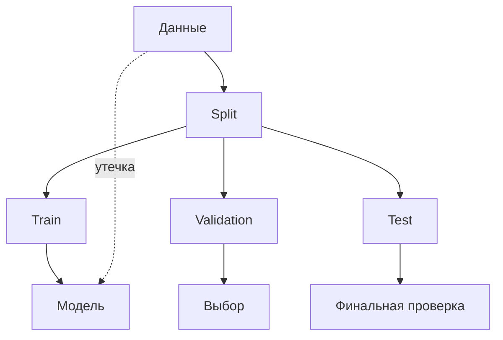

<div class="mission" data-mission="learn-ai-foundation" data-subtopic="learn-ai-foundation" data-title="ML-фундамент" data-review="1,3,7,14,30" data-review-url="../../../review/" data-skills="foundation" data-strict="1" data-hint-default="Сначала попытка. Потом проверка. Решение — после третьей попытки." markdown="1">

<div class="mission-top">
  <span class="mission-kicker">ИИ · ML-фундамент · 3–5 заходов</span>
  <span class="mission-track"><span data-progress></span></span>
  <span class="mission-count" data-count>1 / 7</span>
</div>

<section class="mission-step" data-step="1" markdown="1">

<span class="mission-label">Шаг 1 · жизненный пример · 5 минут</span>

## Зачем это

Без фундамента любая модель — гадание: непонятно, что считаем, с чем сравниваем и почему верим метрике.

**Артефакт:** разбор своего кода по теме и одна задача без готового ответа.

</section>

<section class="mission-step" data-step="2" markdown="1">

<span class="mission-label">Шаг 2 · теория · 12 минут</span>

## Ключевые идеи

- Признак — то, что известно до ответа; целевая переменная — то, что предсказываем.
- Train / validation / test: на тесте не подбирают ни модель, ни порог, ни признаки.
- Baseline — самое простое разумное решение; без него нельзя сказать, что модель «работает».
- Утечка данных (leakage) — когда в признаки попадает информация из будущего или из ответа.

### Как это работает

Модель всегда отвечает на вопрос «что я предсказываю и по каким данным». Сначала фиксируем целевую переменную и момент, в который делается прогноз: от этого зависит, какие признаки допустимы. Если признак становится известен только после ответа, это утечка, и метрика на тесте будет красивой, а на проде — случайной.

Дальше — split. Обучающая часть нужна для подбора весов, валидационная — для выбора модели и порога, тестовая — только для финальной проверки. Один и тот же тест нельзя использовать десять раз: ты начинаешь подбирать под него, и он перестаёт быть независимым. Baseline (константа, среднее, самое частое) задаёт нижнюю планку: если сложная модель его не бьёт, проблема не в модели.

### Схема



### По шагам

1. Зафиксируй цель и момент прогноза.
2. Раздели данные до любых преобразований.
3. Сравни модель с baseline на validation.
4. Тест открой один раз — в конце.

### Пример

```python
from sklearn.model_selection import train_test_split
X_train, X_test, y_train, y_test = train_test_split(
    X, y, test_size=0.2, random_state=42, stratify=y
)
```

### Типичные ошибки

- Обучать на всех данных, а потом «проверять» на них же.
- Заполнять пропуски средним по всей выборке до split — утечка.
- Смотреть только accuracy при дисбалансе классов.

### Как проверить себя

- Объясни схему и шаги без конспекта.
- Назови, где метод ломается.
- Реши задачу и сверь с критерием, а не с ответом.

</section>

<section class="mission-step" data-step="3" data-require-check markdown="1">

<span class="mission-label">Шаг 3 · диагностика · 8 минут</span>

## Проверь модель

Нужно **80%**. Если меньше — вернись к теории.

```quiz
{
  "title": "Диагностика · ML-фундамент",
  "min": 80,
  "questions": [
    {
      "type": "choice",
      "q": "Что верно про «ML-фундамент»?",
      "options": [
        "Признак — то, что известно до ответа; целевая переменная — то, что предсказываем.",
        "Тест можно использовать для подбора гиперпараметров.",
        "Утечка данных улучшает обобщение.",
        "Достаточно accuracy на обучении."
      ],
      "answer": 0,
      "explain": "Признак — то, что известно до ответа; целевая переменная — то, что предсказываем."
    },
    {
      "type": "truefalse",
      "q": "Верно ли: Train / validation / test: на тесте не подбирают ни модель, ни порог, ни признаки.",
      "answer": true,
      "explain": "Train / validation / test: на тесте не подбирают ни модель, ни порог, ни признаки."
    },
    {
      "type": "truefalse",
      "q": "Верно ли: Baseline — самое простое разумное решение; без него нельзя сказать, что модель «работает».",
      "answer": true,
      "explain": "Baseline — самое простое разумное решение; без него нельзя сказать, что модель «работает»."
    },
    {
      "type": "truefalse",
      "q": "Верно ли: Тест можно использовать для подбора гиперпараметров.",
      "answer": false,
      "explain": "Это типичное заблуждение; проверь по теории."
    },
    {
      "type": "truefalse",
      "q": "Верно ли: Утечка данных улучшает обобщение.",
      "answer": false,
      "explain": "Это типичное заблуждение; проверь по теории."
    },
    {
      "type": "truefalse",
      "q": "После задачи нужно объяснить «ML-фундамент» своими словами.",
      "answer": true,
      "explain": "Защита своими словами — часть навыка."
    }
  ]
}
```

</section>

<section class="mission-step" data-step="4" data-require-check data-require-all markdown="1">

<span class="mission-label">Шаг 4 · практика с каркасом · 30 минут</span>

## Посчитай и почини

### 4.1. Посчитай accuracy

tp=8, tn=9, fp=2, fn=1. Напечатай accuracy.

```pyplay
# @mode write
# @expect 0.85
# @hint Доля верных среди всех объектов.
# Посчитай accuracy: tp=8, tn=9, fp=2, fn=1. Напечатай accuracy.
tp, tn, fp, fn = 8, 9, 2, 1
# твой код: посчитай accuracy и напечатай результат
```

### 4.2. Accuracy

Посчитай accuracy.

```pyplay
# @mode write
# @expect 0.75
# @hint Самый частый класс — baseline.
# Baseline: Посчитай долю мажоритарного класса.
labels = [0, 0, 1, 0]
# твой код: доля мажоритарного класса
```

### 4.3. Dot product

Посчитай скалярное произведение.

```pyplay
# @mode write
# @expect 0.75
# @hint Precision = TP/(TP+FP).
# Precision: Посчитай precision.
tp, fp = 6, 2
# твой код: precision
```

### 4.4. Объясни

Напиши 2–3 предложения: где этот метод ломается и что проверить на новых данных.

</section>

<section class="mission-step" data-step="5" data-require-check data-require-all markdown="1">

<span class="mission-label">Шаг 5 · куски задачи · 20 минут</span>

## Перенеси в свой разбор

### 5.1. Данные

Возьми свой ноутбук или таблицу. Запиши, какой признак был бы утечкой.

### 5.2. Метод

Запусти метод на своих данных. Сравни с простым baseline.

### 5.3. Вывод

Объясни, что получилось и где результат может обмануть.

</section>

<section class="mission-step" data-step="6" data-require-check markdown="1">

<span class="mission-label">Шаг 6 · половина модуля · 25 минут</span>

## Собери половину

Соедини 4.1 и 4.3: посчитай результат и объясни, что изменится на других данных.

<textarea data-save="ai-foundation-half" rows="5" placeholder="Моё объяснение: результат, ограничения, что проверю."></textarea>

</section>

<section class="mission-step" data-step="7" data-require-check markdown="1">

<span class="mission-label">Шаг 7 · полный артефакт и защита · 20 минут</span>

## Что сдать

- [ ] Свой результат по теме.
- [ ] Сравнение с baseline.
- [ ] Объяснение, где метод ломается.
- [ ] Ответ на вопрос «почему так».

**Защита:** объясни каждую строку своего кода и назови проверку.

<textarea data-save="ai-foundation-mistake" rows="4" placeholder="Где я ошибся и как это заметить в следующий раз"></textarea>

</section>

<div class="mission-controls">
  <button type="button" class="mission-btn mission-btn--ghost" data-prev>Назад</button>
  <span class="mission-spacer"></span>
  <button type="button" class="mission-btn mission-btn--primary" data-next>Дальше</button>
</div>

<p class="mission-hint" data-hint>Сначала попытка. Потом проверка.</p>

<div class="mission-done" data-complete hidden>
  <strong>Подтема собрана</strong>
  <p>Вернись через 1–3–7 дней и объясни тему без подсказок.</p>
</div>

</div>
