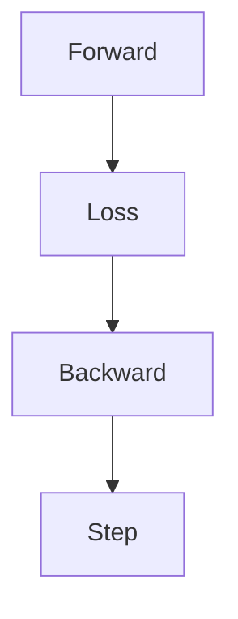

<div class="mission" data-mission="learn-ai-frameworks" data-subtopic="learn-ai-frameworks" data-title="Torch и Keras" data-review="1,3,7,14,30" data-review-url="../../../review/" data-skills="frameworks" data-strict="1" data-hint-default="Сначала попытка. Потом проверка. Решение — после третьей попытки." markdown="1">

<div class="mission-top">
  <span class="mission-kicker">ИИ · Torch и Keras · 3–5 заходов</span>
  <span class="mission-track"><span data-progress></span></span>
  <span class="mission-count" data-count>1 / 7</span>
</div>

<section class="mission-step" data-step="1" markdown="1">

<span class="mission-label">Шаг 1 · жизненный пример · 5 минут</span>

## Зачем это

Фреймворк не думает за тебя: он даёт автоградиент и слои, но выбор модели, loss и метрики остаётся твоим.

**Артефакт:** разбор своего кода по теме и одна задача без готового ответа.

</section>

<section class="mission-step" data-step="2" markdown="1">

<span class="mission-label">Шаг 2 · теория · 12 минут</span>

## Ключевые идеи

- PyTorch: явный цикл `forward → loss → backward → step → zero_grad`.
- Keras: `compile` задаёт optimizer/loss/metrics, `fit` запускает цикл.
- Оптимизаторы SGD/Momentum/Adam по-разному используют градиент и состояние.
- Seed и версии окружения важны для воспроизводимости.

### Как это работает

PyTorch даёт явный контроль: ты сам пишешь цикл и видишь каждый шаг. Keras прячет цикл за `compile`/`fit`, но те же понятия остаются: optimizer, loss, метрики, эпохи. Понимание цикла важнее знания API: если не знаешь, что происходит между `fit` и метрикой, ошибку не найти.

Воспроизводимость — часть результата. Фиксируй seed, версии библиотек, split и порядок данных. Сохраняй не только веса, но и конфиг: модель без конфига трудно повторить. Для отладки сначала прогони маленькую модель на маленьком батче: если она не может переобучиться на 10 примерах, проблема в коде или данных.

### Схема



### По шагам

1. Forward.
2. Loss.
3. Backward.
4. Step и zero_grad.

### Пример

```python
# PyTorch, один шаг
optimizer.zero_grad()
loss = loss_fn(model(x), y)
loss.backward()
optimizer.step()
```

### Типичные ошибки

- Сравнивать модели без одинакового split и seed.
- Менять несколько гиперпараметров сразу и не знать, что помогло.
- Не сохранять конфиг эксперимента.

### Как проверить себя

- Объясни схему и шаги без конспекта.
- Назови, где метод ломается.
- Реши задачу и сверь с критерием, а не с ответом.

</section>

<section class="mission-step" data-step="3" data-require-check markdown="1">

<span class="mission-label">Шаг 3 · диагностика · 8 минут</span>

## Проверь модель

Нужно **80%**. Если меньше — вернись к теории.

```quiz
{
  "title": "Диагностика · Torch и Keras",
  "min": 80,
  "questions": [
    {
      "type": "choice",
      "q": "Что верно про «Torch и Keras»?",
      "options": [
        "PyTorch: явный цикл `forward → loss → backward → step → zero_grad`.",
        "zero_grad не нужен.",
        "Keras не использует optimizer.",
        "Достаточно accuracy на обучении."
      ],
      "answer": 0,
      "explain": "PyTorch: явный цикл `forward → loss → backward → step → zero_grad`."
    },
    {
      "type": "truefalse",
      "q": "Верно ли: Keras: `compile` задаёт optimizer/loss/metrics, `fit` запускает цикл.",
      "answer": true,
      "explain": "Keras: `compile` задаёт optimizer/loss/metrics, `fit` запускает цикл."
    },
    {
      "type": "truefalse",
      "q": "Верно ли: Оптимизаторы SGD/Momentum/Adam по-разному используют градиент и состояние.",
      "answer": true,
      "explain": "Оптимизаторы SGD/Momentum/Adam по-разному используют градиент и состояние."
    },
    {
      "type": "truefalse",
      "q": "Верно ли: zero_grad не нужен.",
      "answer": false,
      "explain": "Это типичное заблуждение; проверь по теории."
    },
    {
      "type": "truefalse",
      "q": "Верно ли: Keras не использует optimizer.",
      "answer": false,
      "explain": "Это типичное заблуждение; проверь по теории."
    },
    {
      "type": "truefalse",
      "q": "Достаточно посмотреть разбор, чтобы считать «Torch и Keras» освоенной.",
      "answer": false,
      "explain": "Без своей попытки и защиты тема не освоена."
    }
  ]
}
```

</section>

<section class="mission-step" data-step="4" data-require-check data-require-all markdown="1">

<span class="mission-label">Шаг 4 · практика с каркасом · 30 минут</span>

## Посчитай и почини

### 4.1. Шаг SGD

w=2, lr=0.1, grad=3. Напечатай новое w.

```pyplay
# @mode write
# @expect 1.7
# @hint Один шаг SGD: w - lr*grad.
# Шаг SGD: w=2, lr=0.1, grad=3. Напечатай новое w.
w, lr, grad = 2.0, 0.1, 3.0
# твой код: сделай один шаг SGD и напечатай w
```

### 4.2. Accuracy

Посчитай accuracy.

```pyplay
# @mode write
# @expect 12
# @hint Шаги = эпохи × батчи.
# Шаги обучения: Посчитай число шагов.
epochs, batches = 3, 4
# твой код: число шагов
```

### 4.3. Dot product

Посчитай скалярное произведение.

```pyplay
# @mode write
# @expect 0.05
# @hint Умножь на коэффициент.
# Learning rate: Посчитай lr после decay.
lr, decay = 0.1, 0.5
# твой код: новый lr
```

### 4.4. Объясни

Напиши 2–3 предложения: где этот метод ломается и что проверить на новых данных.

</section>

<section class="mission-step" data-step="5" data-require-check data-require-all markdown="1">

<span class="mission-label">Шаг 5 · куски задачи · 20 минут</span>

## Перенеси в свой разбор

### 5.1. Данные

Возьми свой ноутбук или таблицу. Запиши, какой признак был бы утечкой.

### 5.2. Метод

Запусти метод на своих данных. Сравни с простым baseline.

### 5.3. Вывод

Объясни, что получилось и где результат может обмануть.

</section>

<section class="mission-step" data-step="6" data-require-check markdown="1">

<span class="mission-label">Шаг 6 · половина модуля · 25 минут</span>

## Собери половину

Соедини 4.1 и 4.3: посчитай результат и объясни, что изменится на других данных.

<textarea data-save="ai-frameworks-half" rows="5" placeholder="Моё объяснение: результат, ограничения, что проверю."></textarea>

</section>

<section class="mission-step" data-step="7" data-require-check markdown="1">

<span class="mission-label">Шаг 7 · полный артефакт и защита · 20 минут</span>

## Что сдать

- [ ] Свой результат по теме.
- [ ] Сравнение с baseline.
- [ ] Объяснение, где метод ломается.
- [ ] Ответ на вопрос «почему так».

**Защита:** объясни каждую строку своего кода и назови проверку.

<textarea data-save="ai-frameworks-mistake" rows="4" placeholder="Где я ошибся и как это заметить в следующий раз"></textarea>

</section>

<div class="mission-controls">
  <button type="button" class="mission-btn mission-btn--ghost" data-prev>Назад</button>
  <span class="mission-spacer"></span>
  <button type="button" class="mission-btn mission-btn--primary" data-next>Дальше</button>
</div>

<p class="mission-hint" data-hint>Сначала попытка. Потом проверка.</p>

<div class="mission-done" data-complete hidden>
  <strong>Подтема собрана</strong>
  <p>Вернись через 1–3–7 дней и объясни тему без подсказок.</p>
</div>

</div>
