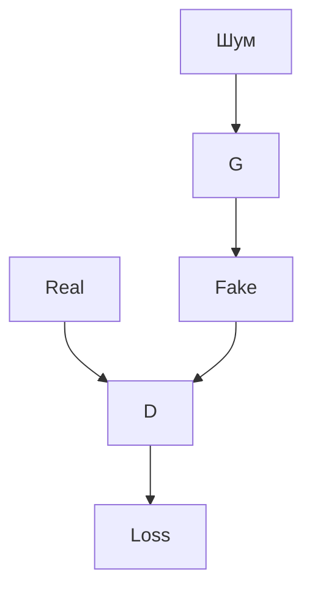

<div class="mission" data-mission="learn-ai-gan" data-subtopic="learn-ai-gan" data-title="GAN" data-review="1,3,7,14,30" data-review-url="../../../review/" data-skills="gan" data-strict="1" data-hint-default="Сначала попытка. Потом проверка. Решение — после третьей попытки." markdown="1">

<div class="mission-top">
  <span class="mission-kicker">ИИ · GAN · 3–5 заходов</span>
  <span class="mission-track"><span data-progress></span></span>
  <span class="mission-count" data-count>1 / 7</span>
</div>

<section class="mission-step" data-step="1" markdown="1">

<span class="mission-label">Шаг 1 · жизненный пример · 5 минут</span>

## Зачем это

GAN учит генератор создавать данные, неотличимые от настоящих, через соревнование с дискриминатором.

**Артефакт:** разбор своего кода по теме и одна задача без готового ответа.

</section>

<section class="mission-step" data-step="2" markdown="1">

<span class="mission-label">Шаг 2 · теория · 12 минут</span>

## Ключевые идеи

- Генератор создаёт объект; дискриминатор отличает настоящее от сгенерированного.
- Обучение — минимакс: улучшение одного меняет задачу другого.
- Mode collapse: генератор выдаёт мало разнообразных примеров.
- Стабильность зависит от архитектуры, lr и баланса шагов.

### Как это работает

Генератор превращает шум в объект, дискриминатор пытается отличить объект от настоящего. Они обучаются одновременно, и цель одного становится задачей другого. Идеальное равновесие — когда дискриминатор не лучше случайного, а генератор выдаёт разнообразные реалистичные примеры.

На практике равновесие хрупкое: один модуль может стать слишком сильным, градиенты исчезают, генератор коллапсирует в один удачный пример. Поэтому важны архитектура, нормализация, баланс шагов и метрики качества, а не только loss. GAN — не «универсальный генератор», а сложный тренировочный процесс.

### Схема



### По шагам

1. Сгенерируй fake.
2. Обучи D.
3. Обнови G.
4. Следи за collapse.

### Пример

```python
for real in loader:
    fake = G(noise())
    loss_d = d_loss(D(real), D(fake.detach()))
    loss_g = g_loss(D(fake))
    # backward и шаги по очереди
```

### Типичные ошибки

- Оценивать GAN по loss без визуальной и количественной проверки.
- Не следить за разнообразием сгенерированных примеров.
- Менять архитектуру до того, как проверен базовый режим.

### Как проверить себя

- Объясни схему и шаги без конспекта.
- Назови, где метод ломается.
- Реши задачу и сверь с критерием, а не с ответом.

</section>

<section class="mission-step" data-step="3" data-require-check markdown="1">

<span class="mission-label">Шаг 3 · диагностика · 8 минут</span>

## Проверь модель

Нужно **80%**. Если меньше — вернись к теории.

```quiz
{
  "title": "Диагностика · GAN",
  "min": 80,
  "questions": [
    {
      "type": "choice",
      "q": "Что верно про «GAN»?",
      "options": [
        "Генератор создаёт объект; дискриминатор отличает настоящее от сгенерированного.",
        "GAN всегда стабилен.",
        "Loss GAN достаточно для качества.",
        "Достаточно accuracy на обучении."
      ],
      "answer": 0,
      "explain": "Генератор создаёт объект; дискриминатор отличает настоящее от сгенерированного."
    },
    {
      "type": "truefalse",
      "q": "Верно ли: Обучение — минимакс: улучшение одного меняет задачу другого.",
      "answer": true,
      "explain": "Обучение — минимакс: улучшение одного меняет задачу другого."
    },
    {
      "type": "truefalse",
      "q": "Верно ли: Mode collapse: генератор выдаёт мало разнообразных примеров.",
      "answer": true,
      "explain": "Mode collapse: генератор выдаёт мало разнообразных примеров."
    },
    {
      "type": "truefalse",
      "q": "Верно ли: GAN всегда стабилен.",
      "answer": false,
      "explain": "Это типичное заблуждение; проверь по теории."
    },
    {
      "type": "truefalse",
      "q": "Верно ли: Loss GAN достаточно для качества.",
      "answer": false,
      "explain": "Это типичное заблуждение; проверь по теории."
    },
    {
      "type": "truefalse",
      "q": "После задачи нужно объяснить «GAN» своими словами.",
      "answer": true,
      "explain": "Защита своими словами — часть навыка."
    }
  ]
}
```

</section>

<section class="mission-step" data-step="4" data-require-check data-require-all markdown="1">

<span class="mission-label">Шаг 4 · практика с каркасом · 30 минут</span>

## Посчитай и почини

### 4.1. Точность дискриминатора

D(real)=0.9, D(fake)=0.1. Посчитай число верных решений из 2.

```pyplay
# @mode write
# @expect 2
# @hint Дискриминатор верен, если real>0.5 и fake<=0.5.
# Точность дискриминатора: D(real)=0.9, D(fake)=0.1. Посчитай число верных решений из 2.
d_real, d_fake = 0.9, 0.1
# твой код: посчитай, сколько решений верны, и напечатай
```

### 4.2. Accuracy

Посчитай accuracy.

```pyplay
# @mode write
# @expect 0.69
# @hint Loss = -log(D(fake)).
# Loss GAN: Посчитай loss генератора.
import math
d_fake = 0.5
# твой код: loss генератора
```

### 4.3. Dot product

Посчитай скалярное произведение.

```pyplay
# @mode write
# @expect 0.8
# @hint Разница вероятностей.
# Дисбаланс: Посчитай разницу.
d_real, d_fake = 0.9, 0.1
# твой код: дисбаланс
```

### 4.4. Объясни

Напиши 2–3 предложения: где этот метод ломается и что проверить на новых данных.

</section>

<section class="mission-step" data-step="5" data-require-check data-require-all markdown="1">

<span class="mission-label">Шаг 5 · куски задачи · 20 минут</span>

## Перенеси в свой разбор

### 5.1. Данные

Возьми свой ноутбук или таблицу. Запиши, какой признак был бы утечкой.

### 5.2. Метод

Запусти метод на своих данных. Сравни с простым baseline.

### 5.3. Вывод

Объясни, что получилось и где результат может обмануть.

</section>

<section class="mission-step" data-step="6" data-require-check markdown="1">

<span class="mission-label">Шаг 6 · половина модуля · 25 минут</span>

## Собери половину

Соедини 4.1 и 4.3: посчитай результат и объясни, что изменится на других данных.

<textarea data-save="ai-gan-half" rows="5" placeholder="Моё объяснение: результат, ограничения, что проверю."></textarea>

</section>

<section class="mission-step" data-step="7" data-require-check markdown="1">

<span class="mission-label">Шаг 7 · полный артефакт и защита · 20 минут</span>

## Что сдать

- [ ] Свой результат по теме.
- [ ] Сравнение с baseline.
- [ ] Объяснение, где метод ломается.
- [ ] Ответ на вопрос «почему так».

**Защита:** объясни каждую строку своего кода и назови проверку.

<textarea data-save="ai-gan-mistake" rows="4" placeholder="Где я ошибся и как это заметить в следующий раз"></textarea>

</section>

<div class="mission-controls">
  <button type="button" class="mission-btn mission-btn--ghost" data-prev>Назад</button>
  <span class="mission-spacer"></span>
  <button type="button" class="mission-btn mission-btn--primary" data-next>Дальше</button>
</div>

<p class="mission-hint" data-hint>Сначала попытка. Потом проверка.</p>

<div class="mission-done" data-complete hidden>
  <strong>Подтема собрана</strong>
  <p>Вернись через 1–3–7 дней и объясни тему без подсказок.</p>
</div>

</div>
