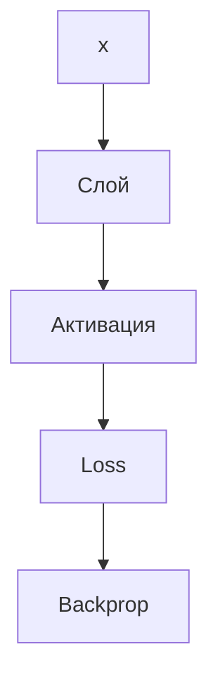

<div class="mission" data-mission="learn-ai-mlp" data-subtopic="learn-ai-mlp" data-title="MLP и backprop" data-review="1,3,7,14,30" data-review-url="../../../review/" data-skills="mlp" data-strict="1" data-hint-default="Сначала попытка. Потом проверка. Решение — после третьей попытки." markdown="1">

<div class="mission-top">
  <span class="mission-kicker">ИИ · MLP и backprop · 3–5 заходов</span>
  <span class="mission-track"><span data-progress></span></span>
  <span class="mission-count" data-count>1 / 7</span>
</div>

<section class="mission-step" data-step="1" markdown="1">

<span class="mission-label">Шаг 1 · жизненный пример · 5 минут</span>

## Зачем это

MLP — это слои линейных преобразований и нелинейностей. Без нелинейности сколько слоёв ни ставь, получится одна линейная модель.

**Артефакт:** разбор своего кода по теме и одна задача без готового ответа.

</section>

<section class="mission-step" data-step="2" markdown="1">

<span class="mission-label">Шаг 2 · теория · 12 минут</span>

## Ключевые идеи

- Нейрон: `y = activation(w·x + b)`.
- Backprop считает градиенты loss по весам; optimizer делает шаг.
- ReLU проста и уменьшает затухание, но может «умирать».
- Слишком большой learning rate — расходимость, слишком маленький — долгое обучение.

### Как это работает

Слой — это матрица весов и смещение. Без нелинейности композиция слоёв остаётся линейной: глубина ничего не добавляет. Активация (ReLU, sigmoid, tanh) вносит нелинейность. Loss превращает ошибку в число, backprop считает градиенты по каждому весу, optimizer делает шаг.

Обучение — не «магия», а цикл: forward, loss, backward, step, обнуление градиентов. Learning rate задаёт размер шага. Слишком большой — loss скачет и расходится; слишком маленький — обучение стоит. Переобучение лечат не только dropout, но и данными, регуляризацией и ранней остановкой.

### Схема



### По шагам

1. Посчитай слой.
2. Примени активацию.
3. Посчитай loss.
4. Сделай шаг.

### Пример

```python
import torch
from torch import nn
model = nn.Sequential(nn.Linear(10, 32), nn.ReLU(), nn.Linear(32, 1))
loss_fn = nn.BCEWithLogitsLoss()
```

### Типичные ошибки

- Забывать `zero_grad`, из-за чего градиенты накапливаются.
- Ставить одинаковый lr всем параметрам без проверки.
- Оценивать модель по loss, не глядя на метрику задачи.

### Как проверить себя

- Объясни схему и шаги без конспекта.
- Назови, где метод ломается.
- Реши задачу и сверь с критерием, а не с ответом.

</section>

<section class="mission-step" data-step="3" data-require-check markdown="1">

<span class="mission-label">Шаг 3 · диагностика · 8 минут</span>

## Проверь модель

Нужно **80%**. Если меньше — вернись к теории.

```quiz
{
  "title": "Диагностика · MLP и backprop",
  "min": 80,
  "questions": [
    {
      "type": "choice",
      "q": "Что верно про «MLP и backprop»?",
      "options": [
        "Нейрон: `y = activation(w·x + b)`.",
        "Без нелинейности MLP становится глубже.",
        "Большой learning rate всегда ускоряет сходимость.",
        "Достаточно accuracy на обучении."
      ],
      "answer": 0,
      "explain": "Нейрон: `y = activation(w·x + b)`."
    },
    {
      "type": "truefalse",
      "q": "Верно ли: Backprop считает градиенты loss по весам; optimizer делает шаг.",
      "answer": true,
      "explain": "Backprop считает градиенты loss по весам; optimizer делает шаг."
    },
    {
      "type": "truefalse",
      "q": "Верно ли: ReLU проста и уменьшает затухание, но может «умирать».",
      "answer": true,
      "explain": "ReLU проста и уменьшает затухание, но может «умирать»."
    },
    {
      "type": "truefalse",
      "q": "Верно ли: Без нелинейности MLP становится глубже.",
      "answer": false,
      "explain": "Это типичное заблуждение; проверь по теории."
    },
    {
      "type": "truefalse",
      "q": "Верно ли: Большой learning rate всегда ускоряет сходимость.",
      "answer": false,
      "explain": "Это типичное заблуждение; проверь по теории."
    },
    {
      "type": "truefalse",
      "q": "Достаточно посмотреть разбор, чтобы считать «MLP и backprop» освоенной.",
      "answer": false,
      "explain": "Без своей попытки и защиты тема не освоена."
    }
  ]
}
```

</section>

<section class="mission-step" data-step="4" data-require-check data-require-all markdown="1">

<span class="mission-label">Шаг 4 · практика с каркасом · 30 минут</span>

## Посчитай и почини

### 4.1. ReLU

Посчитай ReLU(-2).

```pyplay
# @mode write
# @expect 0
# @hint ReLU обнуляет отрицательные.
# ReLU: Посчитай ReLU(-2).
x = -2
# твой код: посчитай ReLU и напечатай
```

### 4.2. Accuracy

Посчитай accuracy.

```pyplay
# @mode write
# @expect 0.5
# @hint Sigmoid(0)=0.5.
# Sigmoid: Посчитай sigmoid(0).
import math
x = 0.0
# твой код: sigmoid
```

### 4.3. Dot product

Посчитай скалярное произведение.

```pyplay
# @mode write
# @expect 12
# @hint Скалярное произведение + bias.
# Нейрон: Посчитай w·x+b.
x = [1, 2]
w = [3, 4]
b = 1
# твой код: взвешенная сумма
```

### 4.4. Объясни

Напиши 2–3 предложения: где этот метод ломается и что проверить на новых данных.

</section>

<section class="mission-step" data-step="5" data-require-check data-require-all markdown="1">

<span class="mission-label">Шаг 5 · куски задачи · 20 минут</span>

## Перенеси в свой разбор

### 5.1. Данные

Возьми свой ноутбук или таблицу. Запиши, какой признак был бы утечкой.

### 5.2. Метод

Запусти метод на своих данных. Сравни с простым baseline.

### 5.3. Вывод

Объясни, что получилось и где результат может обмануть.

</section>

<section class="mission-step" data-step="6" data-require-check markdown="1">

<span class="mission-label">Шаг 6 · половина модуля · 25 минут</span>

## Собери половину

Соедини 4.1 и 4.3: посчитай результат и объясни, что изменится на других данных.

<textarea data-save="ai-mlp-half" rows="5" placeholder="Моё объяснение: результат, ограничения, что проверю."></textarea>

</section>

<section class="mission-step" data-step="7" data-require-check markdown="1">

<span class="mission-label">Шаг 7 · полный артефакт и защита · 20 минут</span>

## Что сдать

- [ ] Свой результат по теме.
- [ ] Сравнение с baseline.
- [ ] Объяснение, где метод ломается.
- [ ] Ответ на вопрос «почему так».

**Защита:** объясни каждую строку своего кода и назови проверку.

<textarea data-save="ai-mlp-mistake" rows="4" placeholder="Где я ошибся и как это заметить в следующий раз"></textarea>

</section>

<div class="mission-controls">
  <button type="button" class="mission-btn mission-btn--ghost" data-prev>Назад</button>
  <span class="mission-spacer"></span>
  <button type="button" class="mission-btn mission-btn--primary" data-next>Дальше</button>
</div>

<p class="mission-hint" data-hint>Сначала попытка. Потом проверка.</p>

<div class="mission-done" data-complete hidden>
  <strong>Подтема собрана</strong>
  <p>Вернись через 1–3–7 дней и объясни тему без подсказок.</p>
</div>

</div>
