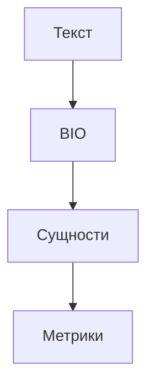

<div class="mission" data-mission="learn-ai-ner" data-subtopic="learn-ai-ner" data-title="NER и spaCy" data-review="1,3,7,14,30" data-review-url="../../../review/" data-skills="ner" data-strict="1" data-hint-default="Сначала попытка. Потом проверка. Решение — после третьей попытки." markdown="1">

<div class="mission-top">
  <span class="mission-kicker">ИИ · NER и spaCy · 3–5 заходов</span>
  <span class="mission-track"><span data-progress></span></span>
  <span class="mission-count" data-count>1 / 7</span>
</div>

<section class="mission-step" data-step="1" markdown="1">

<span class="mission-label">Шаг 1 · жизненный пример · 5 минут</span>

## Зачем это

NER ищет в тексте имена, организации, даты. Важно не только найти, но и правильно определить границы.

**Артефакт:** разбор своего кода по теме и одна задача без готового ответа.

</section>

<section class="mission-step" data-step="2" markdown="1">

<span class="mission-label">Шаг 2 · теория · 12 минут</span>

## Ключевые идеи

- BIO: B — начало сущности, I — продолжение, O — вне сущности.
- Сущность оценивают precision/recall/F1 по типам и границам.
- Правила хорошо работают на узком домене, модель — на разнообразии.
- Ошибка границы иногда хуже, чем пропуск.

### Как это работает

NER — это разметка последовательности: каждому токену назначается тип сущности и позиция в ней. BIO кодирует начало, продолжение и «вне сущности». Модель может ошибиться не только типом, но и границей: «Москва» vs «Москва-Сити». Поэтому метрику считают по сущностям, а не только по токенам.

Правила и словари хороши на узком домене, но плохо переносятся. Модель лучше обобщает, но требует разметки и проверки на своём тексте. Ошибки обычно связаны с редкими именами, сокращениями и неоднозначностью. Перед использованием проверь, какие типы сущностей реально нужны задаче.

### Схема



### По шагам

1. Разметь токены.
2. Собери границы.
3. Оцени по сущностям.
4. Проверь редкие имена.

### Пример

```python
import spacy
nlp = spacy.load("ru_core_news_sm")
doc = nlp("Платон сдал отчёт в Москве 25 ноября")
print([(e.text, e.label_) for e in doc.ents])
```

### Типичные ошибки

- Оценивать NER только по accuracy токенов.
- Не различать ошибку типа и ошибку границы.
- Использовать модель на домене, на котором её не проверяли.

### Как проверить себя

- Объясни схему и шаги без конспекта.
- Назови, где метод ломается.
- Реши задачу и сверь с критерием, а не с ответом.

</section>

<section class="mission-step" data-step="3" data-require-check markdown="1">

<span class="mission-label">Шаг 3 · диагностика · 8 минут</span>

## Проверь модель

Нужно **80%**. Если меньше — вернись к теории.

```quiz
{
  "title": "Диагностика · NER и spaCy",
  "min": 80,
  "questions": [
    {
      "type": "choice",
      "q": "Что верно про «NER и spaCy»?",
      "options": [
        "BIO: B — начало сущности, I — продолжение, O — вне сущности.",
        "NER оценивают только по accuracy токенов.",
        "BIO не различает границы сущностей.",
        "Достаточно accuracy на обучении."
      ],
      "answer": 0,
      "explain": "BIO: B — начало сущности, I — продолжение, O — вне сущности."
    },
    {
      "type": "truefalse",
      "q": "Верно ли: Сущность оценивают precision/recall/F1 по типам и границам.",
      "answer": true,
      "explain": "Сущность оценивают precision/recall/F1 по типам и границам."
    },
    {
      "type": "truefalse",
      "q": "Верно ли: Правила хорошо работают на узком домене, модель — на разнообразии.",
      "answer": true,
      "explain": "Правила хорошо работают на узком домене, модель — на разнообразии."
    },
    {
      "type": "truefalse",
      "q": "Верно ли: NER оценивают только по accuracy токенов.",
      "answer": false,
      "explain": "Это типичное заблуждение; проверь по теории."
    },
    {
      "type": "truefalse",
      "q": "Верно ли: BIO не различает границы сущностей.",
      "answer": false,
      "explain": "Это типичное заблуждение; проверь по теории."
    },
    {
      "type": "truefalse",
      "q": "После задачи нужно объяснить «NER и spaCy» своими словами.",
      "answer": true,
      "explain": "Защита своими словами — часть навыка."
    }
  ]
}
```

</section>

<section class="mission-step" data-step="4" data-require-check data-require-all markdown="1">

<span class="mission-label">Шаг 4 · практика с каркасом · 30 минут</span>

## Посчитай и почини

### 4.1. Число сущностей

В списке две сущности. Напечатай их число.

```pyplay
# @mode write
# @expect 2
# @hint Посчитай сущности в списке.
# Число сущностей: В списке две сущности. Напечатай их число.
ents = ['Moscow', '25 November']
# твой код: напечатай число сущностей
```

### 4.2. Accuracy

Посчитай accuracy.

```pyplay
# @mode write
# @expect 2
# @hint Считай теги B.
# BIO: Посчитай начала сущностей.
tags = ['B', 'I', 'O', 'B']
# твой код: начало сущностей
```

### 4.3. Dot product

Посчитай скалярное произведение.

```pyplay
# @mode write
# @expect 0.67
# @hint Precision = TP/(TP+FP).
# Precision NER: Посчитай precision.
tp, fp = 2, 1
# твой код: precision
```

### 4.4. Объясни

Напиши 2–3 предложения: где этот метод ломается и что проверить на новых данных.

</section>

<section class="mission-step" data-step="5" data-require-check data-require-all markdown="1">

<span class="mission-label">Шаг 5 · куски задачи · 20 минут</span>

## Перенеси в свой разбор

### 5.1. Данные

Возьми свой ноутбук или таблицу. Запиши, какой признак был бы утечкой.

### 5.2. Метод

Запусти метод на своих данных. Сравни с простым baseline.

### 5.3. Вывод

Объясни, что получилось и где результат может обмануть.

</section>

<section class="mission-step" data-step="6" data-require-check markdown="1">

<span class="mission-label">Шаг 6 · половина модуля · 25 минут</span>

## Собери половину

Соедини 4.1 и 4.3: посчитай результат и объясни, что изменится на других данных.

<textarea data-save="ai-ner-half" rows="5" placeholder="Моё объяснение: результат, ограничения, что проверю."></textarea>

</section>

<section class="mission-step" data-step="7" data-require-check markdown="1">

<span class="mission-label">Шаг 7 · полный артефакт и защита · 20 минут</span>

## Что сдать

- [ ] Свой результат по теме.
- [ ] Сравнение с baseline.
- [ ] Объяснение, где метод ломается.
- [ ] Ответ на вопрос «почему так».

**Защита:** объясни каждую строку своего кода и назови проверку.

<textarea data-save="ai-ner-mistake" rows="4" placeholder="Где я ошибся и как это заметить в следующий раз"></textarea>

</section>

<div class="mission-controls">
  <button type="button" class="mission-btn mission-btn--ghost" data-prev>Назад</button>
  <span class="mission-spacer"></span>
  <button type="button" class="mission-btn mission-btn--primary" data-next>Дальше</button>
</div>

<p class="mission-hint" data-hint>Сначала попытка. Потом проверка.</p>

<div class="mission-done" data-complete hidden>
  <strong>Подтема собрана</strong>
  <p>Вернись через 1–3–7 дней и объясни тему без подсказок.</p>
</div>

</div>
