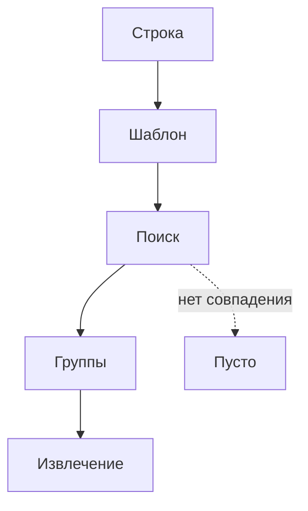

<div class="mission" data-mission="learn-ai-regex" data-subtopic="learn-ai-regex" data-title="Регулярные выражения" data-review="1,3,7,14,30" data-review-url="../../../review/" data-skills="regex" data-strict="1" data-hint-default="Сначала попытка. Потом проверка. Решение — после третьей попытки." markdown="1">

<div class="mission-top">
  <span class="mission-kicker">ИИ · Регулярные выражения · 3–5 заходов</span>
  <span class="mission-track"><span data-progress></span></span>
  <span class="mission-count" data-count>1 / 7</span>
</div>

<section class="mission-step" data-step="1" markdown="1">

<span class="mission-label">Шаг 1 · жизненный пример · 5 минут</span>

## Зачем это

Regex — инструмент для поиска и разбора текста; он экономит часы, но легко становится нечитаемым.

**Артефакт:** разбор своего кода по теме и одна задача без готового ответа.

</section>

<section class="mission-step" data-step="2" markdown="1">

<span class="mission-label">Шаг 2 · теория · 12 минут</span>

## Ключевые идеи

- Шаблон описывает множество строк, а не одну строку.
- Группы `(...)` захватывают части совпадения; `(?:...)` — не захватывает.
- Жадный `*` берёт максимум, ленивый `*?` — минимум.
- Якоря `^` и `$` привязывают совпадение к началу и концу.

### Как это работает

Regex описывает не «смысл», а форму строки. Поэтому его сила — в повторяющихся структурах: даты, коды, email, фрагменты логов. Сложный шаблон собирают по частям: сначала якоря и литералы, потом классы символов, потом группы и квантификаторы. Каждую часть проверяют на маленьком наборе строк.

Группы нужны, чтобы достать части совпадения, а не только факт «нашлось». Жадность меняет результат: `.*` съест как можно больше, `.*?` — как можно меньше. Для вложенных структур (JSON, HTML) regex быстро становится хрупким: там нужен парсер, а не шаблон.

### Схема



### По шагам

1. Опиши форму строки, а не смысл.
2. Проверь шаблон на 3–5 реальных примерах.
3. Достань группы, если нужны части.
4. Проверь жадность и якоря.

### Пример

```python
import re
m = re.search(r"(\d{4})-(\d{2})-(\d{2})", text)
year, month, day = m.groups()
```

### Типичные ошибки

- Писать один огромный шаблон без тестов на реальных строках.
- Забывать про экранирование точек, скобок и обратных слэшей.
- Использовать regex для вложенного синтаксиса, где нужен парсер.

### Как проверить себя

- Объясни схему и шаги без конспекта.
- Назови, где метод ломается.
- Реши задачу и сверь с критерием, а не с ответом.

</section>

<section class="mission-step" data-step="3" data-require-check markdown="1">

<span class="mission-label">Шаг 3 · диагностика · 8 минут</span>

## Проверь модель

Нужно **80%**. Если меньше — вернись к теории.

```quiz
{
  "title": "Диагностика · Регулярные выражения",
  "min": 80,
  "questions": [
    {
      "type": "choice",
      "q": "Что верно про «Регулярные выражения»?",
      "options": [
        "Шаблон описывает множество строк, а не одну строку.",
        "Жадный квантификатор всегда берёт минимум.",
        "Regex лучше парсера для вложенного JSON.",
        "Достаточно accuracy на обучении."
      ],
      "answer": 0,
      "explain": "Шаблон описывает множество строк, а не одну строку."
    },
    {
      "type": "truefalse",
      "q": "Верно ли: Группы `(...)` захватывают части совпадения; `(?:...)` — не захватывает.",
      "answer": true,
      "explain": "Группы `(...)` захватывают части совпадения; `(?:...)` — не захватывает."
    },
    {
      "type": "truefalse",
      "q": "Верно ли: Жадный `*` берёт максимум, ленивый `*?` — минимум.",
      "answer": true,
      "explain": "Жадный `*` берёт максимум, ленивый `*?` — минимум."
    },
    {
      "type": "truefalse",
      "q": "Верно ли: Жадный квантификатор всегда берёт минимум.",
      "answer": false,
      "explain": "Это типичное заблуждение; проверь по теории."
    },
    {
      "type": "truefalse",
      "q": "Верно ли: Regex лучше парсера для вложенного JSON.",
      "answer": false,
      "explain": "Это типичное заблуждение; проверь по теории."
    },
    {
      "type": "truefalse",
      "q": "Достаточно посмотреть разбор, чтобы считать «Регулярные выражения» освоенной.",
      "answer": false,
      "explain": "Без своей попытки и защиты тема не освоена."
    }
  ]
}
```

</section>

<section class="mission-step" data-step="4" data-require-check data-require-all markdown="1">

<span class="mission-label">Шаг 4 · практика с каркасом · 30 минут</span>

## Посчитай и почини

### 4.1. Посчитай цифры

В строке 'a1b2c3' посчитай цифры через re.findall.

```pyplay
# @mode write
# @expect 3
# @hint Найди все цифры.
# Посчитай цифры: В строке 'a1b2c3' посчитай цифры через re.findall.
import re
text = 'a1b2c3'
# твой код: найди цифры и напечатай их число
```

### 4.2. Accuracy

Посчитай accuracy.

```pyplay
# @mode write
# @expect 2026
# @hint Четыре цифры подряд.
# Год из даты: Вытащи год из строки.
import re
text = '2026-11-27'
# твой код: найди год
```

### 4.3. Dot product

Посчитай скалярное произведение.

```pyplay
# @mode write
# @expect 3
# @hint Слова — последовательности букв/цифр.
# Слова: Посчитай слова через re.findall.
import re
text = 'a b c'
# твой код: посчитай слова
```

### 4.4. Объясни

Напиши 2–3 предложения: где этот метод ломается и что проверить на новых данных.

</section>

<section class="mission-step" data-step="5" data-require-check data-require-all markdown="1">

<span class="mission-label">Шаг 5 · куски задачи · 20 минут</span>

## Перенеси в свой разбор

### 5.1. Данные

Возьми свой ноутбук или таблицу. Запиши, какой признак был бы утечкой.

### 5.2. Метод

Запусти метод на своих данных. Сравни с простым baseline.

### 5.3. Вывод

Объясни, что получилось и где результат может обмануть.

</section>

<section class="mission-step" data-step="6" data-require-check markdown="1">

<span class="mission-label">Шаг 6 · половина модуля · 25 минут</span>

## Собери половину

Соедини 4.1 и 4.3: посчитай результат и объясни, что изменится на других данных.

<textarea data-save="ai-regex-half" rows="5" placeholder="Моё объяснение: результат, ограничения, что проверю."></textarea>

</section>

<section class="mission-step" data-step="7" data-require-check markdown="1">

<span class="mission-label">Шаг 7 · полный артефакт и защита · 20 минут</span>

## Что сдать

- [ ] Свой результат по теме.
- [ ] Сравнение с baseline.
- [ ] Объяснение, где метод ломается.
- [ ] Ответ на вопрос «почему так».

**Защита:** объясни каждую строку своего кода и назови проверку.

<textarea data-save="ai-regex-mistake" rows="4" placeholder="Где я ошибся и как это заметить в следующий раз"></textarea>

</section>

<div class="mission-controls">
  <button type="button" class="mission-btn mission-btn--ghost" data-prev>Назад</button>
  <span class="mission-spacer"></span>
  <button type="button" class="mission-btn mission-btn--primary" data-next>Дальше</button>
</div>

<p class="mission-hint" data-hint>Сначала попытка. Потом проверка.</p>

<div class="mission-done" data-complete hidden>
  <strong>Подтема собрана</strong>
  <p>Вернись через 1–3–7 дней и объясни тему без подсказок.</p>
</div>

</div>
