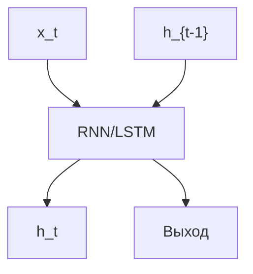

<div class="mission" data-mission="learn-ai-rnn" data-subtopic="learn-ai-rnn" data-title="RNN и LSTM: память и вентили" data-review="1,3,7,14,30" data-review-url="../../../review/" data-skills="rnn" data-strict="1" data-hint-default="Сначала попытка. Потом проверка. Решение — после третьей попытки." markdown="1">

<div class="mission-top">
  <span class="mission-kicker">ИИ · RNN и LSTM: память и вентили · 3–5 заходов</span>
  <span class="mission-track"><span data-progress></span></span>
  <span class="mission-count" data-count>1 / 7</span>
</div>

<section class="mission-step" data-step="1" markdown="1">

<span class="mission-label">Шаг 1 · жизненный пример · 5 минут</span>

## Зачем это

В последовательности важен порядок: «собака укусила человека» и «человек укусил собаку» — разные новости. Полносвязная сеть видит набор слов, но не порядок. RNN обрабатывает элементы по одному и хранит **скрытое состояние** — сжатую память о прочитанном.

**Артефакт:** разбор своего кода по теме и одна задача без готового ответа.

</section>

<section class="mission-step" data-step="2" markdown="1">

<span class="mission-label">Шаг 2 · теория · 12 минут</span>

## Ключевые идеи

- RNN хранит состояние `h_t`: оно обновляется входом `x_t` и прошлым `h_{t-1}`, поэтому порядок шагов — часть данных.
- LSTM добавляет вентили forget/input/output и ячейку `c`: они решают, что забыть, что записать и что отдать.
- `return_sequences=True` отдаёт выход на каждом шаге, `return_state=True` — отдельно `h` и `c`.

### Схема



### По шагам

1. Обработай шаг.
2. Обнови состояние.
3. Передай дальше.
4. Проверь затухание.

### Пример

```python
import torch.nn as nn
lstm = nn.LSTM(input_size=10, hidden_size=20, batch_first=True)
output, (h, c) = lstm(x)
```

### Типичные ошибки

- Перемешивать временные шаги и терять порядок.
- Забыть `batch_first` и перепутать оси batch/seq.
- Брать только последний выход там, где нужна вся последовательность.

### Как проверить себя

- Объясни схему и шаги без конспекта.
- Назови, где метод ломается.
- Реши задачу и сверь с критерием, а не с ответом.

</section>

<section class="mission-step" data-step="3" data-require-check markdown="1">

<span class="mission-label">Шаг 3 · диагностика · 8 минут</span>

## Проверь модель

Нужно **80%**. Если меньше — вернись к теории.

```quiz
{
  "title": "Диагностика · RNN и LSTM: память и вентили",
  "min": 80,
  "questions": [
    {
      "type": "choice",
      "q": "Что верно про «RNN и LSTM: память и вентили»?",
      "options": [
        "Это ключевая идея модуля.",
        "Простая RNN не страдает от затухания.",
        "LSTM не имеет вентилей.",
        "Достаточно accuracy на обучении."
      ],
      "answer": 0,
      "explain": "Это ключевая идея модуля."
    },
    {
      "type": "truefalse",
      "q": "Верно ли: Нужна практика и защита своими словами.",
      "answer": true,
      "explain": "Нужна практика и защита своими словами."
    },
    {
      "type": "truefalse",
      "q": "Верно ли: Нужна практика: объяснить код, решить задачу и защитить результат.",
      "answer": true,
      "explain": "Нужна практика: объяснить код, решить задачу и защитить результат."
    },
    {
      "type": "truefalse",
      "q": "Верно ли: Простая RNN не страдает от затухания.",
      "answer": false,
      "explain": "Это типичное заблуждение; проверь по теории."
    },
    {
      "type": "truefalse",
      "q": "Верно ли: LSTM не имеет вентилей.",
      "answer": false,
      "explain": "Это типичное заблуждение; проверь по теории."
    },
    {
      "type": "truefalse",
      "q": "После задачи нужно объяснить «RNN и LSTM: память и вентили» своими словами.",
      "answer": true,
      "explain": "Защита своими словами — часть навыка."
    }
  ]
}
```

</section>

<section class="mission-step" data-step="4" data-require-check data-require-all markdown="1">

<span class="mission-label">Шаг 4 · практика с каркасом · 30 минут</span>

## Посчитай и почини

### 4.1. Состояние RNN

h_prev=0, x=1, веса 0.5 и 0.5. Напечатай h.

```pyplay
# @mode write
# @expect 0.5
# @hint Новое состояние — взвешенная сумма.
# Состояние RNN: h_prev=0, x=1, веса 0.5 и 0.5. Напечатай h.
h_prev, x, w_h, w_x = 0.0, 1.0, 0.5, 0.5
# твой код: посчитай новое состояние и напечатай
```

### 4.2. Accuracy

Посчитай accuracy.

```pyplay
# @mode write
# @expect 3
# @hint Длина последовательности.
# Шаги: Посчитай число шагов.
seq = [1, 2, 3]
# твой код: число шагов
```

### 4.3. Dot product

Посчитай скалярное произведение.

```pyplay
# @mode write
# @expect 0.125
# @hint Перемножь g три раза.
# Затухание: Посчитай g^3.
g = 0.5
# твой код: затухание за 3 шага
```

### 4.4. Объясни

Напиши 2–3 предложения: где этот метод ломается и что проверить на новых данных.

</section>

<section class="mission-step" data-step="5" data-require-check data-require-all markdown="1">

<span class="mission-label">Шаг 5 · куски задачи · 20 минут</span>

## Перенеси в свой разбор

### 5.1. Данные

Возьми свой ноутбук или таблицу. Запиши, какой признак был бы утечкой.

### 5.2. Метод

Запусти метод на своих данных. Сравни с простым baseline.

### 5.3. Вывод

Объясни, что получилось и где результат может обмануть.

</section>

<section class="mission-step" data-step="6" data-require-check markdown="1">

<span class="mission-label">Шаг 6 · половина модуля · 25 минут</span>

## Собери половину

Соедини 4.1 и 4.3: посчитай результат и объясни, что изменится на других данных.

<textarea data-save="ai-rnn-half" rows="5" placeholder="Моё объяснение: результат, ограничения, что проверю."></textarea>

</section>

<section class="mission-step" data-step="7" data-require-check markdown="1">

<span class="mission-label">Шаг 7 · полный артефакт и защита · 20 минут</span>

## Что сдать

- [ ] Свой результат по теме.
- [ ] Сравнение с baseline.
- [ ] Объяснение, где метод ломается.
- [ ] Ответ на вопрос «почему так».

**Защита:** объясни каждую строку своего кода и назови проверку.

<textarea data-save="ai-rnn-mistake" rows="4" placeholder="Где я ошибся и как это заметить в следующий раз"></textarea>

</section>

<div class="mission-controls">
  <button type="button" class="mission-btn mission-btn--ghost" data-prev>Назад</button>
  <span class="mission-spacer"></span>
  <button type="button" class="mission-btn mission-btn--primary" data-next>Дальше</button>
</div>

<p class="mission-hint" data-hint>Сначала попытка. Потом проверка.</p>

<div class="mission-done" data-complete hidden>
  <strong>Подтема собрана</strong>
  <p>Вернись через 1–3–7 дней и объясни тему без подсказок.</p>
</div>

</div>
