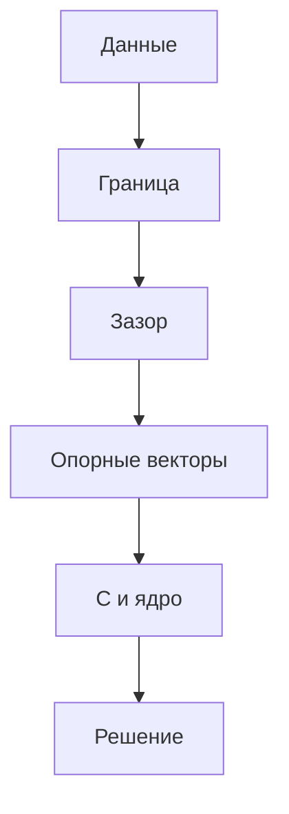

<div class="mission" data-mission="ai-svm-margin" data-subtopic="ai-svm-margin" data-title="SVM: зазор и цена ошибки" data-review="1,3,7,14,30" data-review-url="../../../review/" data-skills="svm-margin,hinge-loss,kernel-choice" data-strict="1" data-hint-default="Сначала попытка. Потом проверка. Решение — после третьей попытки." markdown="1">

<div class="mission-top">
  <span class="mission-kicker">ИИ · SVM · 3–5 заходов по 20–30 минут</span>
  <span class="mission-track"><span data-progress></span></span>
  <span class="mission-count" data-count>1 / 7</span>
</div>

<section class="mission-step" data-step="1" markdown="1">

<span class="mission-label">Шаг 1 · жизненный пример · 5 минут</span>

## Две прямые делят одинаково, но одна — лучше

На доске две прямые разделяют красные и синие точки. Обе дают 100% на обучающей выборке. Но одна проходит почти по точкам, а вторая — по центру.

На зачёте показывают новый код: `SVC(kernel="linear", C=100)`. Нужно объяснить, почему при таком `C` граница может подстроиться под выброс и что будет на новых данных.

**Артефакт:** объяснение выбора границы своими словами + одна задача на hinge loss.

<div class="mission-note mission-note--blue">
  <strong>Правило</strong>
  Сначала назови, что оптимизирует SVM, потом смотри на код.
</div>

</section>

<section class="mission-step" data-step="2" markdown="1">

<span class="mission-label">Шаг 2 · теория · 12 минут</span>

## Зазор, опорные векторы и C

SVM выбирает границу с максимальным **зазором** — расстоянием до ближайших точек разных классов. Эти точки называются опорными векторами. Для линейного случая ширина зазора равна `2 / ||w||`, поэтому SVM минимизирует `||w||` при ограничениях на правильную классификацию.

Параметр `C` задаёт цену ошибки. Большой `C` сильнее штрафует за ошибку: граница старается разделить всё, зазор сужается, риск переобучения растёт. Маленький `C` разрешает части точек оказаться в зазоре или не с той стороны: граница шире и устойчивее к шуму.

### Схема



### По шагам

1. Построй разделяющую границу.
2. Максимизируй зазор.
3. Настрой C и ядро на validation.
4. Проверь на новых данных.

### Ловушка

Accuracy на обучении не доказывает, что SVM настроена хорошо. При большом `C` она может быть идеальной, а на тесте — плохой. Параметры `C` и ядра подбирают на валидации, а не на тесте.

<div class="mission-note mission-note--red">
  <strong>Частая ошибка</strong>
  Считать, что «больше C — всегда лучше». Это компромисс между ошибкой на обучении и шириной зазора.
</div>

### Как проверить себя

- Объясни схему и шаги без конспекта.
- Назови, где метод ломается.
- Реши задачу и сверь с критерием, а не с ответом.

</section>

<section class="mission-step" data-step="3" data-require-check markdown="1">

<span class="mission-label">Шаг 3 · диагностика · 8 минут</span>

## Проверь модель

Нужно **80%**. Если меньше — вернись к абзацу про `C` и пройди заново.

```quiz
{
  "title": "Диагностика · SVM",
  "min": 80,
  "questions": [
    {
      "type": "choice",
      "q": "Что из этого — ключевая идея темы «SVM: зазор и цена ошибки»?",
      "options": [
        "SVM выбирает разделяющую границу с максимальным зазором.",
        "Достаточно accuracy на обучении, чтобы считать результат готовым.",
        "Результат можно не проверять на новых данных.",
        "Чем сложнее модель, тем всегда лучше."
      ],
      "answer": 0,
      "explain": "SVM выбирает разделяющую границу с максимальным зазором."
    },
    {
      "type": "truefalse",
      "q": "Верно ли: Большой C сильнее штрафует ошибки, поэтому граница подстраивается под точки и зазор сужается.",
      "answer": true,
      "explain": "Большой C сильнее штрафует ошибки, поэтому граница подстраивается под точки и зазор сужается."
    },
    {
      "type": "choice",
      "q": "Какое утверждение точнее описывает «SVM: зазор и цена ошибки»?",
      "options": [
        "Теорию можно не применять на практике.",
        "Малый C разрешает часть точек в зазоре, граница становится мягче.",
        "Подсказка должна появляться до первой попытки.",
        "Все признаки одинаково полезны для модели."
      ],
      "answer": 1,
      "explain": "Малый C разрешает часть точек в зазоре, граница становится мягче."
    },
    {
      "type": "truefalse",
      "q": "Верно ли: Зазор = 2 / ||w|| = 2/5 = 0.4.",
      "answer": true,
      "explain": "Зазор = 2 / ||w|| = 2/5 = 0.4."
    },
    {
      "type": "truefalse",
      "q": "Достаточно accuracy на обучении, чтобы считать модель готовой.",
      "answer": false,
      "explain": "Нужна проверка на данных, которых не было при обучении."
    },
    {
      "type": "truefalse",
      "q": "Подсказка должна появляться до первой попытки.",
      "answer": false,
      "explain": "Сначала попытка; подсказка — после второй."
    }
  ]
}
```

</section>

<section class="mission-step" data-step="4" data-require-check data-require-all markdown="1">

<span class="mission-label">Шаг 4 · практика с каркасом · 30 минут</span>

## Посчитай и почини

В каждом задании: **Дано → Надо → Проверка**. В песочнице нет готового решения — только каркас.

### 4.1. Почини hinge loss

**Дано:** `y = 1`, `score = 1.2`, правильный loss должен быть `0.0`.
**Надо:** исправить формулу, чтобы loss был `0.0`.
**Проверка:** `print(round(loss, 2))` выдаёт `0.0`.

```pyplay
# @mode fix
# @expect 0.0
# @hint Hinge loss = max(0, 1 - y * score). Проверь знак.
y = 1
score = 1.2
loss = max(0, 1 + y * score)
print(round(loss, 2))
```

### 4.2. Посчитай зазор

**Дано:** `w = [3, 4]`.
**Надо:** посчитать `2 / ||w||`.
**Проверка:** `print(round(margin, 2))` выдаёт `0.4`.

```pyplay
# @mode write
# @expect 0.85
# @hint Доля верных среди всех.
# Accuracy: Посчитай accuracy.
tp, tn, fp, fn = 8, 9, 2, 1
# твой код: посчитай accuracy и напечатай
```

### 4.3. Напиши решающую функцию

**Дано:** `x = (1, 1)`, `w = (1, 1)`, `b = -0.5`.
**Надо:** вернуть `1`, если `w·x + b > 0`, иначе `0`.
**Проверка:** `print(decision(x, w, b))` выдаёт `1`.

```pyplay
# @mode write
# @expect 32
# @hint Скалярное произведение.
# Dot product: Посчитай скалярное произведение.
a, b = (1, 2, 3), (4, 5, 6)
# твой код: посчитай скалярное произведение и напечатай
```

### 4.4. Объясни выбор

**Дано:** два графика с одинаковой accuracy, но разным зазором.
**Надо:** написать 2–3 предложения, какую границу выбрать и почему.

<div class="mission-note">
  <strong>Критерий</strong>
  Назови зазор, риск переобучения и что будет на новых данных. Ответ проверяется на шаге 6.
</div>


### 4.5. Зазор при маленьком C

**Дано:** `C=0.01`.
**Надо:** 2–3 предложения: что станет с зазором и какие точки окажутся в нём.

<div class="mission-note">
  <strong>Критерий</strong>
  Не называй «лучше/хуже» без данных: объясни компромисс.
</div>

### 4.6. RBF и переобучение

**Дано:** RBF-ядро с очень большим `C`.
**Надо:** объяснить, почему accuracy на обучении может быть 100%, и какой риск на новых данных.

</section>

<section class="mission-step" data-step="5" data-require-check data-require-all markdown="1">

<span class="mission-label">Шаг 5 · куски задачи · 20 минут</span>

## Перенеси в свой разбор

### 5.1. Кусок 1 — данные

Возьми свой ноутбук или таблицу с двумя признаками. Раздели на train/validation/test. Запиши, какой признак был бы утечкой.

### 5.2. Кусок 2 — модель

Обучи `SVC(kernel="linear", C=0.1)` и `C=100`. Сравни accuracy на validation, не на тесте.

### 5.3. Кусок 3 — объяснение

Выбери `C` и объясни: что стало с зазором и почему. Это пойдёт в защиту.

<div class="mission-note mission-note--yellow">
  <strong>Не копируй</strong>
  В отчёт — только свои числа, свой вывод и своё объяснение. Код курса в сдачу не тащить.
</div>

</section>

<section class="mission-step" data-step="6" data-require-check markdown="1">

<span class="mission-label">Шаг 6 · половина модуля · 25 минут</span>

## Собери половину

Соедини 4.2 и 4.3: посчитай зазор для `w` и реши, куда попадёт точка. Затем напиши, что изменится, если `C` уменьшить.

<textarea data-save="svm-half" rows="5" placeholder="Моё объяснение: зазор, точка, C."></textarea>

</section>

<section class="mission-step" data-step="7" data-require-check markdown="1">

<span class="mission-label">Шаг 7 · полный артефакт и защита · 20 минут</span>

## Что сдать

- [ ] Формула hinge loss и один пример расчёта.
- [ ] Зазор для своего `w`.
- [ ] Сравнение `C=0.1` и `C=100` на validation.
- [ ] Объяснение, где модель переобучается.

**Защита:** объясни каждую строку своего кода и ответь, почему выбрал этот `C`.

<textarea data-save="svm-mistake" rows="4" placeholder="Где я ошибся и как это заметить в следующий раз"></textarea>

<p>Дополнительно: [разбор](answers.md) · [шпаргалка](cheatsheet.md) · [практика](practice.md) · [повторение](review-1.md).</p>

<div class="mission-note mission-note--green">
  <strong>Готово, если</strong>
  Ты можешь объяснить зазор, C и hinge loss без конспекта.
</div>

</section>

<div class="mission-controls">
  <button type="button" class="mission-btn mission-btn--ghost" data-prev>Назад</button>
  <span class="mission-spacer"></span>
  <button type="button" class="mission-btn mission-btn--primary" data-next>Дальше</button>
</div>

<p class="mission-hint" data-hint>Сначала попытка. Потом проверка.</p>

<div class="mission-done" data-complete hidden>
  <strong>Подтема собрана</strong>
  <p>Вернись через 1–3–7 дней и объясни зазор и C без подсказок.</p>
</div>

</div>
