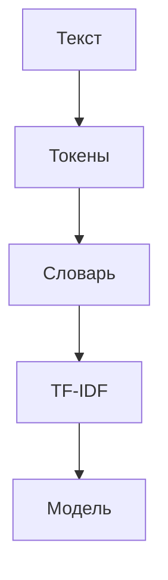

<div class="mission" data-mission="learn-ai-text-bow" data-subtopic="learn-ai-text-bow" data-title="Текст: BoW и TF-IDF" data-review="1,3,7,14,30" data-review-url="../../../review/" data-skills="text-bow" data-strict="1" data-hint-default="Сначала попытка. Потом проверка. Решение — после третьей попытки." markdown="1">

<div class="mission-top">
  <span class="mission-kicker">ИИ · Текст: BoW и TF-IDF · 3–5 заходов</span>
  <span class="mission-track"><span data-progress></span></span>
  <span class="mission-count" data-count>1 / 7</span>
</div>

<section class="mission-step" data-step="1" markdown="1">

<span class="mission-label">Шаг 1 · жизненный пример · 5 минут</span>

## Зачем это

BoW игнорирует порядок слов, но часто достаточно для классификации. TF-IDF снижает вес частых слов.

**Артефакт:** разбор своего кода по теме и одна задача без готового ответа.

</section>

<section class="mission-step" data-step="2" markdown="1">

<span class="mission-label">Шаг 2 · теория · 12 минут</span>

## Ключевые идеи

- Токенизация превращает текст в последовательность токенов.
- BoW считает частоты; вектор может быть очень разреженным.
- TF-IDF = частота в документе × редкость в корпусе.
- BoW не видит порядок и отрицания; для сложных задач нужны последовательности.

### Как это работает

BoW превращает документ в вектор частот по словарю. Словарь строится на обучающей выборке; на тесте используются только те токены, которые уже есть. TF-IDF умножает частоту на редкость: слово, которое есть почти везде, получает меньший вес. Это простая и сильная база для классификации.

Ограничения видны сразу: порядок слов теряется, отрицания и ирония не различаются, редкие слова становятся отдельными разреженными признаками. Поэтому для сложных задач переходят к n-граммам, эмбеддингам и последовательностям. Но прежде чем усложнять, проверь TF-IDF + линейную модель — часто этого достаточно.

### Схема



### По шагам

1. Токенизируй.
2. Построй словарь на train.
3. Посчитай TF-IDF.
4. Обучи модель.

### Пример

```python
from sklearn.feature_extraction.text import TfidfVectorizer
vec = TfidfVectorizer(ngram_range=(1, 2), min_df=2)
X = vec.fit_transform(texts)
```

### Типичные ошибки

- Строить словарь на всех данных, включая тест.
- Забывать про `min_df` и получать десятки тысяч редких признаков.
- Считать BoW пониманием смысла, а не мешком частот.

### Как проверить себя

- Объясни схему и шаги без конспекта.
- Назови, где метод ломается.
- Реши задачу и сверь с критерием, а не с ответом.

</section>

<section class="mission-step" data-step="3" data-require-check markdown="1">

<span class="mission-label">Шаг 3 · диагностика · 8 минут</span>

## Проверь модель

Нужно **80%**. Если меньше — вернись к теории.

```quiz
{
  "title": "Диагностика · Текст: BoW и TF-IDF",
  "min": 80,
  "questions": [
    {
      "type": "choice",
      "q": "Что верно про «Текст: BoW и TF-IDF»?",
      "options": [
        "Токенизация превращает текст в последовательность токенов.",
        "BoW видит порядок слов.",
        "IDF увеличивает вес частых слов.",
        "Достаточно accuracy на обучении."
      ],
      "answer": 0,
      "explain": "Токенизация превращает текст в последовательность токенов."
    },
    {
      "type": "truefalse",
      "q": "Верно ли: BoW считает частоты; вектор может быть очень разреженным.",
      "answer": true,
      "explain": "BoW считает частоты; вектор может быть очень разреженным."
    },
    {
      "type": "truefalse",
      "q": "Верно ли: TF-IDF = частота в документе × редкость в корпусе.",
      "answer": true,
      "explain": "TF-IDF = частота в документе × редкость в корпусе."
    },
    {
      "type": "truefalse",
      "q": "Верно ли: BoW видит порядок слов.",
      "answer": false,
      "explain": "Это типичное заблуждение; проверь по теории."
    },
    {
      "type": "truefalse",
      "q": "Верно ли: IDF увеличивает вес частых слов.",
      "answer": false,
      "explain": "Это типичное заблуждение; проверь по теории."
    },
    {
      "type": "truefalse",
      "q": "Достаточно посмотреть разбор, чтобы считать «Текст: BoW и TF-IDF» освоенной.",
      "answer": false,
      "explain": "Без своей попытки и защиты тема не освоена."
    }
  ]
}
```

</section>

<section class="mission-step" data-step="4" data-require-check data-require-all markdown="1">

<span class="mission-label">Шаг 4 · практика с каркасом · 30 минут</span>

## Посчитай и почини

### 4.1. TF слова

В документе cat, cat, dog. Напечатай TF для cat.

```pyplay
# @mode write
# @expect 0.67
# @hint Частота слова в документе.
# TF слова: В документе cat, cat, dog. Напечатай TF для cat.
words = ['cat', 'cat', 'dog']
# твой код: посчитай TF для cat и напечатай
```

### 4.2. Accuracy

Посчитай accuracy.

```pyplay
# @mode write
# @expect 1.61
# @hint IDF = log(N/df).
# IDF: Посчитай IDF.
import math
N, df = 10, 2
# твой код: IDF
```

### 4.3. Dot product

Посчитай скалярное произведение.

```pyplay
# @mode write
# @expect 0.71
# @hint Косинус = скалярное / произведение норм.
# Косинус: Посчитай косинус.
import math
a, b = [1, 0], [1, 1]
# твой код: косинус
```

### 4.4. Объясни

Напиши 2–3 предложения: где этот метод ломается и что проверить на новых данных.

</section>

<section class="mission-step" data-step="5" data-require-check data-require-all markdown="1">

<span class="mission-label">Шаг 5 · куски задачи · 20 минут</span>

## Перенеси в свой разбор

### 5.1. Данные

Возьми свой ноутбук или таблицу. Запиши, какой признак был бы утечкой.

### 5.2. Метод

Запусти метод на своих данных. Сравни с простым baseline.

### 5.3. Вывод

Объясни, что получилось и где результат может обмануть.

</section>

<section class="mission-step" data-step="6" data-require-check markdown="1">

<span class="mission-label">Шаг 6 · половина модуля · 25 минут</span>

## Собери половину

Соедини 4.1 и 4.3: посчитай результат и объясни, что изменится на других данных.

<textarea data-save="ai-text-bow-half" rows="5" placeholder="Моё объяснение: результат, ограничения, что проверю."></textarea>

</section>

<section class="mission-step" data-step="7" data-require-check markdown="1">

<span class="mission-label">Шаг 7 · полный артефакт и защита · 20 минут</span>

## Что сдать

- [ ] Свой результат по теме.
- [ ] Сравнение с baseline.
- [ ] Объяснение, где метод ломается.
- [ ] Ответ на вопрос «почему так».

**Защита:** объясни каждую строку своего кода и назови проверку.

<textarea data-save="ai-text-bow-mistake" rows="4" placeholder="Где я ошибся и как это заметить в следующий раз"></textarea>

</section>

<div class="mission-controls">
  <button type="button" class="mission-btn mission-btn--ghost" data-prev>Назад</button>
  <span class="mission-spacer"></span>
  <button type="button" class="mission-btn mission-btn--primary" data-next>Дальше</button>
</div>

<p class="mission-hint" data-hint>Сначала попытка. Потом проверка.</p>

<div class="mission-done" data-complete hidden>
  <strong>Подтема собрана</strong>
  <p>Вернись через 1–3–7 дней и объясни тему без подсказок.</p>
</div>

</div>
