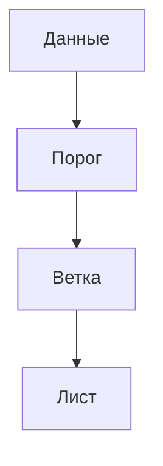

<div class="mission" data-mission="learn-ai-trees" data-subtopic="learn-ai-trees" data-title="Деревья решений" data-review="1,3,7,14,30" data-review-url="../../../review/" data-skills="trees" data-strict="1" data-hint-default="Сначала попытка. Потом проверка. Решение — после третьей попытки." markdown="1">

<div class="mission-top">
  <span class="mission-kicker">ИИ · Деревья решений · 3–5 заходов</span>
  <span class="mission-track"><span data-progress></span></span>
  <span class="mission-count" data-count>1 / 7</span>
</div>

<section class="mission-step" data-step="1" markdown="1">

<span class="mission-label">Шаг 1 · жизненный пример · 5 минут</span>

## Зачем это

Дерево — понятная модель: оно режет пространство признаков на области и в каждой даёт ответ.

**Артефакт:** разбор своего кода по теме и одна задача без готового ответа.

</section>

<section class="mission-step" data-step="2" markdown="1">

<span class="mission-label">Шаг 2 · теория · 12 минут</span>

## Ключевые идеи

- В узле выбирается признак и порог, которые лучше разделяют классы.
- Gini и энтропия измеряют «нечистоту»; не путай их с accuracy.
- Глубокое дерево запоминает шум: нужна обрезка `max_depth`, `min_samples_leaf`.
- Важность признака зависит от данных и корреляций; это не причинность.

### Как это работает

Дерево строит правило «если признак ≤ порог, идём влево, иначе вправо». Порог выбирается так, чтобы дочерние узлы стали чище родительского. Gini и энтропия — разные меры нечистоты, но обе поощряют разделения, где классы перемешиваются меньше. Дерево не требует масштабирования признаков и умеет ловить нелинейности.

Главная опасность — глубина. Дерево может создать отдельную ветку под каждый выброс и запомнить шум. `max_depth`, `min_samples_leaf` и обрезка ограничивают сложность. Важность признака показывает вклад в разделения, но при correlated-признаках делится между ними и не доказывает причинность.

### Схема



### По шагам

1. Выбери порог.
2. Раздели.
3. Ограничь глубину.
4. Проверь на validation.

### Пример

```python
from sklearn.tree import DecisionTreeClassifier
model = DecisionTreeClassifier(max_depth=3, min_samples_leaf=5, random_state=0)
model.fit(X_train, y_train)
```

### Типичные ошибки

- Оценивать дерево только по обучающей выборке.
- Интерпретировать важность признака как «влияние на бизнес».
- Не проверять, что признаки доступны в момент прогноза.

### Как проверить себя

- Объясни схему и шаги без конспекта.
- Назови, где метод ломается.
- Реши задачу и сверь с критерием, а не с ответом.

</section>

<section class="mission-step" data-step="3" data-require-check markdown="1">

<span class="mission-label">Шаг 3 · диагностика · 8 минут</span>

## Проверь модель

Нужно **80%**. Если меньше — вернись к теории.

```quiz
{
  "title": "Диагностика · Деревья решений",
  "min": 80,
  "questions": [
    {
      "type": "choice",
      "q": "Что верно про «Деревья решений»?",
      "options": [
        "В узле выбирается признак и порог, которые лучше разделяют классы.",
        "Глубокое дерево всегда обобщает лучше.",
        "Gini — это accuracy.",
        "Достаточно accuracy на обучении."
      ],
      "answer": 0,
      "explain": "В узле выбирается признак и порог, которые лучше разделяют классы."
    },
    {
      "type": "truefalse",
      "q": "Верно ли: Gini и энтропия измеряют «нечистоту»; не путай их с accuracy.",
      "answer": true,
      "explain": "Gini и энтропия измеряют «нечистоту»; не путай их с accuracy."
    },
    {
      "type": "truefalse",
      "q": "Верно ли: Глубокое дерево запоминает шум: нужна обрезка `max_depth`, `min_samples_leaf`.",
      "answer": true,
      "explain": "Глубокое дерево запоминает шум: нужна обрезка `max_depth`, `min_samples_leaf`."
    },
    {
      "type": "truefalse",
      "q": "Верно ли: Глубокое дерево всегда обобщает лучше.",
      "answer": false,
      "explain": "Это типичное заблуждение; проверь по теории."
    },
    {
      "type": "truefalse",
      "q": "Верно ли: Gini — это accuracy.",
      "answer": false,
      "explain": "Это типичное заблуждение; проверь по теории."
    },
    {
      "type": "truefalse",
      "q": "После задачи нужно объяснить «Деревья решений» своими словами.",
      "answer": true,
      "explain": "Защита своими словами — часть навыка."
    }
  ]
}
```

</section>

<section class="mission-step" data-step="4" data-require-check data-require-all markdown="1">

<span class="mission-label">Шаг 4 · практика с каркасом · 30 минут</span>

## Посчитай и почини

### 4.1. Посчитай Gini

В узле 5 и 5 объектов двух классов. Напечатай Gini.

```pyplay
# @mode write
# @expect 0.5
# @hint Gini = 1 - сумма квадратов долей.
# Посчитай Gini: В узле 5 и 5 объектов двух классов. Напечатай Gini.
p = 5 / 10
# твой код: посчитай Gini и напечатай
```

### 4.2. Accuracy

Посчитай accuracy.

```pyplay
# @mode write
# @expect 1.0
# @hint Энтропия = -Σ p log2 p.
# Энтропия: Посчитай энтропию для p=0.5.
import math
p = 0.5
# твой код: энтропия
```

### 4.3. Dot product

Посчитай скалярное произведение.

```pyplay
# @mode write
# @expect 1
# @hint Самое частое значение.
# Класс большинства: Напечатай класс большинства.
labels = [1, 1, 0]
# твой код: класс большинства
```

### 4.4. Объясни

Напиши 2–3 предложения: где этот метод ломается и что проверить на новых данных.

</section>

<section class="mission-step" data-step="5" data-require-check data-require-all markdown="1">

<span class="mission-label">Шаг 5 · куски задачи · 20 минут</span>

## Перенеси в свой разбор

### 5.1. Данные

Возьми свой ноутбук или таблицу. Запиши, какой признак был бы утечкой.

### 5.2. Метод

Запусти метод на своих данных. Сравни с простым baseline.

### 5.3. Вывод

Объясни, что получилось и где результат может обмануть.

</section>

<section class="mission-step" data-step="6" data-require-check markdown="1">

<span class="mission-label">Шаг 6 · половина модуля · 25 минут</span>

## Собери половину

Соедини 4.1 и 4.3: посчитай результат и объясни, что изменится на других данных.

<textarea data-save="ai-trees-half" rows="5" placeholder="Моё объяснение: результат, ограничения, что проверю."></textarea>

</section>

<section class="mission-step" data-step="7" data-require-check markdown="1">

<span class="mission-label">Шаг 7 · полный артефакт и защита · 20 минут</span>

## Что сдать

- [ ] Свой результат по теме.
- [ ] Сравнение с baseline.
- [ ] Объяснение, где метод ломается.
- [ ] Ответ на вопрос «почему так».

**Защита:** объясни каждую строку своего кода и назови проверку.

<textarea data-save="ai-trees-mistake" rows="4" placeholder="Где я ошибся и как это заметить в следующий раз"></textarea>

</section>

<div class="mission-controls">
  <button type="button" class="mission-btn mission-btn--ghost" data-prev>Назад</button>
  <span class="mission-spacer"></span>
  <button type="button" class="mission-btn mission-btn--primary" data-next>Дальше</button>
</div>

<p class="mission-hint" data-hint>Сначала попытка. Потом проверка.</p>

<div class="mission-done" data-complete hidden>
  <strong>Подтема собрана</strong>
  <p>Вернись через 1–3–7 дней и объясни тему без подсказок.</p>
</div>

</div>
