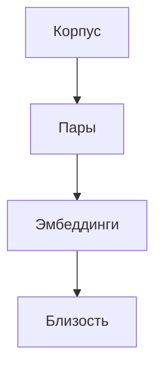

<div class="mission" data-mission="learn-ai-word2vec" data-subtopic="learn-ai-word2vec" data-title="word2vec и BPE" data-review="1,3,7,14,30" data-review-url="../../../review/" data-skills="word2vec" data-strict="1" data-hint-default="Сначала попытка. Потом проверка. Решение — после третьей попытки." markdown="1">

<div class="mission-top">
  <span class="mission-kicker">ИИ · word2vec и BPE · 3–5 заходов</span>
  <span class="mission-track"><span data-progress></span></span>
  <span class="mission-count" data-count>1 / 7</span>
</div>

<section class="mission-step" data-step="1" markdown="1">

<span class="mission-label">Шаг 1 · жизненный пример · 5 минут</span>

## Зачем это

word2vec превращает слово в вектор так, чтобы похожие по контексту слова были рядом. BPE решает проблему редких слов.

**Артефакт:** разбор своего кода по теме и одна задача без готового ответа.

</section>

<section class="mission-step" data-step="2" markdown="1">

<span class="mission-label">Шаг 2 · теория · 12 минут</span>

## Ключевые идеи

- CBOW предсказывает слово по контексту; skip-gram — контекст по слову.
- Negative sampling учит отличать настоящий контекст от случайных слов.
- Косинусная близость измеряет направление, а не длину.
- BPE разбивает редкие слова на частые субслова.

### Как это работает

word2vec учит вектор слова по контексту. CBOW усредняет контекст и предсказывает слово; skip-gram делает наоборот и лучше работает на редких словах. Negative sampling превращает задачу в различение «настоящий сосед / случайное слово», что дешевле полного softmax.

Близость векторов — это близость контекстов, а не синонимия. «Москва» и «Россия» могут быть рядом, но не взаимозаменяемы. BPE решает проблему редких и новых слов: слово разбивается на частые субслова, а вектор собирается из них. Для морфологически богатого русского это особенно полезно.

### Схема



### По шагам

1. Собери пары.
2. Обучи CBOW/skip-gram.
3. Проверь соседей.
4. Добавь BPE для редких.

### Пример

```python
from gensim.models import Word2Vec
model = Word2Vec(sentences, vector_size=100, window=5, min_count=1, sg=1)
model.wv.most_similar("Moscow")
```

### Типичные ошибки

- Считать, что близкие векторы всегда означают синонимы.
- Обучать word2vec на крошечном корпусе и верить результатам.
- Забывать про предобработку: регистр, пунктуация, токенизация.

### Как проверить себя

- Объясни схему и шаги без конспекта.
- Назови, где метод ломается.
- Реши задачу и сверь с критерием, а не с ответом.

</section>

<section class="mission-step" data-step="3" data-require-check markdown="1">

<span class="mission-label">Шаг 3 · диагностика · 8 минут</span>

## Проверь модель

Нужно **80%**. Если меньше — вернись к теории.

```quiz
{
  "title": "Диагностика · word2vec и BPE",
  "min": 80,
  "questions": [
    {
      "type": "choice",
      "q": "Что верно про «word2vec и BPE»?",
      "options": [
        "CBOW предсказывает слово по контексту; skip-gram — контекст по слову.",
        "Близкие векторы всегда синонимы.",
        "BPE ухудшает редкие слова.",
        "Достаточно accuracy на обучении."
      ],
      "answer": 0,
      "explain": "CBOW предсказывает слово по контексту; skip-gram — контекст по слову."
    },
    {
      "type": "truefalse",
      "q": "Верно ли: Negative sampling учит отличать настоящий контекст от случайных слов.",
      "answer": true,
      "explain": "Negative sampling учит отличать настоящий контекст от случайных слов."
    },
    {
      "type": "truefalse",
      "q": "Верно ли: Косинусная близость измеряет направление, а не длину.",
      "answer": true,
      "explain": "Косинусная близость измеряет направление, а не длину."
    },
    {
      "type": "truefalse",
      "q": "Верно ли: Близкие векторы всегда синонимы.",
      "answer": false,
      "explain": "Это типичное заблуждение; проверь по теории."
    },
    {
      "type": "truefalse",
      "q": "Верно ли: BPE ухудшает редкие слова.",
      "answer": false,
      "explain": "Это типичное заблуждение; проверь по теории."
    },
    {
      "type": "truefalse",
      "q": "Достаточно посмотреть разбор, чтобы считать «word2vec и BPE» освоенной.",
      "answer": false,
      "explain": "Без своей попытки и защиты тема не освоена."
    }
  ]
}
```

</section>

<section class="mission-step" data-step="4" data-require-check data-require-all markdown="1">

<span class="mission-label">Шаг 4 · практика с каркасом · 30 минут</span>

## Посчитай и почини

### 4.1. Косинус

Посчитай косинус между [1,0] и [0,1].

```pyplay
# @mode write
# @expect 0.0
# @hint Косинус = скалярное / произведение норм.
# Косинус: Посчитай косинус между [1,0] и [0,1].
import math
a, b = [1, 0], [0, 1]
# твой код: посчитай косинус и напечатай
```

### 4.2. Accuracy

Посчитай accuracy.

```pyplay
# @mode write
# @expect 5.0
# @hint Норма — корень из суммы квадратов.
# Норма: Посчитай норму вектора.
import math
v = [3, 4]
# твой код: норма
```

### 4.3. Dot product

Посчитай скалярное произведение.

```pyplay
# @mode write
# @expect 11
# @hint Сумма попарных произведений.
# Dot: Посчитай скалярное произведение.
a, b = [1, 2], [3, 4]
# твой код: скалярное произведение
```

### 4.4. Объясни

Напиши 2–3 предложения: где этот метод ломается и что проверить на новых данных.

</section>

<section class="mission-step" data-step="5" data-require-check data-require-all markdown="1">

<span class="mission-label">Шаг 5 · куски задачи · 20 минут</span>

## Перенеси в свой разбор

### 5.1. Данные

Возьми свой ноутбук или таблицу. Запиши, какой признак был бы утечкой.

### 5.2. Метод

Запусти метод на своих данных. Сравни с простым baseline.

### 5.3. Вывод

Объясни, что получилось и где результат может обмануть.

</section>

<section class="mission-step" data-step="6" data-require-check markdown="1">

<span class="mission-label">Шаг 6 · половина модуля · 25 минут</span>

## Собери половину

Соедини 4.1 и 4.3: посчитай результат и объясни, что изменится на других данных.

<textarea data-save="ai-word2vec-half" rows="5" placeholder="Моё объяснение: результат, ограничения, что проверю."></textarea>

</section>

<section class="mission-step" data-step="7" data-require-check markdown="1">

<span class="mission-label">Шаг 7 · полный артефакт и защита · 20 минут</span>

## Что сдать

- [ ] Свой результат по теме.
- [ ] Сравнение с baseline.
- [ ] Объяснение, где метод ломается.
- [ ] Ответ на вопрос «почему так».

**Защита:** объясни каждую строку своего кода и назови проверку.

<textarea data-save="ai-word2vec-mistake" rows="4" placeholder="Где я ошибся и как это заметить в следующий раз"></textarea>

</section>

<div class="mission-controls">
  <button type="button" class="mission-btn mission-btn--ghost" data-prev>Назад</button>
  <span class="mission-spacer"></span>
  <button type="button" class="mission-btn mission-btn--primary" data-next>Дальше</button>
</div>

<p class="mission-hint" data-hint>Сначала попытка. Потом проверка.</p>

<div class="mission-done" data-complete hidden>
  <strong>Подтема собрана</strong>
  <p>Вернись через 1–3–7 дней и объясни тему без подсказок.</p>
</div>

</div>
