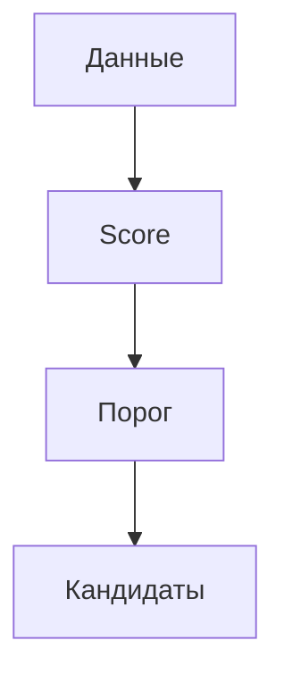

<div class="mission" data-mission="learn-da-anomalies" data-subtopic="learn-da-anomalies" data-title="Аномалии" data-review="1,3,7,14,30" data-review-url="../../../review/" data-skills="anomalies" data-strict="1" data-hint-default="Сначала попытка. Потом проверка. Решение — после третьей попытки." markdown="1">

<div class="mission-top">
  <span class="mission-kicker">Анализ данных · Аномалии · 3–5 заходов</span>
  <span class="mission-track"><span data-progress></span></span>
  <span class="mission-count" data-count>1 / 7</span>
</div>

<section class="mission-step" data-step="1" markdown="1">

<span class="mission-label">Шаг 1 · жизненный пример · 5 минут</span>

## Зачем это

Аномалия — редкое и/или непохожее наблюдение. Метод зависит от того, что считаем «нормой».

**Артефакт:** разбор своего кода по теме и одна задача без готового ответа.

</section>

<section class="mission-step" data-step="2" markdown="1">

<span class="mission-label">Шаг 2 · теория · 12 минут</span>

## Ключевые идеи

- Z-score ловит отклонение от среднего, но чувствителен к выбросам.
- IQR устойчивее к тяжёлым хвостам.
- IsolationForest изолирует точки случайными разрезами.
- LOF смотрит на локальную плотность, One-Class SVM — на границу нормального класса.

### Как это работает

Аномалия определяется относительно модели «нормы». Z-score считает отклонение от среднего в стандартных отклонениях и плохо работает на тяжёлых хвостах: сами выбросы раздувают σ. IQR использует квантили и устойчивее. IsolationForest изолирует точки случайными разрезами: аномалии отделяются быстрее.

LOF смотрит на локальную плотность: точка может быть нормальной глобально, но редкой среди соседей. One-Class SVM учит границу вокруг нормального класса. Ни один метод не «доказывает» аномалию: результат — кандидат на проверку. Всегда смотри на признаки и контекст, а не только на метку.

### Схема



### По шагам

1. Норма.
2. Score.
3. Порог.
4. Проверка.

### Пример

```python
from sklearn.ensemble import IsolationForest
model = IsolationForest(contamination=0.02, random_state=0)
labels = model.fit_predict(X)
```

### Типичные ошибки

- Использовать Z-score на явно несимметричных данных.
- Считать метку аномалии приговором без проверки.
- Настраивать `contamination` по тесту.

### Как проверить себя

- Объясни схему и шаги без конспекта.
- Назови, где метод ломается.
- Реши задачу и сверь с критерием, а не с ответом.

</section>

<section class="mission-step" data-step="3" data-require-check markdown="1">

<span class="mission-label">Шаг 3 · диагностика · 8 минут</span>

## Проверь модель

Нужно **80%**. Если меньше — вернись к теории.

```quiz
{
  "title": "Диагностика · Аномалии",
  "min": 80,
  "questions": [
    {
      "type": "choice",
      "q": "Что верно про «Аномалии»?",
      "options": [
        "Z-score ловит отклонение от среднего, но чувствителен к выбросам.",
        "Z-score устойчив к выбросам.",
        "Метка аномалии — приговор.",
        "Достаточно accuracy на обучении."
      ],
      "answer": 0,
      "explain": "Z-score ловит отклонение от среднего, но чувствителен к выбросам."
    },
    {
      "type": "truefalse",
      "q": "Верно ли: IQR устойчивее к тяжёлым хвостам.",
      "answer": true,
      "explain": "IQR устойчивее к тяжёлым хвостам."
    },
    {
      "type": "truefalse",
      "q": "Верно ли: IsolationForest изолирует точки случайными разрезами.",
      "answer": true,
      "explain": "IsolationForest изолирует точки случайными разрезами."
    },
    {
      "type": "truefalse",
      "q": "Верно ли: Z-score устойчив к выбросам.",
      "answer": false,
      "explain": "Это типичное заблуждение; проверь по теории."
    },
    {
      "type": "truefalse",
      "q": "Верно ли: Метка аномалии — приговор.",
      "answer": false,
      "explain": "Это типичное заблуждение; проверь по теории."
    },
    {
      "type": "truefalse",
      "q": "После задачи нужно объяснить «Аномалии» своими словами.",
      "answer": true,
      "explain": "Защита своими словами — часть навыка."
    }
  ]
}
```

</section>

<section class="mission-step" data-step="4" data-require-check data-require-all markdown="1">

<span class="mission-label">Шаг 4 · практика с каркасом · 30 минут</span>

## Посчитай и почини

### 4.1. Верхняя граница IQR

Q1=1, Q3=3. Напечатай верхнюю границу.

```pyplay
# @mode write
# @expect 6.0
# @hint Верхняя граница = Q3 + 1.5*IQR.
# Верхняя граница IQR: Q1=1, Q3=3. Напечатай верхнюю границу.
q1, q3 = 1, 3
# твой код: посчитай верхнюю границу IQR и напечатай
```

### 4.2. Среднее

Посчитай среднее.

```pyplay
# @mode write
# @expect 2.5
# @hint z=(x-mean)/std.
# Z-score: Посчитай z.
x, mean, std = 10, 5, 2
# твой код: z-score
```

### 4.3. Дисперсия

Посчитай дисперсию.

```pyplay
# @mode write
# @expect 2
# @hint Сравни с границами.
# Аномалии: Посчитай число.
xs = [0, 3, 6, 4]
# твой код: сколько вне [1, 5]
```

### 4.4. Объясни

Напиши 2–3 предложения: где этот метод ломается и что проверить на новых данных.

</section>

<section class="mission-step" data-step="5" data-require-check data-require-all markdown="1">

<span class="mission-label">Шаг 5 · куски задачи · 20 минут</span>

## Перенеси в свой разбор

### 5.1. Данные

Возьми свой ноутбук или таблицу. Запиши, какой признак был бы утечкой.

### 5.2. Метод

Запусти метод на своих данных. Сравни с простым baseline.

### 5.3. Вывод

Объясни, что получилось и где результат может обмануть.

</section>

<section class="mission-step" data-step="6" data-require-check markdown="1">

<span class="mission-label">Шаг 6 · половина модуля · 25 минут</span>

## Собери половину

Соедини 4.1 и 4.3: посчитай результат и объясни, что изменится на других данных.

<textarea data-save="da-anomalies-half" rows="5" placeholder="Моё объяснение: результат, ограничения, что проверю."></textarea>

</section>

<section class="mission-step" data-step="7" data-require-check markdown="1">

<span class="mission-label">Шаг 7 · полный артефакт и защита · 20 минут</span>

## Что сдать

- [ ] Свой результат по теме.
- [ ] Сравнение с baseline.
- [ ] Объяснение, где метод ломается.
- [ ] Ответ на вопрос «почему так».

**Защита:** объясни каждую строку своего кода и назови проверку.

<textarea data-save="da-anomalies-mistake" rows="4" placeholder="Где я ошибся и как это заметить в следующий раз"></textarea>

</section>

<div class="mission-controls">
  <button type="button" class="mission-btn mission-btn--ghost" data-prev>Назад</button>
  <span class="mission-spacer"></span>
  <button type="button" class="mission-btn mission-btn--primary" data-next>Дальше</button>
</div>

<p class="mission-hint" data-hint>Сначала попытка. Потом проверка.</p>

<div class="mission-done" data-complete hidden>
  <strong>Подтема собрана</strong>
  <p>Вернись через 1–3–7 дней и объясни тему без подсказок.</p>
</div>

</div>
