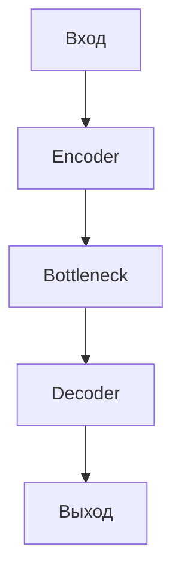

<div class="mission" data-mission="learn-da-autoencoders" data-subtopic="learn-da-autoencoders" data-title="Автоэнкодеры" data-review="1,3,7,14,30" data-review-url="../../../review/" data-skills="autoencoders" data-strict="1" data-hint-default="Сначала попытка. Потом проверка. Решение — после третьей попытки." markdown="1">

<div class="mission-top">
  <span class="mission-kicker">Анализ данных · Автоэнкодеры · 3–5 заходов</span>
  <span class="mission-track"><span data-progress></span></span>
  <span class="mission-count" data-count>1 / 7</span>
</div>

<section class="mission-step" data-step="1" markdown="1">

<span class="mission-label">Шаг 1 · жизненный пример · 5 минут</span>

## Зачем это

Автоэнкодер учится сжимать данные и восстанавливать их; полезен для снижения размерности и поиска аномалий.

**Артефакт:** разбор своего кода по теме и одна задача без готового ответа.

</section>

<section class="mission-step" data-step="2" markdown="1">

<span class="mission-label">Шаг 2 · теория · 12 минут</span>

## Ключевые идеи

- Encoder сжимает, decoder восстанавливает.
- Bottleneck ограничивает объём информации.
- Loss — ошибка восстановления.
- Denoising autoencoder учится на зашумлённых входах.

### Как это работает

Автоэнкодер учится восстановить вход через узкое место. Если узкое место слишком широкое, он просто копирует вход; если слишком узкое — теряет важное. Loss — ошибка восстановления, но хорошее восстановление не всегда означает полезное представление.

Denoising-автоэнкодер получает зашумлённый вход и учится возвращать чистый. Это заставляет его выучивать структуру, а не запоминать шум. Для аномалий используют ошибку восстановления: если объект плохо восстанавливается, он не похож на обучающую норму. Порог выбирают по валидации, а не по тесту.

### Схема



### По шагам

1. Encoder.
2. Bottleneck.
3. Decoder.
4. Loss.

### Пример

```python
import torch.nn as nn
model = nn.Sequential(
    nn.Linear(100, 16), nn.ReLU(),
    nn.Linear(16, 100)
)
```

### Типичные ошибки

- Оценивать автоэнкодер только по loss восстановления.
- Выбирать порог аномалии на тесте.
- Забывать, что автоэнкодер мог выучить и аномалии.

### Как проверить себя

- Объясни схему и шаги без конспекта.
- Назови, где метод ломается.
- Реши задачу и сверь с критерием, а не с ответом.

</section>

<section class="mission-step" data-step="3" data-require-check markdown="1">

<span class="mission-label">Шаг 3 · диагностика · 8 минут</span>

## Проверь модель

Нужно **80%**. Если меньше — вернись к теории.

```quiz
{
  "title": "Диагностика · Автоэнкодеры",
  "min": 80,
  "questions": [
    {
      "type": "choice",
      "q": "Что верно про «Автоэнкодеры»?",
      "options": [
        "Encoder сжимает, decoder восстанавливает.",
        "Широкое горлышко всегда лучше.",
        "Loss восстановления доказывает пользу.",
        "Достаточно accuracy на обучении."
      ],
      "answer": 0,
      "explain": "Encoder сжимает, decoder восстанавливает."
    },
    {
      "type": "truefalse",
      "q": "Верно ли: Bottleneck ограничивает объём информации.",
      "answer": true,
      "explain": "Bottleneck ограничивает объём информации."
    },
    {
      "type": "truefalse",
      "q": "Верно ли: Loss — ошибка восстановления.",
      "answer": true,
      "explain": "Loss — ошибка восстановления."
    },
    {
      "type": "truefalse",
      "q": "Верно ли: Широкое горлышко всегда лучше.",
      "answer": false,
      "explain": "Это типичное заблуждение; проверь по теории."
    },
    {
      "type": "truefalse",
      "q": "Верно ли: Loss восстановления доказывает пользу.",
      "answer": false,
      "explain": "Это типичное заблуждение; проверь по теории."
    },
    {
      "type": "truefalse",
      "q": "После задачи нужно объяснить «Автоэнкодеры» своими словами.",
      "answer": true,
      "explain": "Защита своими словами — часть навыка."
    }
  ]
}
```

</section>

<section class="mission-step" data-step="4" data-require-check data-require-all markdown="1">

<span class="mission-label">Шаг 4 · практика с каркасом · 30 минут</span>

## Посчитай и почини

### 4.1. Reconstruction loss

Вход [1,2], выход [1,3]. Напечатай MSE.

```pyplay
# @mode write
# @expect 0.5
# @hint MSE — среднее квадратов ошибок.
# Reconstruction loss: Вход [1,2], выход [1,3]. Напечатай MSE.
a = [1, 2]
b = [1, 3]
# твой код: посчитай MSE и напечатай
```

### 4.2. Среднее

Посчитай среднее.

```pyplay
# @mode write
# @expect 10.0
# @hint Вход / узкое место.
# Сжатие: Посчитай коэффициент.
inp, code = 100, 10
# твой код: сжатие
```

### 4.3. Дисперсия

Посчитай дисперсию.

```pyplay
# @mode write
# @expect 2.0
# @hint Порог = mean+2*std.
# Порог: Посчитай порог.
mean, std = 1, 0.5
# твой код: порог mean+2std
```

### 4.4. Объясни

Напиши 2–3 предложения: где этот метод ломается и что проверить на новых данных.

</section>

<section class="mission-step" data-step="5" data-require-check data-require-all markdown="1">

<span class="mission-label">Шаг 5 · куски задачи · 20 минут</span>

## Перенеси в свой разбор

### 5.1. Данные

Возьми свой ноутбук или таблицу. Запиши, какой признак был бы утечкой.

### 5.2. Метод

Запусти метод на своих данных. Сравни с простым baseline.

### 5.3. Вывод

Объясни, что получилось и где результат может обмануть.

</section>

<section class="mission-step" data-step="6" data-require-check markdown="1">

<span class="mission-label">Шаг 6 · половина модуля · 25 минут</span>

## Собери половину

Соедини 4.1 и 4.3: посчитай результат и объясни, что изменится на других данных.

<textarea data-save="da-autoencoders-half" rows="5" placeholder="Моё объяснение: результат, ограничения, что проверю."></textarea>

</section>

<section class="mission-step" data-step="7" data-require-check markdown="1">

<span class="mission-label">Шаг 7 · полный артефакт и защита · 20 минут</span>

## Что сдать

- [ ] Свой результат по теме.
- [ ] Сравнение с baseline.
- [ ] Объяснение, где метод ломается.
- [ ] Ответ на вопрос «почему так».

**Защита:** объясни каждую строку своего кода и назови проверку.

<textarea data-save="da-autoencoders-mistake" rows="4" placeholder="Где я ошибся и как это заметить в следующий раз"></textarea>

</section>

<div class="mission-controls">
  <button type="button" class="mission-btn mission-btn--ghost" data-prev>Назад</button>
  <span class="mission-spacer"></span>
  <button type="button" class="mission-btn mission-btn--primary" data-next>Дальше</button>
</div>

<p class="mission-hint" data-hint>Сначала попытка. Потом проверка.</p>

<div class="mission-done" data-complete hidden>
  <strong>Подтема собрана</strong>
  <p>Вернись через 1–3–7 дней и объясни тему без подсказок.</p>
</div>

</div>
