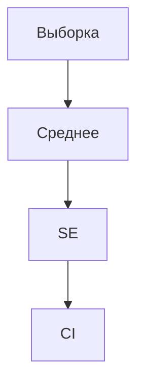

<div class="mission" data-mission="learn-da-clt" data-subtopic="learn-da-clt" data-title="ЦПТ, квантили, интервалы" data-review="1,3,7,14,30" data-review-url="../../../review/" data-skills="clt" data-strict="1" data-hint-default="Сначала попытка. Потом проверка. Решение — после третьей попытки." markdown="1">

<div class="mission-top">
  <span class="mission-kicker">Анализ данных · ЦПТ, квантили, интервалы · 3–5 заходов</span>
  <span class="mission-track"><span data-progress></span></span>
  <span class="mission-count" data-count>1 / 7</span>
</div>

<section class="mission-step" data-step="1" markdown="1">

<span class="mission-label">Шаг 1 · жизненный пример · 5 минут</span>

## Зачем это

ЦПТ объясняет, почему выборочное среднее часто близко к нормальному, даже если исходные данные нет.

**Артефакт:** разбор своего кода по теме и одна задача без готового ответа.

</section>

<section class="mission-step" data-step="2" markdown="1">

<span class="mission-label">Шаг 2 · теория · 12 минут</span>

## Ключевые идеи

- Стандартная ошибка среднего: `SE = σ / √n`.
- Доверительный интервал — про процедуру, а не про «95% вероятности параметра».
- Квантили и z/t-значения зависят от распределения и размера выборки.
- Больше данных сужает интервал, но не убирает смещение.

### Как это работает

ЦПТ говорит: сумма или среднее многих независимых величин при некоторых условиях приближается к нормальному распределению. Поэтому мы можем строить интервалы вокруг среднего, даже если исходные данные не нормальны. Но приближение работает при достаточном `n` и конечной дисперсии; для тяжёлых хвостов и зависимых наблюдений оно может подвести.

Стандартная ошибка `SE = σ/√n` показывает, насколько выборочное среднее колеблется от выборки к выборке. Доверительный интервал — это процедура: если повторить эксперимент много раз, примерно 95% таких интервалов накроют истинный параметр. Это не «вероятность параметра» и не гарантия для одного интервала.

### Схема



### По шагам

1. Среднее.
2. SE.
3. CI.
4. Допущения.

### Пример

```python
import numpy as np
from scipy import stats
se = np.std(x, ddof=1) / np.sqrt(len(x))
ci = stats.t.interval(0.95, len(x)-1, loc=np.mean(x), scale=se)
```

### Типичные ошибки

- Говорить «95% вероятность, что среднее в интервале».
- Забывать про зависимость наблюдений (временные ряды, группы).
- Строить интервал на маленькой выборке без проверки допущений.

### Как проверить себя

- Объясни схему и шаги без конспекта.
- Назови, где метод ломается.
- Реши задачу и сверь с критерием, а не с ответом.

</section>

<section class="mission-step" data-step="3" data-require-check markdown="1">

<span class="mission-label">Шаг 3 · диагностика · 8 минут</span>

## Проверь модель

Нужно **80%**. Если меньше — вернись к теории.

```quiz
{
  "title": "Диагностика · ЦПТ, квантили, интервалы",
  "min": 80,
  "questions": [
    {
      "type": "choice",
      "q": "Что верно про «ЦПТ, квантили, интервалы»?",
      "options": [
        "Стандартная ошибка среднего: `SE = σ / √n`.",
        "ЦПТ работает при зависимых данных без оговорок.",
        "Доверительный интервал — вероятность параметра.",
        "Достаточно accuracy на обучении."
      ],
      "answer": 0,
      "explain": "Стандартная ошибка среднего: `SE = σ / √n`."
    },
    {
      "type": "truefalse",
      "q": "Верно ли: Доверительный интервал — про процедуру, а не про «95% вероятности параметра».",
      "answer": true,
      "explain": "Доверительный интервал — про процедуру, а не про «95% вероятности параметра»."
    },
    {
      "type": "truefalse",
      "q": "Верно ли: Квантили и z/t-значения зависят от распределения и размера выборки.",
      "answer": true,
      "explain": "Квантили и z/t-значения зависят от распределения и размера выборки."
    },
    {
      "type": "truefalse",
      "q": "Верно ли: ЦПТ работает при зависимых данных без оговорок.",
      "answer": false,
      "explain": "Это типичное заблуждение; проверь по теории."
    },
    {
      "type": "truefalse",
      "q": "Верно ли: Доверительный интервал — вероятность параметра.",
      "answer": false,
      "explain": "Это типичное заблуждение; проверь по теории."
    },
    {
      "type": "truefalse",
      "q": "Достаточно посмотреть разбор, чтобы считать «ЦПТ, квантили, интервалы» освоенной.",
      "answer": false,
      "explain": "Без своей попытки и защиты тема не освоена."
    }
  ]
}
```

</section>

<section class="mission-step" data-step="4" data-require-check data-require-all markdown="1">

<span class="mission-label">Шаг 4 · практика с каркасом · 30 минут</span>

## Посчитай и почини

### 4.1. Стандартная ошибка

sigma=10, n=25. Напечатай SE.

```pyplay
# @mode write
# @expect 2.0
# @hint SE = sigma / sqrt(n).
# Стандартная ошибка: sigma=10, n=25. Напечатай SE.
import math
sigma, n = 10, 25
# твой код: посчитай SE и напечатай
```

### 4.2. Среднее

Посчитай среднее.

```pyplay
# @mode write
# @expect 3.92
# @hint 1.96 * SE.
# Интервал: Посчитай половину интервала.
se = 2
# твой код: половина 95% интервала
```

### 4.3. Дисперсия

Посчитай дисперсию.

```pyplay
# @mode write
# @expect 100
# @hint SE = sigma/sqrt(n).
# Размер выборки: Посчитай n.
import math
sigma, se = 10, 1
# твой код: нужное n
```

### 4.4. Объясни

Напиши 2–3 предложения: где этот метод ломается и что проверить на новых данных.

</section>

<section class="mission-step" data-step="5" data-require-check data-require-all markdown="1">

<span class="mission-label">Шаг 5 · куски задачи · 20 минут</span>

## Перенеси в свой разбор

### 5.1. Данные

Возьми свой ноутбук или таблицу. Запиши, какой признак был бы утечкой.

### 5.2. Метод

Запусти метод на своих данных. Сравни с простым baseline.

### 5.3. Вывод

Объясни, что получилось и где результат может обмануть.

</section>

<section class="mission-step" data-step="6" data-require-check markdown="1">

<span class="mission-label">Шаг 6 · половина модуля · 25 минут</span>

## Собери половину

Соедини 4.1 и 4.3: посчитай результат и объясни, что изменится на других данных.

<textarea data-save="da-clt-half" rows="5" placeholder="Моё объяснение: результат, ограничения, что проверю."></textarea>

</section>

<section class="mission-step" data-step="7" data-require-check markdown="1">

<span class="mission-label">Шаг 7 · полный артефакт и защита · 20 минут</span>

## Что сдать

- [ ] Свой результат по теме.
- [ ] Сравнение с baseline.
- [ ] Объяснение, где метод ломается.
- [ ] Ответ на вопрос «почему так».

**Защита:** объясни каждую строку своего кода и назови проверку.

<textarea data-save="da-clt-mistake" rows="4" placeholder="Где я ошибся и как это заметить в следующий раз"></textarea>

</section>

<div class="mission-controls">
  <button type="button" class="mission-btn mission-btn--ghost" data-prev>Назад</button>
  <span class="mission-spacer"></span>
  <button type="button" class="mission-btn mission-btn--primary" data-next>Дальше</button>
</div>

<p class="mission-hint" data-hint>Сначала попытка. Потом проверка.</p>

<div class="mission-done" data-complete hidden>
  <strong>Подтема собрана</strong>
  <p>Вернись через 1–3–7 дней и объясни тему без подсказок.</p>
</div>

</div>
