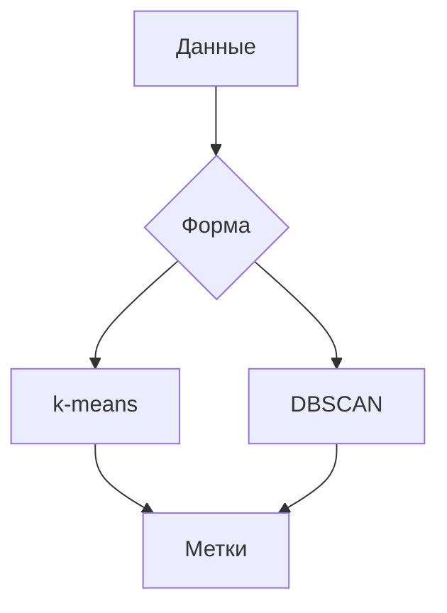

<div class="mission" data-mission="da-clustering-shape" data-subtopic="da-clustering-shape" data-title="Кластеризация: форма и плотность" data-review="1,3,7,14,30" data-review-url="../../../review/" data-skills="kmeans,dbscan,silhouette" data-strict="1" data-hint-default="Сначала попытка. Потом проверка. Решение — после третьей попытки." markdown="1">

<div class="mission-top">
  <span class="mission-kicker">Анализ данных · кластеризация · 3–5 заходов</span>
  <span class="mission-track"><span data-progress></span></span>
  <span class="mission-count" data-count>1 / 7</span>
</div>

<section class="mission-step" data-step="1" markdown="1">

<span class="mission-label">Шаг 1 · жизненный пример · 5 минут</span>

## Две дуги, а k-means видит два круга

На графике две вытянутые дуги. k-means с `k=2` режет их поперёк и получает два бессмысленных кластера. DBSCAN идёт по плотности и находит дуги.

На зачёте показывают код `KMeans(n_clusters=2).fit(X)`. Нужно объяснить, почему результат может быть плохим и что выбрать вместо него.

**Артефакт:** сравнение k-means и DBSCAN на своих данных + объяснение метрики.

<div class="mission-note mission-note--blue">
  <strong>Правило</strong>
  Сначала спроси, какой формы кластеры, потом выбирай алгоритм.
</div>

</section>

<section class="mission-step" data-step="2" markdown="1">

<span class="mission-label">Шаг 2 · теория · 12 минут</span>

## Центры, плотность и silhouette

**k-means** выбирает `k` центров, приписывает точки ближайшему, пересчитывает центры и повторяет. Он предполагает компактные кластеры примерно одного масштаба; выбросы сдвигают центры.

**DBSCAN** строит кластеры из плотных областей. Точка — ядро, если в радиусе `eps` у неё не меньше `min_samples` соседей. Он находит кластеры произвольной формы и помечает выбросы как шум `-1`, но плохо работает при сильно разной плотности.

**Silhouette** сравнивает расстояние до своего кластера `a` и до ближайшего чужого `b`: `(b-a)/max(a,b)`. Значение от -1 до 1. Метрика любит компактные шары; для вытянутых кластеров может недооценивать хорошее решение.

### Схема



### По шагам

1. Форма.
2. Алгоритм.
3. Параметры.
4. Метрика и смысл.

### Ловушка

Silhouette — не истина. На данных с шумом и разной плотностью она может выбрать не тот алгоритм. Всегда смотри на картинку и на смысл кластеров.

<div class="mission-note mission-note--red">
  <strong>Частая ошибка</strong>
  Выбирать `k` или `eps` по тесту. Параметры подбирают на валидации или по смыслу задачи.
</div>

### Как проверить себя

- Объясни схему и шаги без конспекта.
- Назови, где метод ломается.
- Реши задачу и сверь с критерием, а не с ответом.

</section>

<section class="mission-step" data-step="3" data-require-check markdown="1">

<span class="mission-label">Шаг 3 · диагностика · 8 минут</span>

## Проверь модель

Нужно **80%**. Если меньше — вернись к абзацу про форму кластеров.

```quiz
{
  "title": "Диагностика · кластеризация",
  "min": 80,
  "questions": [
    {
      "type": "choice",
      "q": "Что из этого — ключевая идея темы «Кластеризация: форма и плотность»?",
      "options": [
        "DBSCAN ищет плотные области и не требует шаровой формы.",
        "Достаточно accuracy на обучении, чтобы считать результат готовым.",
        "Результат можно не проверять на новых данных.",
        "Чем сложнее модель, тем всегда лучше."
      ],
      "answer": 0,
      "explain": "DBSCAN ищет плотные области и не требует шаровой формы."
    },
    {
      "type": "truefalse",
      "q": "Верно ли: k-means минимизирует расстояние до центров, поэтому любит компактные кластеры.",
      "answer": true,
      "explain": "k-means минимизирует расстояние до центров, поэтому любит компактные кластеры."
    },
    {
      "type": "choice",
      "q": "Какое утверждение точнее описывает «Кластеризация: форма и плотность»?",
      "options": [
        "Теорию можно не применять на практике.",
        "DBSCAN помечает точки, не попавшие в плотную область, как шум -1.",
        "Подсказка должна появляться до первой попытки.",
        "Все признаки одинаково полезны для модели."
      ],
      "answer": 1,
      "explain": "DBSCAN помечает точки, не попавшие в плотную область, как шум -1."
    },
    {
      "type": "truefalse",
      "q": "Верно ли: (b-a)/max(a,b) = (6-2)/6 ≈ 0.67.",
      "answer": true,
      "explain": "(b-a)/max(a,b) = (6-2)/6 ≈ 0.67."
    },
    {
      "type": "truefalse",
      "q": "Достаточно accuracy на обучении, чтобы считать модель готовой.",
      "answer": false,
      "explain": "Нужна проверка на данных, которых не было при обучении."
    },
    {
      "type": "truefalse",
      "q": "Подсказка должна появляться до первой попытки.",
      "answer": false,
      "explain": "Сначала попытка; подсказка — после второй."
    }
  ]
}
```

</section>

<section class="mission-step" data-step="4" data-require-check data-require-all markdown="1">

<span class="mission-label">Шаг 4 · практика с каркасом · 30 минут</span>

## Посчитай и почини

### 4.1. Почини расстояние

**Дано:** точки `(0, 0)` и `(3, 4)`.
**Надо:** евклидово расстояние `5.0`.
**Проверка:** `print(round(dist, 2))` выдаёт `5.0`.

```pyplay
# @mode fix
# @expect 5.0
# @hint Расстояние — корень из суммы квадратов разностей по обеим координатам.
import math
a = (0, 0)
b = (3, 4)
dist = math.sqrt((b[0] - a[0]) ** 2)
print(round(dist, 2))
```

### 4.2. Посчитай silhouette

**Дано:** `a = 2`, `b = 6`.
**Надо:** `(b - a) / max(a, b)`, округлить до 2 знаков.
**Проверка:** `0.67`.

```pyplay
# @mode write
# @expect 4.0
# @hint Среднее — сумма / n.
# Среднее: Посчитай среднее.
xs = [2, 4, 6]
# твой код: посчитай среднее и напечатай
```

### 4.3. Напиши назначение кластеров

**Дано:** точки `[(0,0), (10,10)]`, центры `[(0,0), (10,10)]`.
**Надо:** вернуть список меток `[0, 1]`.
**Проверка:** `print(assign(...))` выдаёт `[0, 1]`.

```pyplay
# @mode write
# @expect 0.67
# @hint Дисперсия — среднее квадратов отклонений.
# Дисперсия: Посчитай дисперсию.
xs = [1, 2, 3]
# твой код: посчитай дисперсию и напечатай
```

### 4.4. Выбери алгоритм

**Дано:** две дуги и шум.
**Надо:** написать 2–3 предложения, что выбрать и почему.

<div class="mission-note">
  <strong>Критерий</strong>
  Назови форму, плотность и что будет с выбросами.
</div>

</section>

<section class="mission-step" data-step="5" data-require-check data-require-all markdown="1">

<span class="mission-label">Шаг 5 · куски задачи · 20 минут</span>

## Перенеси в свой разбор

### 5.1. Кусок 1 — данные

Возьми свои данные с двумя признаками. Стандартизируй их и построй график.

### 5.2. Кусок 2 — два алгоритма

Запусти k-means и DBSCAN. Запиши число кластеров, шум и silhouette для обоих.

### 5.3. Кусок 3 — вывод

Какой результат лучше по смыслу, а не только по метрике? Объясни.

<div class="mission-note mission-note--yellow">
  <strong>Не копируй</strong>
  В отчёт — свои данные, свои параметры и свой вывод.
</div>

</section>

<section class="mission-step" data-step="6" data-require-check markdown="1">

<span class="mission-label">Шаг 6 · половина модуля · 25 минут</span>

## Собери половину

Соедини 4.1 и 4.3: посчитай расстояния и назначь точки. Затем объясни, что изменится, если кластеры вытянутые.

<textarea data-save="da-clustering-half" rows="5" placeholder="Моё объяснение: расстояния, метки, форма."></textarea>

</section>

<section class="mission-step" data-step="7" data-require-check markdown="1">

<span class="mission-label">Шаг 7 · защита · 20 минут</span>

## Что сдать

- [ ] Формула расстояния и silhouette.
- [ ] Сравнение k-means и DBSCAN на своих данных.
- [ ] Объяснение, где метрика врёт.
- [ ] Вывод: какой алгоритм и почему.

**Защита:** объясни каждую строку своего кода и ответь, почему выбрал `k` или `eps`.

<textarea data-save="da-clustering-mistake" rows="4" placeholder="Где я ошибся и как это заметить в следующий раз"></textarea>

<div class="mission-note mission-note--green">
  <strong>Готово, если</strong>
  Ты можешь объяснить разницу k-means и DBSCAN без конспекта.
</div>

</section>

<div class="mission-controls">
  <button type="button" class="mission-btn mission-btn--ghost" data-prev>Назад</button>
  <span class="mission-spacer"></span>
  <button type="button" class="mission-btn mission-btn--primary" data-next>Дальше</button>
</div>

<p class="mission-hint" data-hint>Сначала попытка. Потом проверка.</p>

<div class="mission-done" data-complete hidden>
  <strong>Подтема собрана</strong>
  <p>Вернись через 1–3–7 дней и объясни выбор алгоритма без подсказок.</p>
</div>

</div>
