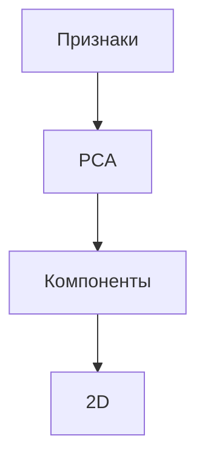

<div class="mission" data-mission="learn-da-dimensionality" data-subtopic="learn-da-dimensionality" data-title="Снижение размерности" data-review="1,3,7,14,30" data-review-url="../../../review/" data-skills="dimensionality" data-strict="1" data-hint-default="Сначала попытка. Потом проверка. Решение — после третьей попытки." markdown="1">

<div class="mission-top">
  <span class="mission-kicker">Анализ данных · Снижение размерности · 3–5 заходов</span>
  <span class="mission-track"><span data-progress></span></span>
  <span class="mission-count" data-count>1 / 7</span>
</div>

<section class="mission-step" data-step="1" markdown="1">

<span class="mission-label">Шаг 1 · жизненный пример · 5 минут</span>

## Зачем это

Много признаков — не всегда много информации. Снижение размерности помогает видеть структуру и убирать шум, но теряет часть данных.

**Артефакт:** разбор своего кода по теме и одна задача без готового ответа.

</section>

<section class="mission-step" data-step="2" markdown="1">

<span class="mission-label">Шаг 2 · теория · 12 минут</span>

## Ключевые идеи

- PCA ищет направления максимальной дисперсии; признаки нужно стандартизировать.
- Explained variance показывает, сколько дисперсии оставили компоненты.
- t-SNE/UMAP хороши для визуализации, но расстояния между кластерами не всегда интерпретируемы.
- Снижение размерности — преобразование, а не «удаление лишних колонок».

### Как это работает

Снижение размерности ищет компактное представление данных. PCA — линейный метод: он поворачивает оси так, чтобы первые компоненты объясняли максимум дисперсии. Признаки перед PCA стандартизируют, иначе признаки с большими единицами доминируют. Explained variance показывает, сколько информации оставили компоненты.

t-SNE и UMAP — нелинейные методы для визуализации. Они хорошо разделяют локальные группы, но расстояния между кластерами и глобальная структура могут искажаться. Поэтому t-SNE-картинка — не доказательство числа кластеров. Для отбора признаков и сжатия чаще используют PCA или модели с регуляризацией.

### Схема



### По шагам

1. Масштаб.
2. PCA.
3. Компоненты.
4. Проверка.

### Пример

```python
from sklearn.decomposition import PCA
from sklearn.preprocessing import StandardScaler
Xz = StandardScaler().fit_transform(X)
pca = PCA(n_components=2).fit(Xz)
```

### Типичные ошибки

- Применять PCA без масштабирования.
- Интерпретировать расстояния на t-SNE как точные.
- Выбирать число компонент только по «красивой картинке».

### Как проверить себя

- Объясни схему и шаги без конспекта.
- Назови, где метод ломается.
- Реши задачу и сверь с критерием, а не с ответом.

</section>

<section class="mission-step" data-step="3" data-require-check markdown="1">

<span class="mission-label">Шаг 3 · диагностика · 8 минут</span>

## Проверь модель

Нужно **80%**. Если меньше — вернись к теории.

```quiz
{
  "title": "Диагностика · Снижение размерности",
  "min": 80,
  "questions": [
    {
      "type": "choice",
      "q": "Что верно про «Снижение размерности»?",
      "options": [
        "PCA ищет направления максимальной дисперсии; признаки нужно стандартизировать.",
        "PCA не требует масштабирования.",
        "t-SNE расстояния точны.",
        "Достаточно accuracy на обучении."
      ],
      "answer": 0,
      "explain": "PCA ищет направления максимальной дисперсии; признаки нужно стандартизировать."
    },
    {
      "type": "truefalse",
      "q": "Верно ли: Explained variance показывает, сколько дисперсии оставили компоненты.",
      "answer": true,
      "explain": "Explained variance показывает, сколько дисперсии оставили компоненты."
    },
    {
      "type": "truefalse",
      "q": "Верно ли: t-SNE/UMAP хороши для визуализации, но расстояния между кластерами не всегда интерпретируемы.",
      "answer": true,
      "explain": "t-SNE/UMAP хороши для визуализации, но расстояния между кластерами не всегда интерпретируемы."
    },
    {
      "type": "truefalse",
      "q": "Верно ли: PCA не требует масштабирования.",
      "answer": false,
      "explain": "Это типичное заблуждение; проверь по теории."
    },
    {
      "type": "truefalse",
      "q": "Верно ли: t-SNE расстояния точны.",
      "answer": false,
      "explain": "Это типичное заблуждение; проверь по теории."
    },
    {
      "type": "truefalse",
      "q": "Достаточно посмотреть разбор, чтобы считать «Снижение размерности» освоенной.",
      "answer": false,
      "explain": "Без своей попытки и защиты тема не освоена."
    }
  ]
}
```

</section>

<section class="mission-step" data-step="4" data-require-check data-require-all markdown="1">

<span class="mission-label">Шаг 4 · практика с каркасом · 30 минут</span>

## Посчитай и почини

### 4.1. Explained variance

Доли 0.6, 0.3, 0.1. Напечатай сумму первых двух.

```pyplay
# @mode write
# @expect 0.9
# @hint Сложи первые две доли.
# Explained variance: Доли 0.6, 0.3, 0.1. Напечатай сумму первых двух.
ev = [0.6, 0.3, 0.1]
# твой код: сложи первые две доли и напечатай
```

### 4.2. Среднее

Посчитай среднее.

```pyplay
# @mode write
# @expect 3
# @hint Складывай по порядку.
# Компоненты: Посчитай число компонент.
ev = [0.5, 0.3, 0.15]
# твой код: сколько компонент до 90%
```

### 4.3. Дисперсия

Посчитай дисперсию.

```pyplay
# @mode write
# @expect 0.2
# @hint 1 - explained variance.
# Ошибка: Посчитай остаток.
ev = 0.8
# твой код: ошибка восстановления
```

### 4.4. Объясни

Напиши 2–3 предложения: где этот метод ломается и что проверить на новых данных.

</section>

<section class="mission-step" data-step="5" data-require-check data-require-all markdown="1">

<span class="mission-label">Шаг 5 · куски задачи · 20 минут</span>

## Перенеси в свой разбор

### 5.1. Данные

Возьми свой ноутбук или таблицу. Запиши, какой признак был бы утечкой.

### 5.2. Метод

Запусти метод на своих данных. Сравни с простым baseline.

### 5.3. Вывод

Объясни, что получилось и где результат может обмануть.

</section>

<section class="mission-step" data-step="6" data-require-check markdown="1">

<span class="mission-label">Шаг 6 · половина модуля · 25 минут</span>

## Собери половину

Соедини 4.1 и 4.3: посчитай результат и объясни, что изменится на других данных.

<textarea data-save="da-dimensionality-half" rows="5" placeholder="Моё объяснение: результат, ограничения, что проверю."></textarea>

</section>

<section class="mission-step" data-step="7" data-require-check markdown="1">

<span class="mission-label">Шаг 7 · полный артефакт и защита · 20 минут</span>

## Что сдать

- [ ] Свой результат по теме.
- [ ] Сравнение с baseline.
- [ ] Объяснение, где метод ломается.
- [ ] Ответ на вопрос «почему так».

**Защита:** объясни каждую строку своего кода и назови проверку.

<textarea data-save="da-dimensionality-mistake" rows="4" placeholder="Где я ошибся и как это заметить в следующий раз"></textarea>

</section>

<div class="mission-controls">
  <button type="button" class="mission-btn mission-btn--ghost" data-prev>Назад</button>
  <span class="mission-spacer"></span>
  <button type="button" class="mission-btn mission-btn--primary" data-next>Дальше</button>
</div>

<p class="mission-hint" data-hint>Сначала попытка. Потом проверка.</p>

<div class="mission-done" data-complete hidden>
  <strong>Подтема собрана</strong>
  <p>Вернись через 1–3–7 дней и объясни тему без подсказок.</p>
</div>

</div>
