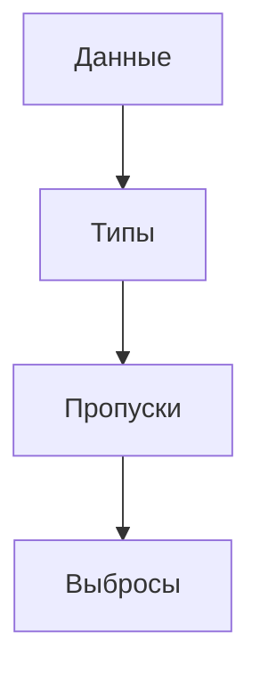

<div class="mission" data-mission="learn-da-eda" data-subtopic="learn-da-eda" data-title="EDA и данные" data-review="1,3,7,14,30" data-review-url="../../../review/" data-skills="eda" data-strict="1" data-hint-default="Сначала попытка. Потом проверка. Решение — после третьей попытки." markdown="1">

<div class="mission-top">
  <span class="mission-kicker">Анализ данных · EDA и данные · 3–5 заходов</span>
  <span class="mission-track"><span data-progress></span></span>
  <span class="mission-count" data-count>1 / 7</span>
</div>

<section class="mission-step" data-step="1" markdown="1">

<span class="mission-label">Шаг 1 · жизненный пример · 5 минут</span>

## Зачем это

EDA — не «построить красивые графики», а понять, что можно и нельзя делать с данными.

**Артефакт:** разбор своего кода по теме и одна задача без готового ответа.

</section>

<section class="mission-step" data-step="2" markdown="1">

<span class="mission-label">Шаг 2 · теория · 12 минут</span>

## Ключевые идеи

- Тип признака определяет допустимые операции: среднее для категорий бессмысленно.
- Пропуски могут быть случайными и неслучайными; стратегия зависит от причины.
- Выбросы проверяют по смыслу, а не только по формуле.
- Корреляция не доказывает причинность.

### Как это работает

EDA начинается с вопроса, а не с графика. Что за объект, что за период, что считается нормой, какие данные были доступны в момент прогноза. Дальше — типы, пропуски, дубли, диапазоны, распределения. Цель — найти ограничения, которые сломают модель, а не нарисовать красивую картинку.

Пропуски бывают случайными, зависящими от признака и зависящими от целевой переменной. От причины зависит стратегия: удалить, заполнить медианой, добавить индикатор или смоделировать. Выбросы проверяют по смыслу: «анomaly» может быть ошибкой ввода, а может — самым важным событием.

### Схема



### По шагам

1. Типы.
2. Пропуски.
3. Выбросы.
4. Решения.

### Пример

```python
df.info()
df.describe(include="all")
df.isna().sum().sort_values(ascending=False).head()
```

### Типичные ошибки

- Удалять пропуски, не проверив, связаны ли они с ответом.
- Считать корреляцию доказательством причинности.
- Строить графики без вопроса, что именно проверяем.

### Как проверить себя

- Объясни схему и шаги без конспекта.
- Назови, где метод ломается.
- Реши задачу и сверь с критерием, а не с ответом.

</section>

<section class="mission-step" data-step="3" data-require-check markdown="1">

<span class="mission-label">Шаг 3 · диагностика · 8 минут</span>

## Проверь модель

Нужно **80%**. Если меньше — вернись к теории.

```quiz
{
  "title": "Диагностика · EDA и данные",
  "min": 80,
  "questions": [
    {
      "type": "choice",
      "q": "Что верно про «EDA и данные»?",
      "options": [
        "Тип признака определяет допустимые операции: среднее для категорий бессмысленно.",
        "Пропуски всегда можно удалять.",
        "Корреляция доказывает причинность.",
        "Достаточно accuracy на обучении."
      ],
      "answer": 0,
      "explain": "Тип признака определяет допустимые операции: среднее для категорий бессмысленно."
    },
    {
      "type": "truefalse",
      "q": "Верно ли: Пропуски могут быть случайными и неслучайными; стратегия зависит от причины.",
      "answer": true,
      "explain": "Пропуски могут быть случайными и неслучайными; стратегия зависит от причины."
    },
    {
      "type": "truefalse",
      "q": "Верно ли: Выбросы проверяют по смыслу, а не только по формуле.",
      "answer": true,
      "explain": "Выбросы проверяют по смыслу, а не только по формуле."
    },
    {
      "type": "truefalse",
      "q": "Верно ли: Пропуски всегда можно удалять.",
      "answer": false,
      "explain": "Это типичное заблуждение; проверь по теории."
    },
    {
      "type": "truefalse",
      "q": "Верно ли: Корреляция доказывает причинность.",
      "answer": false,
      "explain": "Это типичное заблуждение; проверь по теории."
    },
    {
      "type": "truefalse",
      "q": "После задачи нужно объяснить «EDA и данные» своими словами.",
      "answer": true,
      "explain": "Защита своими словами — часть навыка."
    }
  ]
}
```

</section>

<section class="mission-step" data-step="4" data-require-check data-require-all markdown="1">

<span class="mission-label">Шаг 4 · практика с каркасом · 30 минут</span>

## Посчитай и почини

### 4.1. Доля пропусков

2 пропуска из 8. Напечатай долю.

```pyplay
# @mode write
# @expect 0.25
# @hint Доля пропусков.
# Доля пропусков: 2 пропуска из 8. Напечатай долю.
missing, total = 2, 8
# твой код: посчитай долю пропусков и напечатай
```

### 4.2. Среднее

Посчитай среднее.

```pyplay
# @mode write
# @expect 3
# @hint Средний элемент отсортированного ряда.
# Медиана: Посчитай медиану.
xs = [1, 3, 3, 6, 7]
# твой код: медиана
```

### 4.3. Дисперсия

Посчитай дисперсию.

```pyplay
# @mode write
# @expect 2
# @hint Сравни с границами.
# Выбросы: Посчитай значения вне диапазона.
xs = [0, 3, 6]
# твой код: сколько вне [1, 5]
```

### 4.4. Объясни

Напиши 2–3 предложения: где этот метод ломается и что проверить на новых данных.

</section>

<section class="mission-step" data-step="5" data-require-check data-require-all markdown="1">

<span class="mission-label">Шаг 5 · куски задачи · 20 минут</span>

## Перенеси в свой разбор

### 5.1. Данные

Возьми свой ноутбук или таблицу. Запиши, какой признак был бы утечкой.

### 5.2. Метод

Запусти метод на своих данных. Сравни с простым baseline.

### 5.3. Вывод

Объясни, что получилось и где результат может обмануть.

</section>

<section class="mission-step" data-step="6" data-require-check markdown="1">

<span class="mission-label">Шаг 6 · половина модуля · 25 минут</span>

## Собери половину

Соедини 4.1 и 4.3: посчитай результат и объясни, что изменится на других данных.

<textarea data-save="da-eda-half" rows="5" placeholder="Моё объяснение: результат, ограничения, что проверю."></textarea>

</section>

<section class="mission-step" data-step="7" data-require-check markdown="1">

<span class="mission-label">Шаг 7 · полный артефакт и защита · 20 минут</span>

## Что сдать

- [ ] Свой результат по теме.
- [ ] Сравнение с baseline.
- [ ] Объяснение, где метод ломается.
- [ ] Ответ на вопрос «почему так».

**Защита:** объясни каждую строку своего кода и назови проверку.

<textarea data-save="da-eda-mistake" rows="4" placeholder="Где я ошибся и как это заметить в следующий раз"></textarea>

</section>

<div class="mission-controls">
  <button type="button" class="mission-btn mission-btn--ghost" data-prev>Назад</button>
  <span class="mission-spacer"></span>
  <button type="button" class="mission-btn mission-btn--primary" data-next>Дальше</button>
</div>

<p class="mission-hint" data-hint>Сначала попытка. Потом проверка.</p>

<div class="mission-done" data-complete hidden>
  <strong>Подтема собрана</strong>
  <p>Вернись через 1–3–7 дней и объясни тему без подсказок.</p>
</div>

</div>
