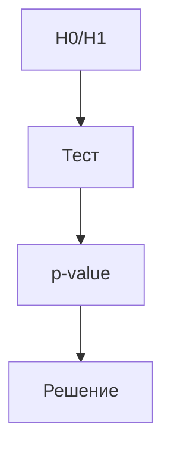

<div class="mission" data-mission="learn-da-hypotheses" data-subtopic="learn-da-hypotheses" data-title="Гипотезы: p-value без магии" data-review="1,3,7,14,30" data-review-url="../../../review/" data-skills="hypotheses" data-strict="1" data-hint-default="Сначала попытка. Потом проверка. Решение — после третьей попытки." markdown="1">

<div class="mission-top">
  <span class="mission-kicker">Анализ данных · Гипотезы: p-value без магии · 3–5 заходов</span>
  <span class="mission-track"><span data-progress></span></span>
  <span class="mission-count" data-count>1 / 7</span>
</div>

<section class="mission-step" data-step="1" markdown="1">

<span class="mission-label">Шаг 1 · жизненный пример · 5 минут</span>

## Зачем это

Сравнивая две группы, легко увидеть разницу «на глаз». Тест отвечает: насколько такая разница ожидаема, если на самом деле ничего не изменилось?

**Артефакт:** разбор своего кода по теме и одна задача без готового ответа.

</section>

<section class="mission-step" data-step="2" markdown="1">

<span class="mission-label">Шаг 2 · теория · 12 минут</span>

## Ключевые идеи

- H0 — «эффекта нет», H1 — «есть»; p-value — вероятность увидеть такие данные при верной H0, а не вероятность самой H0.
- α задают до теста: ошибка I рода — зря отвергнуть H0, II рода — не заметить эффект.
- При множественных проверках порог делят (Bonferroni) или контролируют FDR, иначе ложные срабатывания растут.

### Схема



### По шагам

1. H0/H1.
2. Тест.
3. p-value.
4. Решение и ошибка.

### Пример

```python
from scipy import stats
t_stat, p_value = stats.ttest_ind(a, b)
```

### Типичные ошибки

- Трактать p-value как вероятность гипотезы.
- Менять α после результата.
- Сделать 20 тестов и радоваться одному `p < 0.05`.

### Как проверить себя

- Объясни схему и шаги без конспекта.
- Назови, где метод ломается.
- Реши задачу и сверь с критерием, а не с ответом.

</section>

<section class="mission-step" data-step="3" data-require-check markdown="1">

<span class="mission-label">Шаг 3 · диагностика · 8 минут</span>

## Проверь модель

Нужно **80%**. Если меньше — вернись к теории.

```quiz
{
  "title": "Диагностика · Гипотезы: p-value без магии",
  "min": 80,
  "questions": [
    {
      "type": "choice",
      "q": "Что верно про «Гипотезы: p-value без магии»?",
      "options": [
        "Это ключевая идея модуля.",
        "p-value — вероятность H0.",
        "p<0.05 доказывает H1.",
        "Достаточно accuracy на обучении."
      ],
      "answer": 0,
      "explain": "Это ключевая идея модуля."
    },
    {
      "type": "truefalse",
      "q": "Верно ли: Нужна практика и защита своими словами.",
      "answer": true,
      "explain": "Нужна практика и защита своими словами."
    },
    {
      "type": "truefalse",
      "q": "Верно ли: Нужна практика: объяснить код, решить задачу и защитить результат.",
      "answer": true,
      "explain": "Нужна практика: объяснить код, решить задачу и защитить результат."
    },
    {
      "type": "truefalse",
      "q": "Верно ли: p-value — вероятность H0.",
      "answer": false,
      "explain": "Это типичное заблуждение; проверь по теории."
    },
    {
      "type": "truefalse",
      "q": "Верно ли: p<0.05 доказывает H1.",
      "answer": false,
      "explain": "Это типичное заблуждение; проверь по теории."
    },
    {
      "type": "truefalse",
      "q": "После задачи нужно объяснить «Гипотезы: p-value без магии» своими словами.",
      "answer": true,
      "explain": "Защита своими словами — часть навыка."
    }
  ]
}
```

</section>

<section class="mission-step" data-step="4" data-require-check data-require-all markdown="1">

<span class="mission-label">Шаг 4 · практика с каркасом · 30 минут</span>

## Посчитай и почини

### 4.1. Решение теста

p=0.03, alpha=0.05. Напечатай reject или keep.

```pyplay
# @mode write
# @expect reject
# @hint Сравни p и alpha.
# Решение теста: p=0.03, alpha=0.05. Напечатай reject или keep.
p = 0.03
alpha = 0.05
# твой код: напечатай reject или keep
```

### 4.2. Среднее

Посчитай среднее.

```pyplay
# @mode write
# @expect 2
# @hint Сравни каждый p с alpha.
# Отклонения: Посчитай число отклонений.
ps = [0.01, 0.2, 0.04]
# твой код: сколько отклонили при alpha=0.05
```

### 4.3. Дисперсия

Посчитай дисперсию.

```pyplay
# @mode write
# @expect 0.01
# @hint alpha / число проверок.
# Бонферрони: Посчитай новый alpha.
alpha, m = 0.05, 5
# твой код: поправка Бонферрони
```

### 4.4. Объясни

Напиши 2–3 предложения: где этот метод ломается и что проверить на новых данных.

</section>

<section class="mission-step" data-step="5" data-require-check data-require-all markdown="1">

<span class="mission-label">Шаг 5 · куски задачи · 20 минут</span>

## Перенеси в свой разбор

### 5.1. Данные

Возьми свой ноутбук или таблицу. Запиши, какой признак был бы утечкой.

### 5.2. Метод

Запусти метод на своих данных. Сравни с простым baseline.

### 5.3. Вывод

Объясни, что получилось и где результат может обмануть.

</section>

<section class="mission-step" data-step="6" data-require-check markdown="1">

<span class="mission-label">Шаг 6 · половина модуля · 25 минут</span>

## Собери половину

Соедини 4.1 и 4.3: посчитай результат и объясни, что изменится на других данных.

<textarea data-save="da-hypotheses-half" rows="5" placeholder="Моё объяснение: результат, ограничения, что проверю."></textarea>

</section>

<section class="mission-step" data-step="7" data-require-check markdown="1">

<span class="mission-label">Шаг 7 · полный артефакт и защита · 20 минут</span>

## Что сдать

- [ ] Свой результат по теме.
- [ ] Сравнение с baseline.
- [ ] Объяснение, где метод ломается.
- [ ] Ответ на вопрос «почему так».

**Защита:** объясни каждую строку своего кода и назови проверку.

<textarea data-save="da-hypotheses-mistake" rows="4" placeholder="Где я ошибся и как это заметить в следующий раз"></textarea>

</section>

<div class="mission-controls">
  <button type="button" class="mission-btn mission-btn--ghost" data-prev>Назад</button>
  <span class="mission-spacer"></span>
  <button type="button" class="mission-btn mission-btn--primary" data-next>Дальше</button>
</div>

<p class="mission-hint" data-hint>Сначала попытка. Потом проверка.</p>

<div class="mission-done" data-complete hidden>
  <strong>Подтема собрана</strong>
  <p>Вернись через 1–3–7 дней и объясни тему без подсказок.</p>
</div>

</div>
