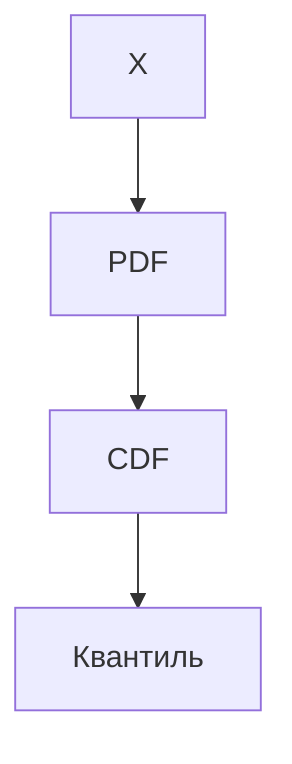

<div class="mission" data-mission="learn-da-probability" data-subtopic="learn-da-probability" data-title="Вероятность и распределения" data-review="1,3,7,14,30" data-review-url="../../../review/" data-skills="probability" data-strict="1" data-hint-default="Сначала попытка. Потом проверка. Решение — после третьей попытки." markdown="1">

<div class="mission-top">
  <span class="mission-kicker">Анализ данных · Вероятность и распределения · 3–5 заходов</span>
  <span class="mission-track"><span data-progress></span></span>
  <span class="mission-count" data-count>1 / 7</span>
</div>

<section class="mission-step" data-step="1" markdown="1">

<span class="mission-label">Шаг 1 · жизненный пример · 5 минут</span>

## Зачем это

Распределение описывает, какие значения вероятны. Без него нельзя понять p-value, интервалы и выбросы.

**Артефакт:** разбор своего кода по теме и одна задача без готового ответа.

</section>

<section class="mission-step" data-step="2" markdown="1">

<span class="mission-label">Шаг 2 · теория · 12 минут</span>

## Ключевые идеи

- PDF — плотность, CDF — накопленная вероятность.
- Среднее и дисперсия — не вся форма распределения.
- Нормальное распределение не универсально; проверяй данные.
- Квантиль — значение, ниже которого лежит заданная доля.

### Как это работает

Распределение описывает, какие значения вероятны и с какой плотностью. PDF — плотность в точке, CDF — накопленная вероятность до значения. Среднее и дисперсия — только два числа; форма распределения может быть важнее. Нормальное распределение удобно, но не универсально: доходности, время отклика и ошибки часто имеют тяжёлые хвосты.

Квантили отвечают на практический вопрос: «какое значение не превышают 95% наблюдений». Они устойчивее среднего и часто нужны для порогов и интервалов. Перед тем как считать p-value или строить модель, посмотри на распределение и выбросы: тест может предполагать то, чего в данных нет.

### Схема



### По шагам

1. Распределение.
2. PDF/CDF.
3. Квантиль.
4. Проверка.

### Пример

```python
from scipy import stats
p = stats.norm.cdf(1.96)      # ≈ 0.975
q = stats.norm.ppf(0.975)     # ≈ 1.96
```

### Типичные ошибки

- Путать PDF и вероятность конкретного значения.
- Считать распределение нормальным без проверки.
- Использовать среднее для тяжёлых хвостов без оговорок.

### Как проверить себя

- Объясни схему и шаги без конспекта.
- Назови, где метод ломается.
- Реши задачу и сверь с критерием, а не с ответом.

</section>

<section class="mission-step" data-step="3" data-require-check markdown="1">

<span class="mission-label">Шаг 3 · диагностика · 8 минут</span>

## Проверь модель

Нужно **80%**. Если меньше — вернись к теории.

```quiz
{
  "title": "Диагностика · Вероятность и распределения",
  "min": 80,
  "questions": [
    {
      "type": "choice",
      "q": "Что верно про «Вероятность и распределения»?",
      "options": [
        "PDF — плотность, CDF — накопленная вероятность.",
        "PDF — вероятность точного значения.",
        "Среднее описывает тяжёлые хвосты.",
        "Достаточно accuracy на обучении."
      ],
      "answer": 0,
      "explain": "PDF — плотность, CDF — накопленная вероятность."
    },
    {
      "type": "truefalse",
      "q": "Верно ли: Среднее и дисперсия — не вся форма распределения.",
      "answer": true,
      "explain": "Среднее и дисперсия — не вся форма распределения."
    },
    {
      "type": "truefalse",
      "q": "Верно ли: Нормальное распределение не универсально; проверяй данные.",
      "answer": true,
      "explain": "Нормальное распределение не универсально; проверяй данные."
    },
    {
      "type": "truefalse",
      "q": "Верно ли: PDF — вероятность точного значения.",
      "answer": false,
      "explain": "Это типичное заблуждение; проверь по теории."
    },
    {
      "type": "truefalse",
      "q": "Верно ли: Среднее описывает тяжёлые хвосты.",
      "answer": false,
      "explain": "Это типичное заблуждение; проверь по теории."
    },
    {
      "type": "truefalse",
      "q": "После задачи нужно объяснить «Вероятность и распределения» своими словами.",
      "answer": true,
      "explain": "Защита своими словами — часть навыка."
    }
  ]
}
```

</section>

<section class="mission-step" data-step="4" data-require-check data-require-all markdown="1">

<span class="mission-label">Шаг 4 · практика с каркасом · 30 минут</span>

## Посчитай и почини

### 4.1. Z-score

x=75, mean=70, std=5. Напечатай z.

```pyplay
# @mode write
# @expect 1.0
# @hint Z-score = (x - mean) / std.
# Z-score: x=75, mean=70, std=5. Напечатай z.
x, mu, sigma = 75, 70, 5
# твой код: посчитай z-score и напечатай
```

### 4.2. Среднее

Посчитай среднее.

```pyplay
# @mode write
# @expect 0.67
# @hint Среднее квадратов отклонений.
# Дисперсия: Посчитай дисперсию.
xs = [1, 2, 3]
# твой код: дисперсия
```

### 4.3. Дисперсия

Посчитай дисперсию.

```pyplay
# @mode write
# @expect 0.5
# @hint Половина вероятности выше среднего.
# Вероятность: Напечатай 0.5.
# твой код: P(X > mean) для симметричного распределения
```

### 4.4. Объясни

Напиши 2–3 предложения: где этот метод ломается и что проверить на новых данных.

</section>

<section class="mission-step" data-step="5" data-require-check data-require-all markdown="1">

<span class="mission-label">Шаг 5 · куски задачи · 20 минут</span>

## Перенеси в свой разбор

### 5.1. Данные

Возьми свой ноутбук или таблицу. Запиши, какой признак был бы утечкой.

### 5.2. Метод

Запусти метод на своих данных. Сравни с простым baseline.

### 5.3. Вывод

Объясни, что получилось и где результат может обмануть.

</section>

<section class="mission-step" data-step="6" data-require-check markdown="1">

<span class="mission-label">Шаг 6 · половина модуля · 25 минут</span>

## Собери половину

Соедини 4.1 и 4.3: посчитай результат и объясни, что изменится на других данных.

<textarea data-save="da-probability-half" rows="5" placeholder="Моё объяснение: результат, ограничения, что проверю."></textarea>

</section>

<section class="mission-step" data-step="7" data-require-check markdown="1">

<span class="mission-label">Шаг 7 · полный артефакт и защита · 20 минут</span>

## Что сдать

- [ ] Свой результат по теме.
- [ ] Сравнение с baseline.
- [ ] Объяснение, где метод ломается.
- [ ] Ответ на вопрос «почему так».

**Защита:** объясни каждую строку своего кода и назови проверку.

<textarea data-save="da-probability-mistake" rows="4" placeholder="Где я ошибся и как это заметить в следующий раз"></textarea>

</section>

<div class="mission-controls">
  <button type="button" class="mission-btn mission-btn--ghost" data-prev>Назад</button>
  <span class="mission-spacer"></span>
  <button type="button" class="mission-btn mission-btn--primary" data-next>Дальше</button>
</div>

<p class="mission-hint" data-hint>Сначала попытка. Потом проверка.</p>

<div class="mission-done" data-complete hidden>
  <strong>Подтема собрана</strong>
  <p>Вернись через 1–3–7 дней и объясни тему без подсказок.</p>
</div>

</div>
