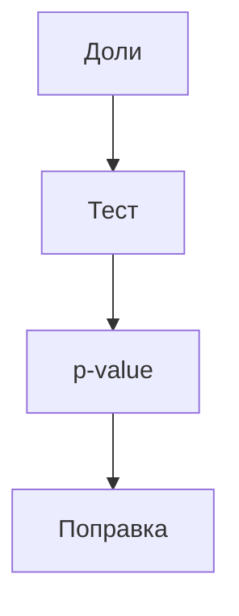

<div class="mission" data-mission="learn-da-proportions" data-subtopic="learn-da-proportions" data-title="Доли и множественные проверки" data-review="1,3,7,14,30" data-review-url="../../../review/" data-skills="proportions" data-strict="1" data-hint-default="Сначала попытка. Потом проверка. Решение — после третьей попытки." markdown="1">

<div class="mission-top">
  <span class="mission-kicker">Анализ данных · Доли и множественные проверки · 3–5 заходов</span>
  <span class="mission-track"><span data-progress></span></span>
  <span class="mission-count" data-count>1 / 7</span>
</div>

<section class="mission-step" data-step="1" markdown="1">

<span class="mission-label">Шаг 1 · жизненный пример · 5 минут</span>

## Зачем это

Для долей нужны свои тесты; при многих проверках риск ложной тревоги растёт.

**Артефакт:** разбор своего кода по теме и одна задача без готового ответа.

</section>

<section class="mission-step" data-step="2" markdown="1">

<span class="mission-label">Шаг 2 · теория · 12 минут</span>

## Ключевые идеи

- Доля — среднее бинарной переменной; SE считается иначе, чем для непрерывной.
- McNemar — для парных бинарных измерений.
- Бонферрони делит α на число проверок; консервативен.
- FDR контролирует долю ложных открытий, а не вероятность хотя бы одной ошибки.

### Как это работает

Доля — это среднее бинарной переменной. Для сравнения двух долей используют z-тест или точный тест; для парных измерений (до/после) — McNemar. Обычный t-тест для долей может дать неверный результат, если выборка маленькая или доля близка к 0/1.

Множественные проверки — отдельная проблема. Если проверить 20 гипотез при α=0.05, ожидаемо одна даст ложную тревогу. Бонферрони делит α на число проверок и консервативен; FDR контролирует долю ложных открытий и мягче. Выбор метода зависит от цены ошибки и числа проверок.

### Схема



### По шагам

1. Доли.
2. Тест.
3. p-value.
4. Поправка.

### Пример

```python
from statsmodels.stats.proportion import proportions_ztest
stat, p = proportions_ztest([success_a, success_b], [n_a, n_b])
```

### Типичные ошибки

- Использовать обычный t-тест для долей без проверки условий.
- Игнорировать множественные сравнения.
- Считать p-value после выбора «лучшей» подгруппы честным.

### Как проверить себя

- Объясни схему и шаги без конспекта.
- Назови, где метод ломается.
- Реши задачу и сверь с критерием, а не с ответом.

</section>

<section class="mission-step" data-step="3" data-require-check markdown="1">

<span class="mission-label">Шаг 3 · диагностика · 8 минут</span>

## Проверь модель

Нужно **80%**. Если меньше — вернись к теории.

```quiz
{
  "title": "Диагностика · Доли и множественные проверки",
  "min": 80,
  "questions": [
    {
      "type": "choice",
      "q": "Что верно про «Доли и множественные проверки»?",
      "options": [
        "Доля — среднее бинарной переменной; SE считается иначе, чем для непрерывной.",
        "При 20 проверках α=0.05 не меняет риск.",
        "McNemar — для независимых групп.",
        "Достаточно accuracy на обучении."
      ],
      "answer": 0,
      "explain": "Доля — среднее бинарной переменной; SE считается иначе, чем для непрерывной."
    },
    {
      "type": "truefalse",
      "q": "Верно ли: McNemar — для парных бинарных измерений.",
      "answer": true,
      "explain": "McNemar — для парных бинарных измерений."
    },
    {
      "type": "truefalse",
      "q": "Верно ли: Бонферрони делит α на число проверок; консервативен.",
      "answer": true,
      "explain": "Бонферрони делит α на число проверок; консервативен."
    },
    {
      "type": "truefalse",
      "q": "Верно ли: При 20 проверках α=0.05 не меняет риск.",
      "answer": false,
      "explain": "Это типичное заблуждение; проверь по теории."
    },
    {
      "type": "truefalse",
      "q": "Верно ли: McNemar — для независимых групп.",
      "answer": false,
      "explain": "Это типичное заблуждение; проверь по теории."
    },
    {
      "type": "truefalse",
      "q": "Достаточно посмотреть разбор, чтобы считать «Доли и множественные проверки» освоенной.",
      "answer": false,
      "explain": "Без своей попытки и защиты тема не освоена."
    }
  ]
}
```

</section>

<section class="mission-step" data-step="4" data-require-check data-require-all markdown="1">

<span class="mission-label">Шаг 4 · практика с каркасом · 30 минут</span>

## Посчитай и почини

### 4.1. Доля

30 успехов из 100. Напечатай долю.

```pyplay
# @mode write
# @expect 0.3
# @hint Доля = успехи / всего.
# Доля: 30 успехов из 100. Напечатай долю.
success, n = 30, 100
# твой код: посчитай долю и напечатай
```

### 4.2. Среднее

Посчитай среднее.

```pyplay
# @mode write
# @expect -4.0
# @hint z = (phat-p0)/SE.
# Z для доли: Посчитай z.
import math
phat, p0, n = 0.3, 0.5, 100
# твой код: z для доли
```

### 4.3. Дисперсия

Посчитай дисперсию.

```pyplay
# @mode write
# @expect 0.01
# @hint alpha*rank/m.
# FDR: Посчитай порог.
alpha, rank, m = 0.05, 2, 10
# твой код: порог FDR
```

### 4.4. Объясни

Напиши 2–3 предложения: где этот метод ломается и что проверить на новых данных.

</section>

<section class="mission-step" data-step="5" data-require-check data-require-all markdown="1">

<span class="mission-label">Шаг 5 · куски задачи · 20 минут</span>

## Перенеси в свой разбор

### 5.1. Данные

Возьми свой ноутбук или таблицу. Запиши, какой признак был бы утечкой.

### 5.2. Метод

Запусти метод на своих данных. Сравни с простым baseline.

### 5.3. Вывод

Объясни, что получилось и где результат может обмануть.

</section>

<section class="mission-step" data-step="6" data-require-check markdown="1">

<span class="mission-label">Шаг 6 · половина модуля · 25 минут</span>

## Собери половину

Соедини 4.1 и 4.3: посчитай результат и объясни, что изменится на других данных.

<textarea data-save="da-proportions-half" rows="5" placeholder="Моё объяснение: результат, ограничения, что проверю."></textarea>

</section>

<section class="mission-step" data-step="7" data-require-check markdown="1">

<span class="mission-label">Шаг 7 · полный артефакт и защита · 20 минут</span>

## Что сдать

- [ ] Свой результат по теме.
- [ ] Сравнение с baseline.
- [ ] Объяснение, где метод ломается.
- [ ] Ответ на вопрос «почему так».

**Защита:** объясни каждую строку своего кода и назови проверку.

<textarea data-save="da-proportions-mistake" rows="4" placeholder="Где я ошибся и как это заметить в следующий раз"></textarea>

</section>

<div class="mission-controls">
  <button type="button" class="mission-btn mission-btn--ghost" data-prev>Назад</button>
  <span class="mission-spacer"></span>
  <button type="button" class="mission-btn mission-btn--primary" data-next>Дальше</button>
</div>

<p class="mission-hint" data-hint>Сначала попытка. Потом проверка.</p>

<div class="mission-done" data-complete hidden>
  <strong>Подтема собрана</strong>
  <p>Вернись через 1–3–7 дней и объясни тему без подсказок.</p>
</div>

</div>
