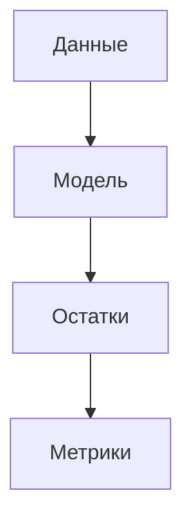

<div class="mission" data-mission="learn-da-regression" data-subtopic="learn-da-regression" data-title="Регрессия" data-review="1,3,7,14,30" data-review-url="../../../review/" data-skills="regression" data-strict="1" data-hint-default="Сначала попытка. Потом проверка. Решение — после третьей попытки." markdown="1">

<div class="mission-top">
  <span class="mission-kicker">Анализ данных · Регрессия · 3–5 заходов</span>
  <span class="mission-track"><span data-progress></span></span>
  <span class="mission-count" data-count>1 / 7</span>
</div>

<section class="mission-step" data-step="1" markdown="1">

<span class="mission-label">Шаг 1 · жизненный пример · 5 минут</span>

## Зачем это

Регрессия предсказывает число и объясняет вклад признаков; метрика должна соответствовать задаче.

**Артефакт:** разбор своего кода по теме и одна задача без готового ответа.

</section>

<section class="mission-step" data-step="2" markdown="1">

<span class="mission-label">Шаг 2 · теория · 12 минут</span>

## Ключевые идеи

- МНК минимизирует сумму квадратов остатков.
- R² сравнивает с константным прогнозом; он может быть отрицательным на тесте.
- Полиномиальные признаки увеличивают гибкость и риск переобучения.
- Ridge уменьшает веса, Lasso зануляет часть признаков.

### Как это работает

Линейная регрессия ищет веса, минимизирующие сумму квадратов остатков. R² показывает, какую долю дисперсии объяснила модель относительно константного прогноза; на тесте он может быть отрицательным. Полиномиальные признаки добавляют гибкость, но быстро приводят к переобучению.

Ridge (L2) уменьшает веса, Lasso (L1) зануляет часть признаков. Регуляризация помогает при мультиколлинеарности и малом числе наблюдений. Метрику выбирают по задаче: MAE устойчивее к выбросам и понятнее в единицах цели, MSE сильнее наказывает большие ошибки. Перед моделью проверь пропуски, выбросы и масштаб.

### Схема



### По шагам

1. Модель.
2. Остатки.
3. Метрики.
4. Регуляризация.

### Пример

```python
from sklearn.linear_model import Ridge
model = Ridge(alpha=1.0)
model.fit(X_train, y_train)
```

### Типичные ошибки

- Оставлять выбросы, которые ломают МНК, без анализа.
- Сравнивать R² на разных выборках без контекста.
- Забывать, что коэффициенты зависят от масштаба признаков.

### Как проверить себя

- Объясни схему и шаги без конспекта.
- Назови, где метод ломается.
- Реши задачу и сверь с критерием, а не с ответом.

</section>

<section class="mission-step" data-step="3" data-require-check markdown="1">

<span class="mission-label">Шаг 3 · диагностика · 8 минут</span>

## Проверь модель

Нужно **80%**. Если меньше — вернись к теории.

```quiz
{
  "title": "Диагностика · Регрессия",
  "min": 80,
  "questions": [
    {
      "type": "choice",
      "q": "Что верно про «Регрессия»?",
      "options": [
        "МНК минимизирует сумму квадратов остатков.",
        "R² не может быть отрицательным.",
        "Lasso увеличивает все веса.",
        "Достаточно accuracy на обучении."
      ],
      "answer": 0,
      "explain": "МНК минимизирует сумму квадратов остатков."
    },
    {
      "type": "truefalse",
      "q": "Верно ли: R² сравнивает с константным прогнозом; он может быть отрицательным на тесте.",
      "answer": true,
      "explain": "R² сравнивает с константным прогнозом; он может быть отрицательным на тесте."
    },
    {
      "type": "truefalse",
      "q": "Верно ли: Полиномиальные признаки увеличивают гибкость и риск переобучения.",
      "answer": true,
      "explain": "Полиномиальные признаки увеличивают гибкость и риск переобучения."
    },
    {
      "type": "truefalse",
      "q": "Верно ли: R² не может быть отрицательным.",
      "answer": false,
      "explain": "Это типичное заблуждение; проверь по теории."
    },
    {
      "type": "truefalse",
      "q": "Верно ли: Lasso увеличивает все веса.",
      "answer": false,
      "explain": "Это типичное заблуждение; проверь по теории."
    },
    {
      "type": "truefalse",
      "q": "После задачи нужно объяснить «Регрессия» своими словами.",
      "answer": true,
      "explain": "Защита своими словами — часть навыка."
    }
  ]
}
```

</section>

<section class="mission-step" data-step="4" data-require-check data-require-all markdown="1">

<span class="mission-label">Шаг 4 · практика с каркасом · 30 минут</span>

## Посчитай и почини

### 4.1. MAE

true=[1,2,3], pred=[1,3,3]. Напечатай MAE.

```pyplay
# @mode write
# @expect 0.33
# @hint MAE — среднее абсолютных ошибок.
# MAE: true=[1,2,3], pred=[1,3,3]. Напечатай MAE.
true = [1, 2, 3]
pred = [1, 3, 3]
# твой код: посчитай MAE и напечатай
```

### 4.2. Среднее

Посчитай среднее.

```pyplay
# @mode write
# @expect 0.75
# @hint R² = 1 - SSE/SST.
# R²: Посчитай R².
sse, sst = 2, 8
# твой код: R²
```

### 4.3. Дисперсия

Посчитай дисперсию.

```pyplay
# @mode write
# @expect 1.0
# @hint w/(1+alpha).
# Ridge: Посчитай вес.
w, alpha = 2, 1
# твой код: вес после Ridge
```

### 4.4. Объясни

Напиши 2–3 предложения: где этот метод ломается и что проверить на новых данных.

</section>

<section class="mission-step" data-step="5" data-require-check data-require-all markdown="1">

<span class="mission-label">Шаг 5 · куски задачи · 20 минут</span>

## Перенеси в свой разбор

### 5.1. Данные

Возьми свой ноутбук или таблицу. Запиши, какой признак был бы утечкой.

### 5.2. Метод

Запусти метод на своих данных. Сравни с простым baseline.

### 5.3. Вывод

Объясни, что получилось и где результат может обмануть.

</section>

<section class="mission-step" data-step="6" data-require-check markdown="1">

<span class="mission-label">Шаг 6 · половина модуля · 25 минут</span>

## Собери половину

Соедини 4.1 и 4.3: посчитай результат и объясни, что изменится на других данных.

<textarea data-save="da-regression-half" rows="5" placeholder="Моё объяснение: результат, ограничения, что проверю."></textarea>

</section>

<section class="mission-step" data-step="7" data-require-check markdown="1">

<span class="mission-label">Шаг 7 · полный артефакт и защита · 20 минут</span>

## Что сдать

- [ ] Свой результат по теме.
- [ ] Сравнение с baseline.
- [ ] Объяснение, где метод ломается.
- [ ] Ответ на вопрос «почему так».

**Защита:** объясни каждую строку своего кода и назови проверку.

<textarea data-save="da-regression-mistake" rows="4" placeholder="Где я ошибся и как это заметить в следующий раз"></textarea>

</section>

<div class="mission-controls">
  <button type="button" class="mission-btn mission-btn--ghost" data-prev>Назад</button>
  <span class="mission-spacer"></span>
  <button type="button" class="mission-btn mission-btn--primary" data-next>Дальше</button>
</div>

<p class="mission-hint" data-hint>Сначала попытка. Потом проверка.</p>

<div class="mission-done" data-complete hidden>
  <strong>Подтема собрана</strong>
  <p>Вернись через 1–3–7 дней и объясни тему без подсказок.</p>
</div>

</div>
