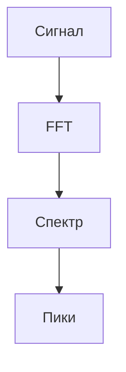

<div class="mission" data-mission="learn-da-signals" data-subtopic="learn-da-signals" data-title="Сигналы: FFT и вейвлеты" data-review="1,3,7,14,30" data-review-url="../../../review/" data-skills="signals" data-strict="1" data-hint-default="Сначала попытка. Потом проверка. Решение — после третьей попытки." markdown="1">

<div class="mission-top">
  <span class="mission-kicker">Анализ данных · Сигналы: FFT и вейвлеты · 3–5 заходов</span>
  <span class="mission-track"><span data-progress></span></span>
  <span class="mission-count" data-count>1 / 7</span>
</div>

<section class="mission-step" data-step="1" markdown="1">

<span class="mission-label">Шаг 1 · жизненный пример · 5 минут</span>

## Зачем это

Сигнал можно смотреть во времени и в частоте. FFT показывает частоты, но теряет локальность; вейвлеты сохраняют и время, и частоту.

**Артефакт:** разбор своего кода по теме и одна задача без готового ответа.

</section>

<section class="mission-step" data-step="2" markdown="1">

<span class="mission-label">Шаг 2 · теория · 12 минут</span>

## Ключевые идеи

- FFT раскладывает сигнал на синусоиды.
- Окно уменьшает утечку, но расширяет пик.
- Периодограмма — оценка спектральной плотности, она шумная.
- Вейвлеты дают время-частотное представление.

### Как это работает

Сигнал можно рассматривать как функцию времени или как набор частот. FFT показывает, какие частоты присутствуют, но не говорит, когда они появились. Окно уменьшает утечку спектра, но расширяет пики: это компромисс между разрешением по частоте и по времени.

Периодограмма — оценка спектральной плотности; она шумная, поэтому её сглаживают. Вейвлеты дают время-частотное представление и лучше подходят для нестационарных сигналов: всплесков, смен режима, коротких событий. Выбор метода зависит от вопроса: «какие частоты вообще есть» или «когда появилась частота».

### Схема



### По шагам

1. Окно.
2. FFT.
3. Пики.
4. Вейвлеты.

### Пример

```python
import numpy as np
spectrum = np.fft.rfft(signal)
freqs = np.fft.rfftfreq(len(signal), d=dt)
```

### Типичные ошибки

- Применять FFT к короткому сигналу без окна и удивляться утечке.
- Интерпретировать периодограмму как точный спектр.
- Сравнивать сигналы разной длины без учёта разрешения.

### Как проверить себя

- Объясни схему и шаги без конспекта.
- Назови, где метод ломается.
- Реши задачу и сверь с критерием, а не с ответом.

</section>

<section class="mission-step" data-step="3" data-require-check markdown="1">

<span class="mission-label">Шаг 3 · диагностика · 8 минут</span>

## Проверь модель

Нужно **80%**. Если меньше — вернись к теории.

```quiz
{
  "title": "Диагностика · Сигналы: FFT и вейвлеты",
  "min": 80,
  "questions": [
    {
      "type": "choice",
      "q": "Что верно про «Сигналы: FFT и вейвлеты»?",
      "options": [
        "FFT раскладывает сигнал на синусоиды.",
        "FFT показывает время появления частоты.",
        "Окно не влияет на спектр.",
        "Достаточно accuracy на обучении."
      ],
      "answer": 0,
      "explain": "FFT раскладывает сигнал на синусоиды."
    },
    {
      "type": "truefalse",
      "q": "Верно ли: Окно уменьшает утечку, но расширяет пик.",
      "answer": true,
      "explain": "Окно уменьшает утечку, но расширяет пик."
    },
    {
      "type": "truefalse",
      "q": "Верно ли: Периодограмма — оценка спектральной плотности, она шумная.",
      "answer": true,
      "explain": "Периодограмма — оценка спектральной плотности, она шумная."
    },
    {
      "type": "truefalse",
      "q": "Верно ли: FFT показывает время появления частоты.",
      "answer": false,
      "explain": "Это типичное заблуждение; проверь по теории."
    },
    {
      "type": "truefalse",
      "q": "Верно ли: Окно не влияет на спектр.",
      "answer": false,
      "explain": "Это типичное заблуждение; проверь по теории."
    },
    {
      "type": "truefalse",
      "q": "Достаточно посмотреть разбор, чтобы считать «Сигналы: FFT и вейвлеты» освоенной.",
      "answer": false,
      "explain": "Без своей попытки и защиты тема не освоена."
    }
  ]
}
```

</section>

<section class="mission-step" data-step="4" data-require-check data-require-all markdown="1">

<span class="mission-label">Шаг 4 · практика с каркасом · 30 минут</span>

## Посчитай и почини

### 4.1. Доминирующая частота

Спектр [1,5,2]. Напечатай индекс максимума.

```pyplay
# @mode write
# @expect 1
# @hint Индекс максимума спектра.
# Доминирующая частота: Спектр [1,5,2]. Напечатай индекс максимума.
spectrum = [1, 5, 2]
# твой код: напечатай индекс максимума
```

### 4.2. Среднее

Посчитай среднее.

```pyplay
# @mode write
# @expect 20.0
# @hint f = idx*fs/n.
# Частота: Посчитай частоту.
idx, fs, n = 2, 100, 10
# твой код: частота bin
```

### 4.3. Дисперсия

Посчитай дисперсию.

```pyplay
# @mode write
# @expect 2
# @hint Длина / окно.
# Окна: Посчитай число окон.
length, window = 8, 4
# твой код: число окон
```

### 4.4. Объясни

Напиши 2–3 предложения: где этот метод ломается и что проверить на новых данных.

</section>

<section class="mission-step" data-step="5" data-require-check data-require-all markdown="1">

<span class="mission-label">Шаг 5 · куски задачи · 20 минут</span>

## Перенеси в свой разбор

### 5.1. Данные

Возьми свой ноутбук или таблицу. Запиши, какой признак был бы утечкой.

### 5.2. Метод

Запусти метод на своих данных. Сравни с простым baseline.

### 5.3. Вывод

Объясни, что получилось и где результат может обмануть.

</section>

<section class="mission-step" data-step="6" data-require-check markdown="1">

<span class="mission-label">Шаг 6 · половина модуля · 25 минут</span>

## Собери половину

Соедини 4.1 и 4.3: посчитай результат и объясни, что изменится на других данных.

<textarea data-save="da-signals-half" rows="5" placeholder="Моё объяснение: результат, ограничения, что проверю."></textarea>

</section>

<section class="mission-step" data-step="7" data-require-check markdown="1">

<span class="mission-label">Шаг 7 · полный артефакт и защита · 20 минут</span>

## Что сдать

- [ ] Свой результат по теме.
- [ ] Сравнение с baseline.
- [ ] Объяснение, где метод ломается.
- [ ] Ответ на вопрос «почему так».

**Защита:** объясни каждую строку своего кода и назови проверку.

<textarea data-save="da-signals-mistake" rows="4" placeholder="Где я ошибся и как это заметить в следующий раз"></textarea>

</section>

<div class="mission-controls">
  <button type="button" class="mission-btn mission-btn--ghost" data-prev>Назад</button>
  <span class="mission-spacer"></span>
  <button type="button" class="mission-btn mission-btn--primary" data-next>Дальше</button>
</div>

<p class="mission-hint" data-hint>Сначала попытка. Потом проверка.</p>

<div class="mission-done" data-complete hidden>
  <strong>Подтема собрана</strong>
  <p>Вернись через 1–3–7 дней и объясни тему без подсказок.</p>
</div>

</div>
