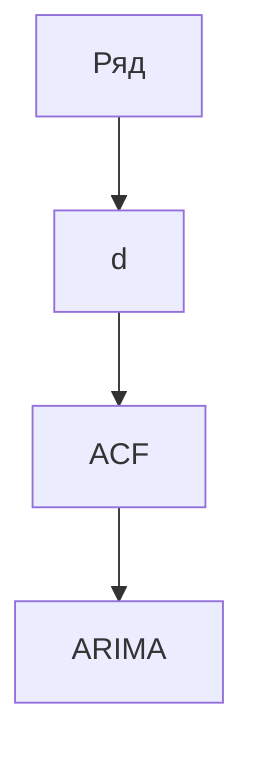

<div class="mission" data-mission="learn-da-time-series" data-subtopic="learn-da-time-series" data-title="Временные ряды: ARIMA(p,d,q)" data-review="1,3,7,14,30" data-review-url="../../../review/" data-skills="time-series" data-strict="1" data-hint-default="Сначала попытка. Потом проверка. Решение — после третьей попытки." markdown="1">

<div class="mission-top">
  <span class="mission-kicker">Анализ данных · Временные ряды: ARIMA(p,d,q) · 3–5 заходов</span>
  <span class="mission-track"><span data-progress></span></span>
  <span class="mission-count" data-count>1 / 7</span>
</div>

<section class="mission-step" data-step="1" markdown="1">

<span class="mission-label">Шаг 1 · жизненный пример · 5 минут</span>

## Зачем это

Во временном ряду соседние значения связаны. Нельзя перемешивать строки: порядок — часть данных. ARIMA описывает ряд через прошлые значения и прошлые ошибки.

**Артефакт:** разбор своего кода по теме и одна задача без готового ответа.

</section>

<section class="mission-step" data-step="2" markdown="1">

<span class="mission-label">Шаг 2 · теория · 12 минут</span>

## Ключевые идеи

- Порядок строк — часть данных: случайное перемешивание ломает автокорреляцию.
- ARIMA(p, d, q): p — прошлые значения, d — разности до стационарности, q — прошлые ошибки.
- Стационарность проверяют тестом и по ACF; train/val/test делят по времени, а не случайно.

### Схема



### По шагам

1. Стационарность.
2. d.
3. p/q.
4. Остатки.

### Пример

```python
from statsmodels.tsa.arima.model import ARIMA
model = ARIMA(series, order=(1, 1, 0)).fit()
```

### Типичные ошибки

- Делать случайный split временного ряда.
- Брать `d` без проверки стационарности.
- Оценивать модель на прошлом, подглядывая в будущее.

### Как проверить себя

- Объясни схему и шаги без конспекта.
- Назови, где метод ломается.
- Реши задачу и сверь с критерием, а не с ответом.

</section>

<section class="mission-step" data-step="3" data-require-check markdown="1">

<span class="mission-label">Шаг 3 · диагностика · 8 минут</span>

## Проверь модель

Нужно **80%**. Если меньше — вернись к теории.

```quiz
{
  "title": "Диагностика · Временные ряды: ARIMA(p,d,q)",
  "min": 80,
  "questions": [
    {
      "type": "choice",
      "q": "Что верно про «Временные ряды: ARIMA(p,d,q)»?",
      "options": [
        "Это ключевая идея модуля.",
        "ARIMA не требует стационарности.",
        "d — это сезонность.",
        "Достаточно accuracy на обучении."
      ],
      "answer": 0,
      "explain": "Это ключевая идея модуля."
    },
    {
      "type": "truefalse",
      "q": "Верно ли: Нужна практика и защита своими словами.",
      "answer": true,
      "explain": "Нужна практика и защита своими словами."
    },
    {
      "type": "truefalse",
      "q": "Верно ли: Нужна практика: объяснить код, решить задачу и защитить результат.",
      "answer": true,
      "explain": "Нужна практика: объяснить код, решить задачу и защитить результат."
    },
    {
      "type": "truefalse",
      "q": "Верно ли: ARIMA не требует стационарности.",
      "answer": false,
      "explain": "Это типичное заблуждение; проверь по теории."
    },
    {
      "type": "truefalse",
      "q": "Верно ли: d — это сезонность.",
      "answer": false,
      "explain": "Это типичное заблуждение; проверь по теории."
    },
    {
      "type": "truefalse",
      "q": "Достаточно посмотреть разбор, чтобы считать «Временные ряды: ARIMA(p,d,q)» освоенной.",
      "answer": false,
      "explain": "Без своей попытки и защиты тема не освоена."
    }
  ]
}
```

</section>

<section class="mission-step" data-step="4" data-require-check data-require-all markdown="1">

<span class="mission-label">Шаг 4 · практика с каркасом · 30 минут</span>

## Посчитай и почини

### 4.1. Скользящее среднее

Ряд [1,2,3], окно 2. Напечатай последнее среднее.

```pyplay
# @mode write
# @expect 2.5
# @hint Скользящее среднее последних двух.
# Скользящее среднее: Ряд [1,2,3], окно 2. Напечатай последнее среднее.
values = [1, 2, 3]
window = 2
# твой код: посчитай последнее скользящее среднее и напечатай
```

### 4.2. Среднее

Посчитай среднее.

```pyplay
# @mode write
# @expect 3
# @hint Вычти соседние значения.
# Разность: Напечатай вторую разность.
xs = [1, 3, 6]
# твой код: первая разность
```

### 4.3. Дисперсия

Посчитай дисперсию.

```pyplay
# @mode write
# @expect 3.5
# @hint Последние два значения.
# Скользящее среднее: Посчитай среднее.
xs = [1, 2, 3, 4]
# твой код: среднее последних двух
```

### 4.4. Объясни

Напиши 2–3 предложения: где этот метод ломается и что проверить на новых данных.

</section>

<section class="mission-step" data-step="5" data-require-check data-require-all markdown="1">

<span class="mission-label">Шаг 5 · куски задачи · 20 минут</span>

## Перенеси в свой разбор

### 5.1. Данные

Возьми свой ноутбук или таблицу. Запиши, какой признак был бы утечкой.

### 5.2. Метод

Запусти метод на своих данных. Сравни с простым baseline.

### 5.3. Вывод

Объясни, что получилось и где результат может обмануть.

</section>

<section class="mission-step" data-step="6" data-require-check markdown="1">

<span class="mission-label">Шаг 6 · половина модуля · 25 минут</span>

## Собери половину

Соедини 4.1 и 4.3: посчитай результат и объясни, что изменится на других данных.

<textarea data-save="da-time-series-half" rows="5" placeholder="Моё объяснение: результат, ограничения, что проверю."></textarea>

</section>

<section class="mission-step" data-step="7" data-require-check markdown="1">

<span class="mission-label">Шаг 7 · полный артефакт и защита · 20 минут</span>

## Что сдать

- [ ] Свой результат по теме.
- [ ] Сравнение с baseline.
- [ ] Объяснение, где метод ломается.
- [ ] Ответ на вопрос «почему так».

**Защита:** объясни каждую строку своего кода и назови проверку.

<textarea data-save="da-time-series-mistake" rows="4" placeholder="Где я ошибся и как это заметить в следующий раз"></textarea>

</section>

<div class="mission-controls">
  <button type="button" class="mission-btn mission-btn--ghost" data-prev>Назад</button>
  <span class="mission-spacer"></span>
  <button type="button" class="mission-btn mission-btn--primary" data-next>Дальше</button>
</div>

<p class="mission-hint" data-hint>Сначала попытка. Потом проверка.</p>

<div class="mission-done" data-complete hidden>
  <strong>Подтема собрана</strong>
  <p>Вернись через 1–3–7 дней и объясни тему без подсказок.</p>
</div>

</div>
