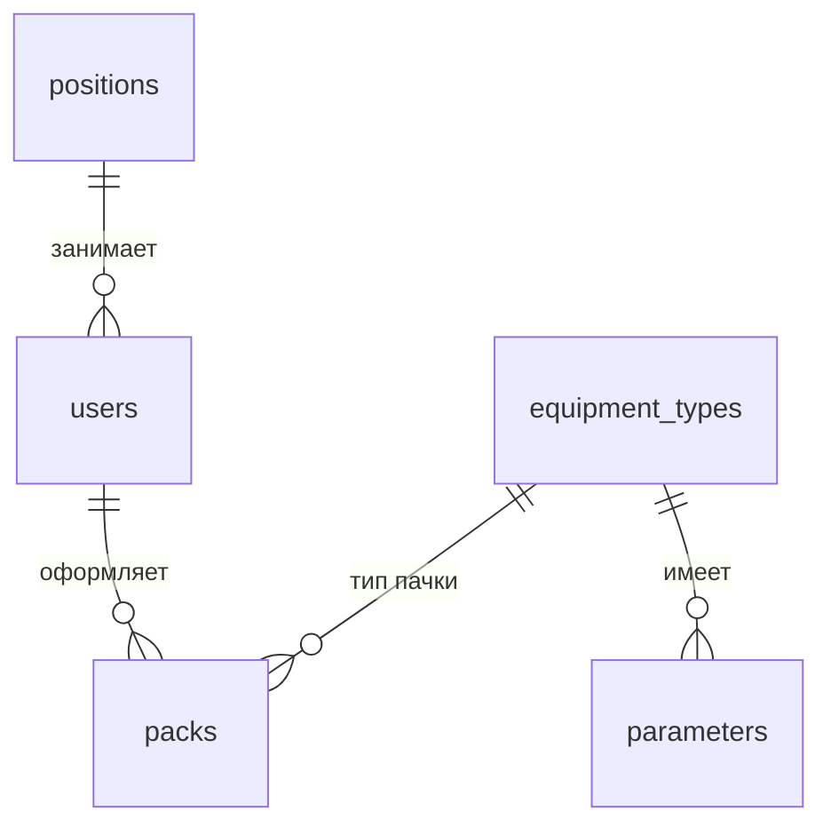

# 4. Связи таблиц

Пять таблиц домашки должны соединяться в один `SELECT`. Значит, между ними нужны
связи. После урока ты спроектируешь схему и поймёшь, в каком порядке создавать
таблицы.

## Зачем связи

Требование «Select с объединением всех таблиц» невозможно выполнить, если таблицы
никак не связаны. Связь задаётся внешним ключом.

!!! note "Определение"
    **FOREIGN KEY** (внешний ключ) — столбец, значения которого ссылаются на
    первичный ключ другой таблицы. Гарантирует, что ссылка ведёт на существующую
    запись.

## Схема пяти таблиц

Возьмём такую модель: должность есть у пользователя, пользователь оформляет
пачки, у типа оборудования есть параметры, а пачка привязана к пользователю и к
типу оборудования.



Читается так: одна должность — у многих пользователей; один пользователь —
у многих пачек; один тип оборудования — у многих пачек и многих параметров.

!!! tip "Почему так"
    Эта модель даёт единый путь `должности → пользователи → пачки →
    типы_оборудования → параметры`. По нему все пять таблиц соединяются одним
    запросом. Конкретные поля под свою предметную область ты можешь поменять,
    путь должен остаться.

## Как задать внешний ключ

```sql
CREATE TABLE users (
    id          INTEGER      NOT NULL,
    full_name   VARCHAR(150) NOT NULL,
    position_id INTEGER      NOT NULL,
    CONSTRAINT pk_users PRIMARY KEY (id),
    CONSTRAINT fk_users_position
        FOREIGN KEY (position_id) REFERENCES positions (id)
);
```

`position_id` в `users` ссылается на `id` в `positions`. СУБД не даст вставить
пользователя с `position_id`, которого нет в `positions`.

## Таблица-связка packs

`packs` ссылается сразу на две таблицы:

```sql
CREATE TABLE packs (
    id                INTEGER NOT NULL,
    user_id           INTEGER NOT NULL,
    equipment_type_id INTEGER NOT NULL,
    created_on        DATE    NOT NULL,
    quantity          INTEGER NOT NULL,
    CONSTRAINT pk_packs PRIMARY KEY (id),
    CONSTRAINT fk_packs_user
        FOREIGN KEY (user_id) REFERENCES users (id),
    CONSTRAINT fk_packs_type
        FOREIGN KEY (equipment_type_id) REFERENCES equipment_types (id)
);
```

## Порядок создания

Родителей создаём первыми, детей — последними:

```text
1. positions
2. equipment_types
3. users            (ссылается на positions)
4. parameters       (ссылается на equipment_types)
5. packs            (ссылается на users и equipment_types)
```

При удалении — строго наоборот (урок 3).

## Частые ошибки

!!! warning "Ошибка"
    Создать `users` раньше `positions`. Внешний ключ сослался на несуществующую
    таблицу — ошибка. Родитель всегда первый.

!!! warning "Ошибка"
    Тип столбца-ссылки не совпадает с типом ключа. `position_id` должен быть тем
    же `INTEGER`, что и `positions.id`.

## Что дальше

В уроке 5 наполняем таблицы данными и собираем JOIN всех таблиц.
