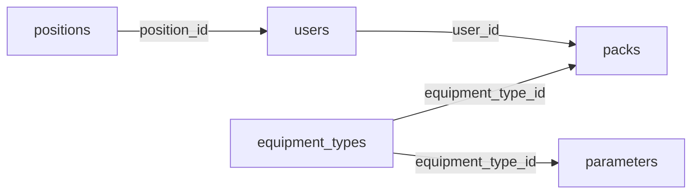

# 5. Тестовые данные и JOIN всех таблиц

Финальный технический урок. Наполняем таблицы данными и пишем `SELECT`, который
объединяет все пять таблиц — это результат для скриншота.

## Вставка данных и порядок

```sql
INSERT INTO positions (id, name) VALUES
    (1, 'Оператор'),
    (2, 'Механик'),
    (3, 'Инженер');
```

Столбцы перечисляем явно: так `INSERT` не сломается при изменении структуры.

Данные вставляем в том же порядке, что и создание таблиц — родители первыми:

```text
positions → equipment_types → users → parameters → packs
```

!!! warning "Ошибка"
    Вставить `packs` раньше `users`. Внешний ключ не найдёт пользователя с таким
    `user_id` и отклонит вставку.

## Даты в ANSI-92

```sql
INSERT INTO packs (id, user_id, equipment_type_id, created_on, quantity) VALUES
    (1, 1, 1, DATE '2026-09-01', 10);
```

`DATE '2026-09-01'` — литерал даты по стандарту. Многие СУБД принимают и просто
`'2026-09-01'`, но стандартная форма переносима.

## Два синтаксиса JOIN

В уроке ты писал объединение через запятую и `WHERE`:

```sql
SELECT *
FROM solders, ranks
WHERE solders.rank_id = ranks.id;
```

Это старый синтаксис. ANSI-92 предпочитает явный `JOIN ... ON`:

```sql
SELECT *
FROM users u
JOIN positions pos ON u.position_id = pos.id;
```

Результат одинаковый, но `JOIN ... ON` отделяет условие связи от фильтра
`WHERE`. Когда таблиц пять, это критично для читаемости.

## Как читать цепочку JOIN

`JOIN` строит **одну широкую таблицу**, добавляя столбцы справа. Каждый новый
`JOIN` приклеивает строки новой таблицы к тому, что уже собрано.

!!! note "Главное правило"
    `ON` всегда связывает **новую** таблицу (ту, что в этом `JOIN`) с **уже
    подключённой** (любой слева). Таблицу нельзя прицепить к той, которой ещё нет
    в запросе.

Прогоним цепочку на данных из урока. Алиасы: `u` — `users`, `pos` — `positions`,
`p` — `packs`, `et` — `equipment_types`, `par` — `parameters`.

**Шаг 0. `FROM users u`** — основа запроса:

| u.id | full_name | position_id |
|---|---|---|
| 1 | Иванов Иван | 1 |
| 2 | Петров Пётр | 2 |
| 3 | Сидорова Анна | 3 |

**Шаг 1. `JOIN positions pos ON u.position_id = pos.id`** — для каждой строки
ищем должность, где `pos.id = u.position_id`:

| u.id | full_name | pos.name |
|---|---|---|
| 1 | Иванов Иван | Оператор |
| 2 | Петров Пётр | Механик |
| 3 | Сидорова Анна | Инженер |

**Шаг 2. `JOIN packs p ON p.user_id = u.id`** — приклеиваем пачки пользователя:

| u.id | full_name | pos.name | p.id | p.equipment_type_id |
|---|---|---|---|---|
| 1 | Иванов Иван | Оператор | 1 | 1 |
| 2 | Петров Пётр | Механик | 2 | 1 |
| 3 | Сидорова Анна | Инженер | 3 | 2 |

**Шаг 3. `JOIN equipment_types et ON p.equipment_type_id = et.id`** — по коду
типа достаём название:

| u.id | p.id | et.name |
|---|---|---|
| 1 | 1 | Насос |
| 2 | 2 | Насос |
| 3 | 3 | Компрессор |

**Шаг 4. `JOIN parameters par ON par.equipment_type_id = et.id`** — параметры
крепятся **к типу**, а не к пачке. У «Насоса» два параметра, поэтому строки
размножаются:

| p.id | et.name | par.name |
|---|---|---|
| 1 | Насос | Давление |
| 1 | Насос | Расход |
| 2 | Насос | Давление |
| 2 | Насос | Расход |
| 3 | Компрессор | Мощность |

Итог — 5 строк. Это и есть результат запроса.

!!! tip "Как писать самому"
    Иди по цепочке вопросами: «как из `users` добраться до `positions`?» →
    `u.position_id = pos.id`. «как из `users` до `packs`?» → `p.user_id = u.id`.
    «как из `packs` до `equipment_types`?» → `p.equipment_type_id = et.id`.
    «как из `equipment_types` до `parameters`?» → `par.equipment_type_id = et.id`.
    Каждый ответ — один `JOIN`.

## JOIN всех пяти таблиц

```sql
SELECT u.id           AS user_id,
       u.full_name,
       pos.name       AS position,
       p.id           AS pack_id,
       p.created_on,
       p.quantity,
       et.name        AS equipment_type,
       par.name       AS parameter,
       par.unit
FROM users u
JOIN positions pos       ON u.position_id = pos.id
JOIN packs p             ON p.user_id = u.id
JOIN equipment_types et  ON p.equipment_type_id = et.id
JOIN parameters par      ON par.equipment_type_id = et.id
ORDER BY u.id, p.id, par.id;
```

Разбор:

- `u`, `pos`, `p`, `et`, `par` — псевдонимы таблиц, чтобы не писать длинные имена
  и различать одноимённые столбцы;
- каждый `JOIN ... ON` цепляет следующую таблицу по ключу;
- `AS user_id` переименовывает столбец в результате.

!!! warning "Не путай псевдоним таблицы и префикс ключа"
    `p` — это псевдоним `packs`. `pk_` в именах ограничений — это primary key.
    Разные вещи. Поэтому в курсе `packs` — `p`, а не `pk`.



## Почему строк может стать больше

!!! warning "Размножение строк"
    `parameters` присоединяется по `equipment_type_id`. Если у типа оборудования
    несколько параметров, каждая пачка такого типа повторится столько раз,
    сколько параметров. Это не ошибка, а следствие связи «один ко многим».
    Проверяй количество строк в результате.

## Скриншот

Запусти `SELECT` из урока, убедись, что вернулись данные из всех таблиц, и сделай
скриншот окна результата. Это пункт 2 домашки.

## Частые ошибки

!!! warning "Ошибка"
    Соединять таблицы по «похожим» столбцам вместо ключей. Связь всегда идёт по
    паре «внешний ключ → первичный ключ».

!!! warning "Ошибка"
    Соединить `parameters` с `packs` напрямую. Общего поля у них нет. Связь идёт
    через `equipment_types`.

!!! warning "Ошибка"
    Использовать псевдоним, которого нет в `FROM`/`JOIN`. Если написал `pk.id`,
    а таблица объявлена как `p`, СУБД скажет «unknown alias».

## Что дальше

В уроке 6 оформляем работу: ветка, коммит, Pull Request.
