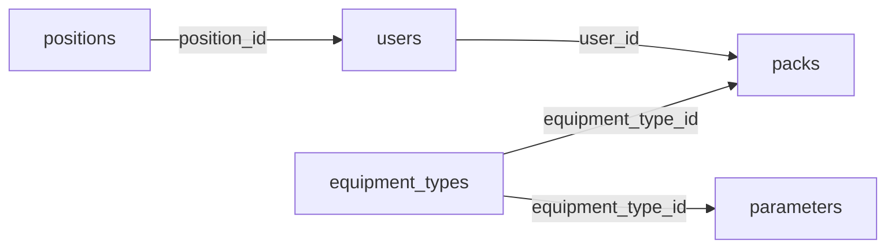

# 5. Тестовые данные и JOIN всех таблиц

Финальный технический урок. Наполняем таблицы данными и пишем `SELECT`, который
объединяет все пять таблиц — это результат для скриншота.

## Вставка данных и порядок

```sql
INSERT INTO positions (id, name) VALUES
    (1, 'Оператор'),
    (2, 'Механик'),
    (3, 'Инженер');
```

Столбцы перечисляем явно: так `INSERT` не сломается при изменении структуры.

Данные вставляем в том же порядке, что и создание таблиц — родители первыми:

```text
positions → equipment_types → users → parameters → packs
```

!!! warning "Ошибка"
    Вставить `packs` раньше `users`. Внешний ключ не найдёт пользователя с таким
    `user_id` и отклонит вставку.

## Даты в ANSI-92

```sql
INSERT INTO packs (id, user_id, equipment_type_id, created_on, quantity) VALUES
    (1, 1, 1, DATE '2026-09-01', 10);
```

`DATE '2026-09-01'` — литерал даты по стандарту. Многие СУБД принимают и просто
`'2026-09-01'`, но стандартная форма переносима.

## Два синтаксиса JOIN

В уроке ты писал объединение через запятую и `WHERE`:

```sql
SELECT *
FROM solders, ranks
WHERE solders.rank_id = ranks.id;
```

Это старый синтаксис. ANSI-92 предпочитает явный `JOIN ... ON`:

```sql
SELECT *
FROM users u
JOIN positions p ON u.position_id = p.id;
```

Результат одинаковый, но `JOIN ... ON` отделяет условие связи от фильтра
`WHERE`. Когда таблиц пять, это критично для читаемости.

## JOIN всех пяти таблиц

```sql
SELECT u.id           AS user_id,
       u.full_name,
       p.name         AS position,
       pk.id          AS pack_id,
       pk.created_on,
       pk.quantity,
       et.name        AS equipment_type,
       pr.name        AS parameter,
       pr.unit
FROM users u
JOIN positions p        ON u.position_id = p.id
JOIN packs pk           ON pk.user_id = u.id
JOIN equipment_types et ON pk.equipment_type_id = et.id
JOIN parameters pr      ON pr.equipment_type_id = et.id
ORDER BY u.id, pk.id, pr.id;
```

Разбор:

- `u`, `p`, `pk`, `et`, `pr` — псевдонимы таблиц, чтобы не писать длинные имена;
- каждый `JOIN ... ON` цепляет следующую таблицу по ключу;
- `AS user_id` переименовывает столбец в результате.



## Почему строк может стать больше

!!! warning "Размножение строк"
    `parameters` присоединяется по `equipment_type_id`. Если у типа оборудования
    несколько параметров, каждая пачка такого типа повторится столько раз,
    сколько параметров. Это не ошибка, а следствие связи «один ко многим».
    Проверяй количество строк в результате.

## Скриншот

Запусти `SELECT` из урока, убедись, что вернулись данные из всех таблиц, и сделай
скриншот окна результата. Это пункт 2 домашки.

## Частые ошибки

!!! warning "Ошибка"
    Соединять таблицы по «похожим» столбцам вместо ключей. Связь всегда идёт по
    паре «внешний ключ → первичный ключ».

!!! warning "Ошибка"
    Взять `JOIN` вместо `LEFT JOIN` там, где строки без пары тоже нужны. Здесь
    все пачки имеют пользователя и тип, поэтому обычного `JOIN` достаточно.

## Что дальше

В уроке 6 оформляем работу: ветка, коммит, Pull Request.
