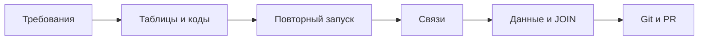

# Домашнее задание: SQL-скрипт для базы оборудования

Курс на 1 час. Разбирает домашку целиком: от стандарта ANSI-92 и уникальных
кодов до JOIN всех таблиц и Pull Request. После него ты сам напишешь скрипт,
который запускается повторно.

## Что требуется в домашке

!!! abstract "Условие"
    1. Скрипт в формате SQL (ANSI 92):
        - таблицы «пачки», «пользователи», «должности», «параметры», «типы оборудования»;
        - тестовые данные;
        - скрипт можно запускать повторно;
        - у каждой таблицы уникальный код, у каждой записи — уникальный код.
    2. `SELECT` с объединением всех таблиц — и скриншот результата.
    3. Pull Request в своём репозитории, задание в отдельной ветке.

## План и тайминг

| # | Урок | Время |
|---|------|-------|
| 1 | [Требования домашки и ANSI-92](01-trebovaniya.md) | 4 мин |
| 2 | [Таблицы и уникальные коды](02-tablicy-klyuchi.md) | 6 мин |
| 3 | [Повторный запуск скрипта](03-povtornyy-zapusk.md) | 5 мин |
| 4 | [Связи таблиц](04-svyazi.md) | 6 мин |
| 5 | [Тестовые данные и JOIN всех таблиц](05-dannye-i-join.md) | 6 мин |
| 6 | [Git-ветка и Pull Request](06-git-pr.md) | 3 мин |
| — | [Практика](practice.md) + [ответы](answers.md) | 30 мин |
| — | [Шпаргалка](cheatsheet.md) | перед сдачей |

Итого: около 60 минут — 30 минут теории и 30 минут практики.

## Карта курса

## Что нужно знать заранее

- Что такое таблица, строка, столбец.
- Команды `CREATE TABLE`, `INSERT`, `SELECT` на уровне примера с `solders`/`ranks`.
- Базовый `WHERE` и `LIKE`.

Если эти темы забылись — вернись к уроку 2 прошлой лекции, потом продолжай.

## Глоссарий

- **DDL** (Data Definition Language) — команды структуры: `CREATE`, `ALTER`, `DROP`.
- **DML** (Data Manipulation Language) — команды данных: `INSERT`, `UPDATE`, `DELETE`.
- **ANSI-92** — стандарт SQL 1992 года, задаёт переносимый между СУБД синтаксис.
- **PRIMARY KEY** — первичный ключ, уникальный код записи в таблице.
- **UNIQUE** — ограничение «значения не повторяются».
- **FOREIGN KEY** — внешний ключ, ссылка на первичный ключ другой таблицы.
- **Идемпотентность** — свойство скрипта давать один и тот же результат при повторном запуске.
- **JOIN** — объединение строк из нескольких таблиц по общему столбцу.
