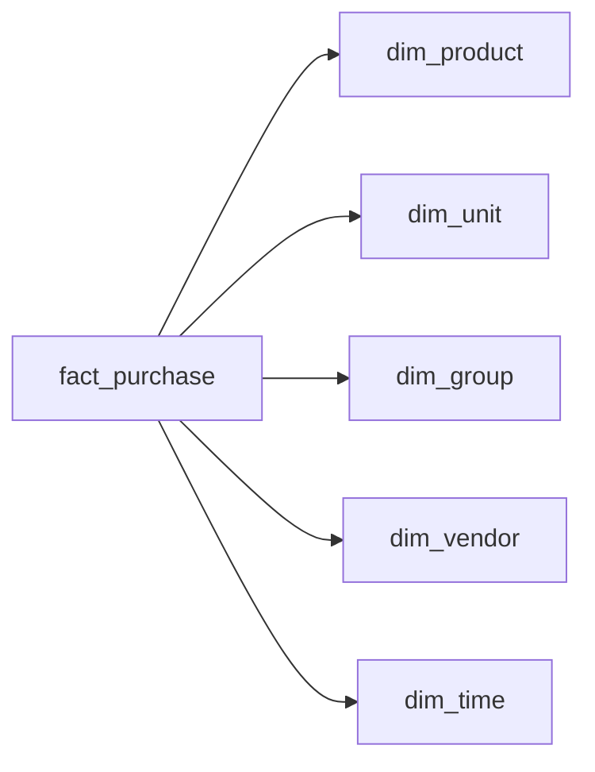

<div class="mission" data-mission="sql-fact-purchase" data-subtopic="sql-fact-purchase" data-title="Факт закупки: таблица и связи" data-review="1,3,7,14,30" data-review-url="../../review/sql/" data-skills="fact-table,dimensional-modeling,plpgsql" data-strict="1" data-hint-default="Сначала попытка. Потом проверка. Решение — после третьей попытки." markdown="1">

<div class="mission-top">
  <span class="mission-kicker">SQL · факт закупки · 3–5 заходов</span>
  <span class="mission-track"><span data-progress></span></span>
  <span class="mission-count" data-count>1 / 7</span>
</div>

<section class="mission-step" data-step="1" markdown="1">

<span class="mission-label">Шаг 1 · жизненный пример · 5 минут</span>

## Одна закупка — это факт, всё остальное — измерения

Ты закупаешь 10 кг муки у поставщика А в ноябре 2026. В отчёте нужна не просто «закупка», а **сколько**, **на какую сумму**, **что**, **у кого** и **когда**.

**Факт** — сама операция закупки: количество, сумма, дата. **Измерения** — справочники, на которые ссылается факт: номенклатура, единица, группа, поставщик, время.

**Артефакт:** рабочая таблица `fact_purchase` + связи с ресурсами, скрипт `fact_purchase.sql`.

<div class="mission-note mission-note--blue">
  <strong>Правило</strong>
  Сначала назови факт и измерения, потом пиши `create table`.
</div>

</section>

<section class="mission-step" data-step="2" markdown="1">

<span class="mission-label">Шаг 2 · теория · 12 минут</span>

## Поля, ключи и связи

Таблица фактов хранит числовые события. Минимальный набор:

| Поле | Смысл | Тип |
|---|---|---|
| `id` | свой ключ | `bigint`, `default nextval(...)` |
| `code` | код операции | `bigint`, `unique` |
| `product_id` | номенклатура | `integer`, FK |
| `unit_id` | единица | `integer`, FK |
| `group_id` | группа | `integer`, FK |
| `vendor_id` | поставщик | `integer`, FK |
| `quantity` | количество | `numeric(12,3)`, `>= 0` |
| `amount` | сумма | `numeric(14,2)`, `>= 0` |
| `date_add` | дата вставки | `date`, `default current_date` |
| `time_id` | временной отрезок | `integer`, FK |

### Схема



### По шагам

1. Создай `sequence` для своего `id`.
2. Создай таблицу с полями и `primary key`.
3. Добавь `references` на измерения.
4. Добавь `check` на количество и сумму.
5. Добавь `comment on` для таблицы и ключевых полей.

### Типичные ошибки

- `id` без `sequence` или `primary key`.
- `insert` без списка колонок.
- `delete` без `where`.
- `on conflict` вместо явной проверки.
- Цикл вместо `select`/CTE.
- `create table` вне `do $$`.

<div class="mission-note mission-note--red">
  <strong>Стиль Воловикова</strong>
  Всё DDL/DML — в `do $$` с вложенными `begin … end; commit;`. У каждой таблицы свой `id` + sequence. `comment on` — коротко и по делу.
</div>

### Как проверить себя

- Назови факт и каждое измерение.
- Объясни, зачем `id` и `code` — разные вещи.
- Проверь, что FK ссылается на существующий справочник.

</section>

<section class="mission-step" data-step="3" data-require-check markdown="1">

<span class="mission-label">Шаг 3 · диагностика · 8 минут</span>

## Проверь модель

Нужно **80%**. Если меньше — вернись к таблице полей.

```quiz
{
  "title": "Диагностика · факт закупки",
  "min": 80,
  "questions": [
    {"type":"choice","q":"Что в таблице фактов является измерением?","options":["Количество","Сумма","Поставщик","Дата вставки"],"answer":2,"explain":"Поставщик — справочник, на который ссылается факт. Количество и сумма — меры."},
    {"type":"truefalse","q":"У факта должен быть свой id и sequence.","answer":true,"explain":"Свой ключ нужен для ссылок и стабильной идентификации строки."},
    {"type":"choice","q":"Что означает references dim_product(id)?","options":["Проверку, что product_id есть в справочнике","Копирование названия продукта","Сортировку по продукту","Запрет на null"],"answer":0,"explain":"FK проверяет, что код номенклатуры существует в dim_product."},
    {"type":"truefalse","q":"insert into fact_purchase values (...) допустим по стилю курса.","answer":false,"explain":"Нужен список колонок: insert into t (колонки) values (...)."},
    {"type":"choice","q":"Где должно быть DDL по стилю Воловикова?","options":["В обычном begin; ... commit;","Внутри do $$ с вложенными begin … end; commit;","В одном select","В комментарии"],"answer":1,"explain":"Стиль курса — do $$ с вложенными блоками."},
    {"type":"truefalse","q":"delete from fact_purchase без where — безопасная очистка.","answer":false,"explain":"Без where удаляются все строки; это ошибка, если не задумано."}
  ]
}
```

</section>

<section class="mission-step" data-step="4" data-require-check data-require-all markdown="1">

<span class="mission-label">Шаг 4 · практика по строкам · 30 минут</span>

## Собери скрипт по кусочкам

Восемь маленьких задач. В каждой — 1–2 строки смысла и один шаг к `fact_purchase.sql`.

### 4.1. Блок и sequence

`do $$` открывает PL/pgSQL-блок, `begin/commit` фиксируют шаги. Sequence — счётчик для `id`.

```sqlplay
-- @seed fact_purchase_dims
-- @mode write
-- @expect {"columns":["id"],"rows":[[1]]}
-- @hint Создай sequence внутри do $$, затем вызови nextval снаружи.
do $$
begin
    begin
        -- твой код: create sequence seq_fact_purchase
    end;
    commit;
end $$;

-- твой код: select nextval('seq_fact_purchase') as id;
```

### 4.2. Таблица

Теперь сама таблица: 9 полей, свой `id`, типы. Sequence уже дана в каркасе.

```sqlplay
-- @seed fact_purchase_dims
-- @mode write
-- @expect {"columns":["cnt"],"rows":[[0]]}
-- @hint Перечисли колонки: id, code, product_id, unit_id, group_id, vendor_id, quantity, amount, date_add, time_id.
do $$
begin
    begin
        create sequence seq_fact_purchase;
        create table fact_purchase (
            -- твой код: колонки и типы
        );
    end;
    commit;
end $$;

-- твой код: select count(*) as cnt from fact_purchase;
```

### 4.3. Primary key

Проверь, что у таблицы есть первичный ключ. В Excel это уникальный номер строки.

```sqlplay
-- @seed fact_purchase_empty
-- @mode write
-- @expect {"columns":["cnt"],"rows":[[1]]}
-- @hint Считай ограничения с contype = 'p' для fact_purchase.
-- твой код: select count(*) as cnt from pg_constraint ...
```

### 4.4. References

Проверь, что пять измерений связаны внешними ключами. Это защита от «товара, которого нет в справочнике».

```sqlplay
-- @seed fact_purchase_empty
-- @mode write
-- @expect {"columns":["cnt"],"rows":[[5]]}
-- @hint Считай contype = 'f' для fact_purchase.
-- твой код: select count(*) as cnt from pg_constraint ...
```

### 4.5. Comment on

Короткое описание таблицы для человека. Одна строка.

```sqlplay
-- @seed fact_purchase_empty
-- @mode write
-- @expect {"columns":["descr"],"rows":[["Факт закупки"]]}
-- @hint comment on table fact_purchase is 'Факт закупки';
do $$
begin
    begin
        -- твой код: comment on table ...
    end;
    commit;
end $$;

-- твой код: select obj_description('fact_purchase'::regclass, 'pg_class') as descr;
```

### 4.6. Insert с колонками

Добавь одну закупку. Колонки перечисляй явно — как в Excel с заголовками.

```sqlplay
-- @seed fact_purchase_empty
-- @mode write
-- @expect {"columns":["cnt"],"rows":[[1]]}
-- @hint insert into fact_purchase (code, product_id, unit_id, group_id, vendor_id, quantity, amount, date_add, time_id) values (...)
do $$
begin
    begin
        -- твой код: insert одной строки
    end;
    commit;
end $$;

-- твой код: select count(*) as cnt from fact_purchase;
```

### 4.7. Select-проверка

Проверь битые ссылки: фактов с продуктом, которого нет в справочнике, быть не должно.

```sqlplay
-- @seed fact_purchase_rows
-- @mode write
-- @expect {"columns":["cnt"],"rows":[[0]]}
-- @hint left join на dim_product и условие p.id is null.
-- твой код: select count(*) as cnt ...
```

### 4.8. Найди ошибку

В insert не хватает обязательных колонок. Почини, чтобы строка вставилась.

```sqlplay
-- @seed fact_purchase_empty
-- @mode fix
-- @expect {"columns":["cnt"],"rows":[[1]]}
-- @hint Добавь недостающие колонки и значения; id/date_add можно не указывать.
do $$
begin
    begin
        insert into fact_purchase (code, product_id) values (1001, 1);
    end;
    commit;
end $$;

-- твой код: select count(*) as cnt from fact_purchase;
```

</section>

<section class="mission-step" data-step="5" data-require-check data-require-all markdown="1">

<span class="mission-label">Шаг 5 · куски задачи · 20 минут</span>

## Перенеси в свою домашку

### 5.1. Карта факта

Выпиши 9 полей из ТЗ и для каждого: мера, измерение или служебное.

### 5.2. Связи

Для каждого измерения назови таблицу-справочник и поле-ключ. Если справочника нет — это блокер, а не «сделаю без FK».

### 5.3. Проверки

Напиши 3 проверки: пустой код, отрицательное количество, ссылка на несуществующий продукт.

</section>

<section class="mission-step" data-step="6" data-require-check markdown="1">

<span class="mission-label">Шаг 6 · половина модуля · 25 минут</span>

## Собери половину

Соедини 4.1 и 4.2: создай таблицу и вставь одну закупку. Затем объясни, какие FK сработают при вставке.

<textarea data-save="sql-fact-purchase-half" rows="6" placeholder="Моё объяснение: таблица, вставка, FK..."></textarea>

</section>

<section class="mission-step" data-step="7" data-require-check markdown="1">

<span class="mission-label">Шаг 7 · полный артефакт и защита · 20 минут</span>

## Что сдать

- [ ] `fact_purchase.sql`: sequence, table, PK, FK, checks, comments.
- [ ] `insert` одной закупки со списком колонок.
- [ ] 3 проверочных `select`: count, сумма по поставщику, битые ссылки.
- [ ] Объяснение каждой строки.

**Защита:** покажи скрипт и ответь, зачем каждое поле и каждая связь.

<textarea data-save="sql-fact-purchase-mistake" rows="4" placeholder="Где я ошибся и как это заметить в следующий раз"></textarea>

<div class="mission-note mission-note--green">
  <strong>Готово, если</strong>
  Скрипт запускается, FK работают, вставка проходит, каждую строку можешь объяснить.
</div>

</section>

<div class="mission-controls">
  <button type="button" class="mission-btn mission-btn--ghost" data-prev>Назад</button>
  <span class="mission-spacer"></span>
  <button type="button" class="mission-btn mission-btn--primary" data-next>Дальше</button>
</div>

<p class="mission-hint" data-hint>Сначала попытка. Потом проверка.</p>

<div class="mission-done" data-complete hidden>
  <strong>Подтема собрана</strong>
  <p>Вернись через 1–3–7 дней и объясни факт и измерения без конспекта.</p>
</div>

</div>
