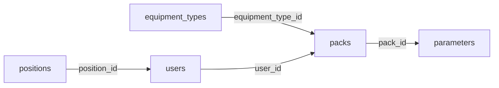

# 4. Переписываем таблицы

Собираем пять таблиц заново: с реальными данными из ТЗ, без связей, но с
уникальными кодами. После урока у тебя будет готовый блок `CREATE TABLE`.

## Модель

Принимаем, что **пачка — это один сеанс измерения**. Внутри пачки лежат
измеренные параметры. Тогда:



Стрелки — логические ссылки. Столбцы есть, но `FOREIGN KEY` не объявляем.

## Пять таблиц

```sql
create table equipment_types (
    id   integer not null,
    name varchar(50) not null,
    constraint pk_equipment_types primary key (id),
    constraint uq_equipment_types_name unique (name)
);

create table positions (
    id   integer not null,
    name varchar(150) not null,
    constraint pk_positions primary key (id),
    constraint uq_positions_name unique (name)
);

create table users (
    id          integer not null,
    full_name   varchar(150) not null,
    position_id integer not null,
    constraint pk_users primary key (id)
);

create table packs (
    id                integer not null,
    user_id           integer not null,
    equipment_type_id integer not null,
    created_on        date not null,
    constraint pk_packs primary key (id)
);

create table parameters (
    id      integer not null,
    pack_id integer not null,
    name    varchar(150) not null,
    unit    varchar(20),
    value   numeric(10,2) not null,
    constraint pk_parameters primary key (id)
);
```

Ключевое отличие от прошлой версии: в `parameters` появился `value`, а `FOREIGN
KEY` нет нигде.

## Порядок создания

Родителей создаём первыми, детей — последними:

```text
equipment_types → positions → users → packs → parameters
```

## Тестовые данные

```sql
insert into equipment_types (id, name) values
    (1, 'ДМК'),
    (2, 'ВР');

insert into positions (id, name) values
    (1, 'Оператор метеопоста'),
    (2, 'Начальник метеопоста'),
    (3, 'Техник');

insert into users (id, full_name, position_id) values
    (1, 'Иванов Иван', 1),
    (2, 'Петров Пётр', 2);

insert into packs (id, user_id, equipment_type_id, created_on) values
    (1, 1, 1, date '2026-09-01'),
    (2, 2, 2, date '2026-09-02');

insert into parameters (id, pack_id, name, unit, value) values
    (1, 1, 'Высота метеопоста', 'м', 100),
    (2, 1, 'Температура воздуха на высоте метеопоста', '°C', 15),
    (3, 1, 'Давление атмосферы на высоте метеопоста', 'мм рт. ст.', 750),
    (4, 1, 'Направление ветра в приземном слое воздуха', 'б. д. у.', 0),
    (5, 1, 'Скорость ветра в приземном слое воздуха', 'м/с', 0),
    (6, 2, 'Высота метеопоста', 'м', 100),
    (7, 2, 'Температура воздуха на высоте метеопоста', '°C', 12),
    (8, 2, 'Давление атмосферы на высоте метеопоста', 'мм рт. ст.', 760),
    (9, 2, 'Направление ветра в приземном слое воздуха', 'б. д. у.', 20),
    (10, 2, 'Дальность сноса пуль', 'м', 45);
```

Пачка 1 — измерения с `ДМК` (есть скорость ветра), пачка 2 — с `ВР` (есть
дальность сноса пуль). Так видны оба типа оборудования.

!!! warning "Ошибка"
    Ссылаться на несуществующий код. Без `FOREIGN KEY` СУБД не остановит, и в
    данных появится «висячая» ссылка. Проверяй руками: `pack_id` есть в `packs`,
    `user_id` — в `users` и так далее.

## Что дальше

В уроке 5 объединяем все пять таблиц одним `SELECT`.
