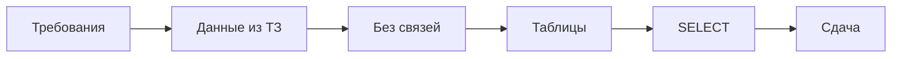

# Исправляем домашку под ТЗ (ДМК/ВР)

Курс на 30 минут. Разбирает замечания преподавателя и переделывает скрипт под
реальное техническое задание: типы оборудования `ДМК`/`ВР`, параметры со
значениями, без связей между таблицами.

## Что сказал преподаватель

!!! abstract "Замечания"
    1. Запрос верен, но **где значения параметров**? В таблице только наименование.
    2. **Связи мы пока не делаем.** Это лишнее.
    3. Типы оборудования и параметры уже **определены в ТЗ** — брать оттуда.

## План и тайминг

| # | Урок | Время |
|---|------|-------|
| 1 | [Требования и замечания](01-trebovaniya.md) | 3 мин |
| 2 | [Реальные данные из ТЗ](02-dannye-tz.md) | 4 мин |
| 3 | [Убираем связи](03-bez-svyazey.md) | 3 мин |
| 4 | [Переписываем таблицы](04-tablicy.md) | 4 мин |
| 5 | [SELECT с объединением](05-select.md) | 3 мин |
| 6 | [Сдача: .sql, скриншот, PR](06-sdacha.md) | 2 мин |
| — | [Практика](practice.md) + [ответы](answers.md) | 11 мин |

Итого около 30 минут: 19 минут теории и 11 минут практики.

## Карта курса

## Что нужно знать заранее

- `CREATE TABLE`, `INSERT`, `SELECT` из базового курса.
- Что такое первичный ключ (`PRIMARY KEY`).
- Что такое `JOIN ... ON`.

Если это забылось — сначала пройди [базовый подкурс](../domashka/index.md).

## Глоссарий

- **ТЗ** — техническое задание, документ `_Docs/Artillery/TechnicalTask.md`.
- **ДМК** — десантный метеокомплект, тип оборудования.
- **ВР** — ветровое ружьё, тип оборудования.
- **Пачка** — один сеанс измерения (набор измеренных параметров).
- **Параметр** — измеряемая величина: высота, температура, давление и т. д.
- **PRIMARY KEY** — уникальный код записи.
- **FOREIGN KEY** — внешний ключ, объявленная связь между таблицами.
