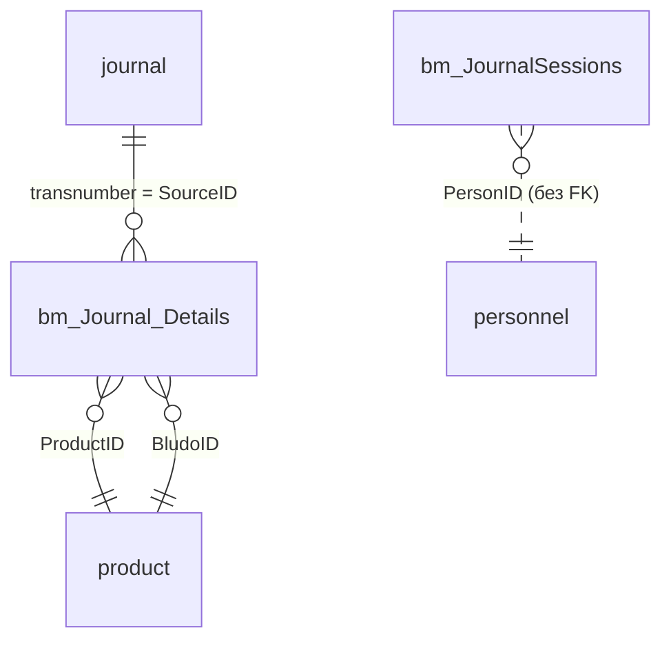

<div class="mission" data-mission="sql-front-razvedka" data-subtopic="sql-front-razvedka" data-format="hw-pieces" data-title="Front: разведка базы MSSQL" data-homework="Анализ структуры Front · Воловиков · до 15.11.2026 23:59 · замечания до 16.11.2026 23:59" data-new="db_name,cast,count(distinct),top" data-review="1,3,7,14,30" data-review-url="../../review/sql/" data-skills="mssql-basics,t-sql,metadata,relationships,er-mermaid" data-strict="1" data-tutor="off" data-hint-default="Сначала запусти пример. Потом допиши у себя." markdown="1">

<div class="mission-top">
  <span class="mission-kicker">SQL · Front на MSSQL · по шагам</span>
  <span class="mission-track"><span data-progress></span></span>
  <span class="mission-count" data-count>1 / 6</span>
</div>

<section class="mission-step" data-step="1" data-kind="map" markdown="1">

<span class="mission-label">Шаг 1 · что нужно сделать · 5 минут</span>

## Если совсем коротко

Тебе дали **чужую базу ресторана `Front`**. Надо не программировать, а **прочитать базу и написать отчёт** по пяти темам.

| Что сделать | Что получится |
|---|---|
| 1. Найти таблицы по пяти темам | 5 SQL-файлов |
| 2. Описать таблицы: колонка, назначение, пример | `README.md` |
| 3. Нарисовать 5 схем связей | 5 PNG-картинок |
| 4. Сделать скриншоты результатов запросов | 5 PNG-скриншотов |
| 5. Сложить всё в папку и открыть PR | ссылка на PR в Forlabs |

**Пять тем:**

| Тема | Где искать | Фильтр |
|---|---|---|
| Закупка | `bm_JournalBarnetDocs`, `bm_StorageOperations` | `DocumentTypeID = 4`, `OperationID = 1` |
| Продажа | `journal` | `transtype = 101` |
| Поставщики | `vendors` | `clientgroup = 31` |
| Персонал | `personnel`, `bm_JournalSessions` | `PersonID` |
| Остатки | `bm_StorageOperations`, `bm_StorageOperationsType` | `OperationID = 1 / 2` |

## Что это за база

`Front` — старая касса ресторана на MS SQL Server. В ней 243 таблицы, но **122 пустые**. Тебе не нужно знать все. Достаточно пяти групп:

- **продажи** — `journal` (строки чеков), `bm_Journal_Details` (детали), `bm_JournalSessions` (кто работал);
- **закупки и склад** — `bm_JournalBarnetDocs` (документы), `bm_StorageOperations` (движения), `bm_StorageOperationsType` (типы);
- **поставщики** — `vendors`, `vendorgroup`, `bm_Contracts`, `bm_Companies`;
- **персонал** — `personnel`, `bm_PersonnelSecurity`, `bm_JournalSessions`;
- **товары и цены** — `product`, `pricelist`, `pricegroup`, `recipe`.

Главная ловушка: в `bm_StorageOperations` колонки `Quantity` и `Rest` заполнены нулями, а реальное количество — в `Count`. В `product.onhand` вообще `NULL`. Это надо честно написать в отчёте, а не выдумывать числа.

## Что сдать

В `My_work_db_place/_Infra/scripts/home_work_nine/`:

```text
home_work_nine/
  README.md
  sql/
    01_zakupka.sql
    02_prodazha.sql
    03_postavshchiki.sql
    04_personal.sql
    05_ostatki.sql
  img/
    er_zakupka.png
    er_prodazha.png
    er_postavshchiki.png
    er_personal.png
    er_ostatki.png
    res_zakupka.png
    res_prodazha.png
    res_postavshchiki.png
    res_personal.png
    res_ostatki.png
```

В PR — **только эта папка**. Ни `docker-compose.yaml`, ни `restore.sql`, ни `.env`, ни файлы курса.

## План на час

| Шаг | Что делаем | Время |
|---|---|---|
| 2 | Создаём 5 SQL-файлов. Код уже написан, его надо запустить и сохранить | 25 мин |
| 3 | Собираем `README.md` по шаблону | 10 мин |
| 4 | Делаем 5 ER-картинок из готовых Mermaid-схем | 10 мин |
| 5 | Скриншоты, папка, PR | 10 мин |
| 6 | Проверяем, что можешь объяснить | 5 мин |

## Проверь подключение

Открой **New Query с узла `Front`** и запусти:

```mssqllocal
-- @mode run
-- @expect {"columns":["db"],"rows":[["Front"]]}
-- @hint Если вышло master — нажми на базу внизу и выбери Front.
select db_name() as db;
```

<div class="mission-note mission-note--yellow" markdown="1">
<strong>Правила, чтобы не придрался учитель</strong>

- только `select`, ничего не меняем в базе;
- без `select *` в отчётах;
- в PR только `home_work_nine/`;
- не добавляй ABC-анализ и лишние таблицы — в этом ДЗ их нет;
- код простой: `select`, `join`, `group by`, `top`, `cast`;
- каждый запрос должен уметь объяснить своими словами.
</div>

</section>

<section class="mission-step" data-step="2" data-kind="piece" data-require-check data-require-all markdown="1">

<span class="mission-label">Кусок 1 · пять SQL-файлов · 25 минут</span>

## Создай папку и пять файлов

<div class="mission-note mission-note--yellow piece-why" markdown="1">
<strong>Зачем</strong>

ДЗ, п. 1 и п. 4: по каждому направлению нужны таблицы и запрос-доказательство. Пять файлов — это и есть доказательства.
</div>

Создай папку `_Infra/scripts/home_work_nine/sql/` и пять файлов. Код ниже можно копировать: он короткий и без сложных конструкций. В каждом файле первая строка `use Front;` — чтобы запрос точно шёл в нужную базу.

### `01_zakupka.sql`

```sql
use Front;

-- сколько документов закупки и за какой период
select count(*) as documents,
	cast(min(Period) as date) as first_day,
	cast(max(Period) as date) as last_day
from bm_JournalBarnetDocs
where DocumentTypeID = 4;

-- сколько поступлений, товара и на какую сумму
select count(*) as operations,
	sum(Count) as quantity,
	sum(Amount) as amount,
	cast(min(DateAdd) as date) as first_day,
	cast(max(DateAdd) as date) as last_day
from bm_StorageOperations
where OperationID = 1;

-- топ-5 поставщиков по сумме поступления
select top 5
	coalesce(v.firstname, v.lastname) as supplier,
	count(*) as operations,
	sum(o.Count) as quantity,
	sum(o.Amount) as amount
from bm_StorageOperations o
join vendors v on v.id = o.VendorID
where o.OperationID = 1
group by coalesce(v.firstname, v.lastname)
order by amount desc;
```

`DocumentTypeID = 4` — «Поступление продуктов». `OperationID = 1` — «Поступление» на складе. `Count` — количество.

### `02_prodazha.sql`

```sql
use Front;

-- сколько строк продаж, сколько чеков и за какой период
select count(*) as lines,
	count(distinct receiptn) as receipts,
	cast(min(dater) as date) as first_day,
	cast(max(dater) as date) as last_day
from journal
where transtype = 101;

-- общее количество и сумма продаж
select sum(quantity) as quantity,
	sum(amount) as amount
from journal
where transtype = 101;

-- топ-5 товаров по сумме
select top 5
	description as product,
	sum(quantity) as quantity,
	sum(amount) as amount
from journal
where transtype = 101
group by description
order by amount desc;
```

`transtype = 101` — продажа. `receiptn` — номер чека, поэтому `count(distinct receiptn)` считает чеки, а `count(*)` — строки.

### `03_postavshchiki.sql`

```sql
use Front;

-- сколько поставщиков
select count(*) as suppliers
from vendors
where clientgroup = 31;

-- договоры и организации
select count(*) as contracts from bm_Contracts;
select count(*) as companies from bm_Companies;

-- топ-5 поставщиков по числу поступлений
select top 5
	coalesce(v.firstname, v.lastname) as supplier,
	count(*) as operations,
	sum(o.Amount) as amount
from bm_StorageOperations o
join vendors v on v.id = o.VendorID
where o.OperationID = 1
group by coalesce(v.firstname, v.lastname)
order by operations desc;
```

`clientgroup = 31` — группа «Поставщики». `bm_Contracts` пустая (0 строк), `bm_Companies` — 1 строка. Так и напиши в README.

### `04_personal.sql`

```sql
use Front;

-- сколько сотрудников
select count(*) as personnel
from personnel;

-- сессии: сколько, у скольких сотрудников и за какой период
select count(*) as sessions,
	count(distinct PersonID) as employees,
	cast(min(DateAdd) as date) as first_day,
	cast(max(DateAdd) as date) as last_day
from bm_JournalSessions;

-- топ-5 сотрудников по числу сессий
select top 5
	p.personid,
	coalesce(p.lastname, '') + ' ' + coalesce(p.firstname, '') as person,
	count(*) as sessions
from bm_JournalSessions s
join personnel p on p.personid = s.PersonID
group by p.personid, p.lastname, p.firstname
order by sessions desc;
```

`bm_WorkHours` пустая — часы по ней не считаем. Активность берём из `bm_JournalSessions`.

### `05_ostatki.sql`

```sql
use Front;

-- операции склада по типам
select t.Description as operation,
	count(*) as operations,
	sum(o.Count) as quantity,
	sum(o.Amount) as amount
from bm_StorageOperations o
join bm_StorageOperationsType t on t.ID = o.OperationID
group by t.Description
order by operations desc;

-- топ-5 товаров по движению
select top 5
	p.productid,
	p.description,
	sum(o.Count) as quantity
from bm_StorageOperations o
join product p on p.id = o.ProductID
group by p.productid, p.description
order by quantity desc;

-- периоды остатков
select count(*) as periods,
	cast(min(datebeginperiod) as date) as first_day,
	cast(max(datebeginperiod) as date) as last_day
from stockperiod;
```

`Quantity` и `Rest` — нули, `product.onhand` — `NULL`. Поэтому остатки считаем по движениям `Count`. Это важный вывод для README.

### Проверка: закупка

Запусти у себя и вставь результат. Должно быть 3 175 документов.

```mssqllocal
-- @mode run
-- @expect {"columns":["documents","first_day","last_day"],"rows":[[3175,"2020-10-26","2023-12-02"]]}
-- @hint DocumentTypeID = 4; cast(Period as date) убирает время.
select count(*) as documents,
	cast(min(Period) as date) as first_day,
	cast(max(Period) as date) as last_day
from bm_JournalBarnetDocs
where DocumentTypeID = 4;
```

### Задача: сумма продаж

Допиши одну строку — сумму продаж. Должно получиться `178336.5` и `42306984.17`.

```mssqllocal
-- @mode write
-- @id sales-amount
-- @expect {"columns":["quantity","amount"],"rows":[[178336.5,42306984.17]]}
-- @hint sum(quantity), sum(amount), where transtype = 101.
select sum(quantity) as quantity,
	-- твой код: sum(amount) as amount
from journal
-- твой код: where transtype = 101
```

<div class="mission-note mission-note--green piece-hw" markdown="1">
<strong>Кусок ДЗ</strong>

Создай пять файлов и вставь в них код выше. Запусти каждый файл целиком. Если ошибок нет — переходи к README. Скриншоты сделаешь на шаге 5.
</div>

</section>

<section class="mission-step" data-step="3" data-kind="piece" data-require-check data-require-all markdown="1">

<span class="mission-label">Кусок 2 · README · 10 минут</span>

## Опиши таблицы по шаблону

<div class="mission-note mission-note--yellow piece-why" markdown="1">
<strong>Зачем</strong>

ДЗ, п. 2: «для каждой таблицы колонку, назначение и пример данных». Не надо описывать все колонки — по одной ключевой на каждую таблицу из твоего списка.
</div>

### Откуда брать колонки

```mssqllocal
-- @mode run
-- @expect {"columns":["column_name","data_type"],"rows":[["ID","bigint"],["DocumentID","bigint"],["OperationID","bigint"],["SourceID","bigint"],["BludoID","bigint"]]}
-- @hint information_schema.columns; фильтр по dbo и имени таблицы.
select top 5 column_name, data_type
from information_schema.columns
where table_schema = 'dbo' and table_name = 'bm_StorageOperations'
order by ordinal_position;
```

### Задача: три примера данных

```mssqllocal
-- @mode write
-- @id readme-example
-- @expect {"columns":["ID","DocumentID","OperationID","ProductID","Count","Amount"],"rows":[[4780421,388235,1,4368,2.764,892.77],[4780422,388236,1,4619,9,1809],[4780433,388238,1,4365,10,2420]]}
-- @hint top 3, order by ID; where OperationID = 1.
select top 3 ID, DocumentID, OperationID, ProductID, Count, Amount
from bm_StorageOperations
-- твой код: where OperationID = 1
-- твой код: order by ID
```

### Шаблон README

Скопируй структуру и заполни по каждому направлению:

```md
# Анализ базы Front

## 1. Закупка продукции

Основные таблицы: ...
Связанные таблицы: ...

| Таблица | Колонка | Назначение | Пример |
|---|---|---|---|
| bm_JournalBarnetDocs | DocumentTypeID | тип документа, 4 — поступление | 4 |
| bm_StorageOperations | OperationID | тип операции, 1 — поступление | 1 |
| ... | ... | ... | ... |

Проверка: sql/01_zakupka.sql, img/res_zakupka.png.
ER: img/er_zakupka.png.
```

Повтори для продажи, поставщиков, персонала и остатков. В каждом разделе — 5–9 строк таблицы, не больше. Полный готовый README лежит в [полном коде](reference.md) — сверься с ним, но не копируй слепо.

<div class="mission-note mission-note--green piece-hw" markdown="1">
<strong>Кусок ДЗ</strong>

Создай `README.md` и заполни пять разделов. В каждом обязательно:
- основные таблицы;
- связанные таблицы;
- по одной ключевой колонке на каждую таблицу: назначение и пример;
- ссылки на SQL и PNG.
</div>

</section>

<section class="mission-step" data-step="4" data-kind="piece" data-require-check data-require-all markdown="1">

<span class="mission-label">Кусок 3 · пять ER-картинок · 10 минут</span>

## Скопируй Mermaid и сохрани PNG

<div class="mission-note mission-note--yellow piece-why" markdown="1">
<strong>Зачем</strong>

ДЗ, п. 3: пять ER-диаграмм картинками в PR. Рисовать вручную долго, Mermaid делает картинку из текста.
</div>

### Пример: продажа



- `||--o{` — один ко многим, **есть FK**;
- `}o..||` — связь **без FK**;
- в ER только ключи и 1–2 важные колонки.

### Почему «один ко многим» — правда

```mssqllocal
-- @mode run
-- @expect {"columns":["lines","receipts"],"rows":[[119367,43043]]}
-- @hint count(*) — строки, count(distinct receiptn) — чеки.
select count(*) as lines,
	count(distinct receiptn) as receipts
from journal
where transtype = 101;
```

### Задача: самый большой чек

```mssqllocal
-- @mode write
-- @id er-lines-per-receipt
-- @expect {"columns":["receiptn","lines"],"rows":[[10130528,36],[42000532,21],[13004165,20],[42000412,20],[11563390,19]],"ordered":true}
-- @hint group by receiptn; order by lines desc; top 5.
select top 5 receiptn, count(*) as lines
from journal
-- твой код: where transtype = 101
-- твой код: group by receiptn order by lines desc
```

### Как получить пять PNG

1. Открой [mermaid.live](https://mermaid.live).
2. Вставь схему из [полного кода](reference.md) — там все пять.
3. Нажми **Actions → PNG**.
4. Сохрани в `img/`:
   - `er_zakupka.png`
   - `er_prodazha.png`
   - `er_postavshchiki.png`
   - `er_personal.png`
   - `er_ostatki.png`

<div class="mission-note mission-note--green piece-hw" markdown="1">
<strong>Кусок ДЗ</strong>

Сделай пять PNG и вставь их в README в нужные разделы. В PR — именно PNG, не ссылка на mermaid.live.
</div>

</section>

<section class="mission-step" data-step="5" data-kind="assemble" data-require-check markdown="1">

<span class="mission-label">Сборка · скриншоты и PR · 10 минут</span>

## Скриншоты результатов

По каждому направлению:

1. Открой SQL-файл в VS Code.
2. Запусти **Ctrl+Shift+E**.
3. Внизу открой **Query Results**.
4. Выдели таблицу, `Shift+PrtSc`.
5. Сохрани в `img/res_zakupka.png`, `res_prodazha.png` и так далее.

## Сложи папку

```text
home_work_nine/
  README.md
  sql/01_zakupka.sql ... 05_ostatki.sql
  img/er_*.png, res_*.png
```

Проверь, что в README пять разделов и в каждом есть ссылки на SQL и картинки.

## Полный код для сверки

Открой [полный код](reference.md). Там готовые README, пять SQL-файлов и пять Mermaid-схем. Сверь свои файлы с эталоном. Если что-то не сходится — исправь у себя, но сначала пойми, что именно не сходится.

## Ветка и PR

```bash
cd ~/Documents/DB/My_work_db_place

# если PR #8 с прошлой домашкой ещё открыт — сначала влей его
git switch main
git pull
git switch -c homework_nine

# скопируй папку home_work_nine в _Infra/scripts/
git add _Infra/scripts/home_work_nine
git commit -m "added home work nine"
git push -u origin homework_nine
```

Открой PR из `homework_nine` в `main`. В описании PR прикрепи 5 ER и 5 скриншотов результатов. Ссылку на PR вставь в Forlabs до **15.11.2026 23:59**.

<div class="mission-note mission-note--red" markdown="1">
<strong>Что не должно попасть в PR</strong>

`docker-compose.yaml`, `.gitignore`, `restore.sql`, `.env`, `mssql-data`, `backup`, `classwork`, `prompt.md`, файлы курса.
</div>

<ul class="mission-checklist">
  <li><input type="checkbox" data-save="pr-sql"> 5 SQL-файлов, все запускаются без ошибок.</li>
  <li><input type="checkbox" data-save="pr-readme"> README: 5 разделов, таблицы, ссылки.</li>
  <li><input type="checkbox" data-save="pr-er"> 5 ER в PNG.</li>
  <li><input type="checkbox" data-save="pr-res"> 5 скриншотов результатов.</li>
  <li><input type="checkbox" data-save="pr-files"> В PR только home_work_nine.</li>
  <li><input type="checkbox" data-save="pr-explain"> Могу объяснить каждый запрос.</li>
</ul>

</section>

<section class="mission-step" data-step="6" data-kind="defend" data-require-check markdown="1">

<span class="mission-label">Защита · 5 минут</span>

## Проверь, что понимаешь

<textarea class="mission-textarea" data-save="defend-1" placeholder="Почему в закупке DocumentTypeID = 4 и OperationID = 1?"></textarea>
<textarea class="mission-textarea" data-save="defend-2" placeholder="Почему считаешь Count, а не Quantity?"></textarea>
<textarea class="mission-textarea" data-save="defend-3" placeholder="Чем count(*) отличается от count(distinct receiptn)?"></textarea>
<textarea class="mission-textarea" data-save="defend-4" placeholder="Почему bm_Contracts пустая и что это значит?"></textarea>
<textarea class="mission-textarea" data-save="defend-5" placeholder="Почему product.onhand не подходит для остатков?"></textarea>

```quiz
{
  "title": "Защита · Front",
  "min": 80,
  "questions": [
    {"type":"choice","q":"Что нужно сдать в этом ДЗ?","options":["5 SQL-файлов, README, 5 ER и скриншоты","Только один SQL-скрипт","Только ER-диаграммы","Только README"],"answer":0,"explain":"ДЗ состоит из четырёх пунктов: таблицы, описание, ER, запросы со скриншотами."},
    {"type":"choice","q":"Запрос вернул 0 строк из таблицы, которая в дереве Front есть. Первое, что проверить?","options":["В какой базе выполняется запрос: select db_name()","Переподключить Docker","Удалить и восстановить Front","Добавить top 1000"],"answer":0,"explain":"По умолчанию подключение идёт в master. Запрос не туда — самая частая причина «пусто»."},
    {"type":"choice","q":"Почему для закупки DocumentTypeID = 4?","options":["Это тип «Поступление продуктов»","Это тип «Списание»","Это номер склада","Это код поставщика"],"answer":0,"explain":"Типы документов лежат в bm_JournalTypeDocuments: 4 — поступление, 5 — списание."},
    {"type":"choice","q":"Что показывает count(distinct receiptn)?","options":["Сколько разных чеков","Сколько строк в чеке","Сумму продаж","Количество товаров"],"answer":0,"explain":"count(*) считает строки, count(distinct receiptn) — уникальные номера чеков."},
    {"type":"truefalse","q":"Если в таблице есть колонка onhand, по ней всегда можно посчитать остаток.","answer":false,"explain":"В Front product.onhand — NULL у всех. Остаток анализируют по движениям bm_StorageOperations.Count."},
    {"type":"choice","q":"Почему bm_Contracts не даёт много данных?","options":["В ней 0 строк","В ней только поставщики","В ней только товары","Она не в dbo"],"answer":0,"explain":"Таблица есть, но пустая. Это надо честно написать в README."},
    {"type":"choice","q":"Что из этого НЕ кладём в PR?","options":["docker-compose.yaml и restore.sql","README.md","img/er_*.png","sql/*.sql"],"answer":0,"explain":"Это подготовка из ТЗ, а не ДЗ. В PR — только home_work_nine."}
  ]
}
```

<textarea class="mission-textarea" data-save="error" placeholder="Что сегодня было неочевидно? Коротко."></textarea>

</section>

<div class="mission-controls">
  <button type="button" class="mission-btn mission-btn--ghost" data-prev>Назад</button>
  <span class="mission-spacer"></span>
  <button type="button" class="mission-btn mission-btn--primary" data-next>Дальше</button>
</div>

<p class="mission-hint" data-hint>Сначала пример. Потом допиши у себя.</p>

<div class="mission-done" data-complete hidden>
  <strong>Разведка закончена</strong>
  <p>Пять SQL, README, пять ER, скриншоты и PR — всё в home_work_nine.</p>
  <div class="mission-card__actions">
    <a class="button button--primary" href="reference/">Полный код для сверки</a>
    <a class="button" href="../">Все SQL-заходы</a>
  </div>
</div>

</div>
