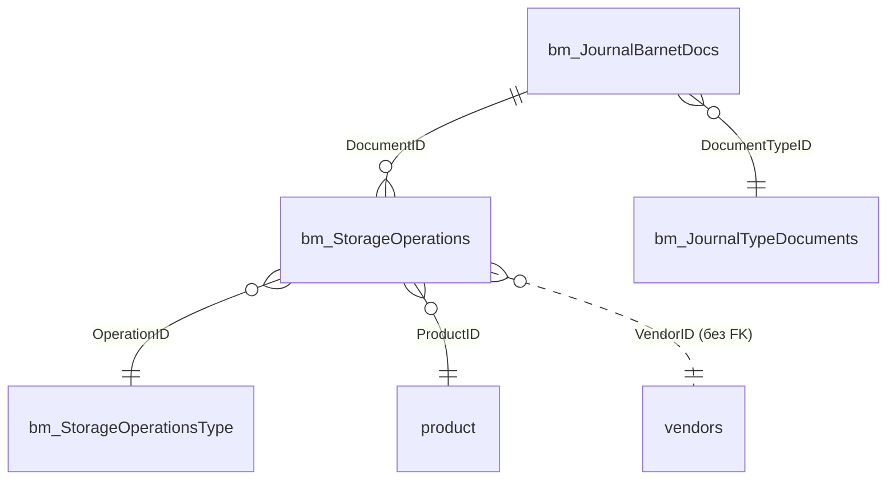
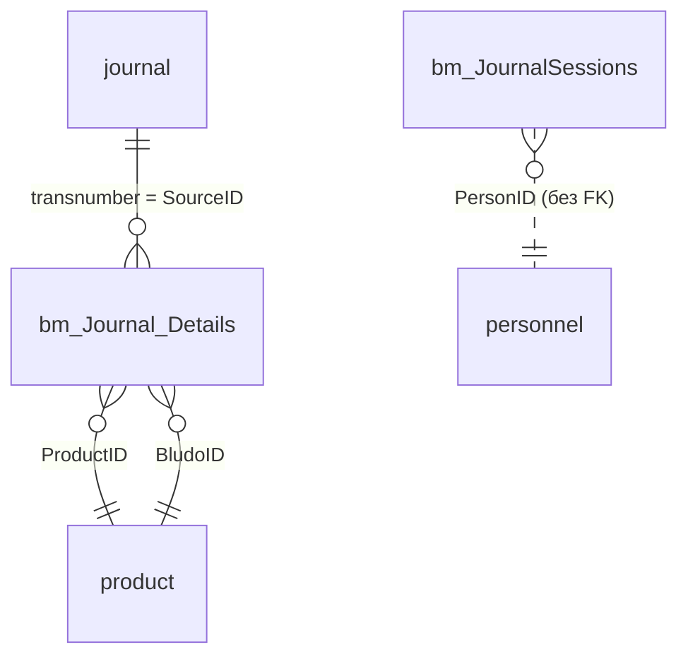
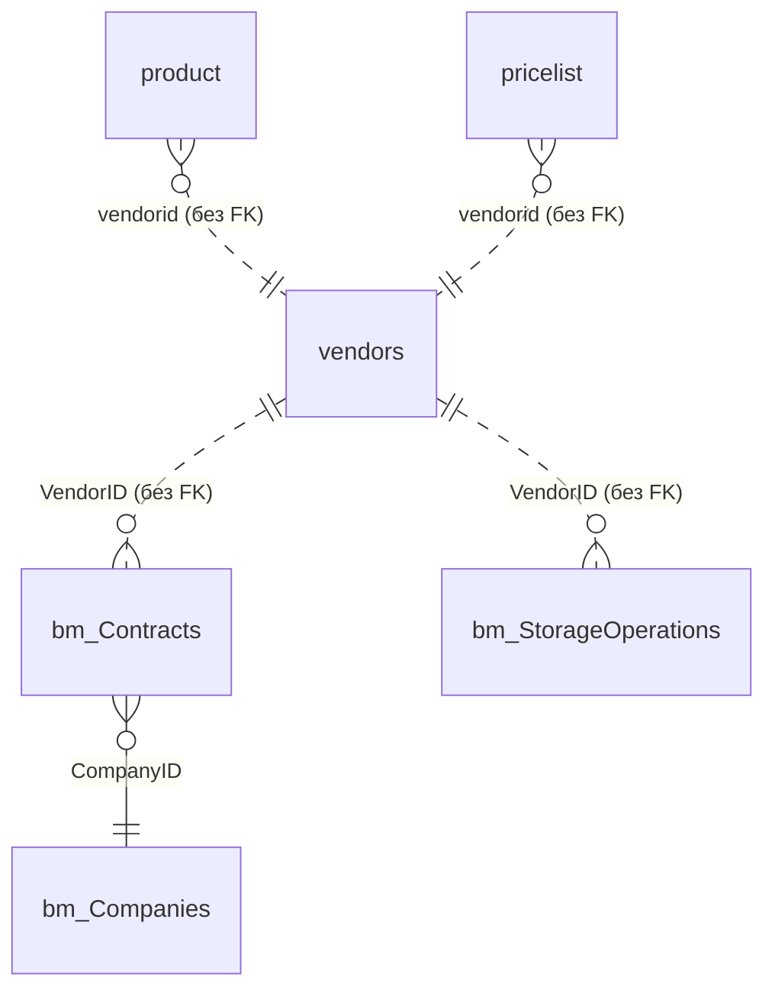
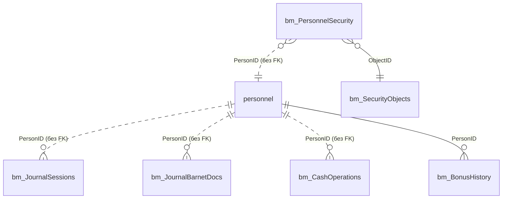
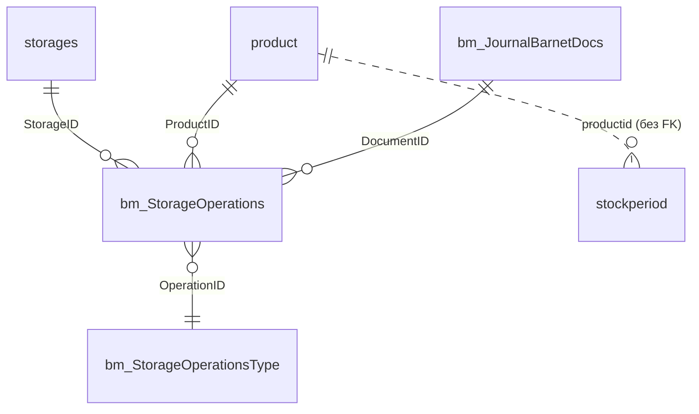

# Front: полный код для сверки

!!! warning "Сначала своя попытка"
    Это эталон для сверки, а не файл для копирования в PR. Учитель спрашивает,
    что делает каждая строка. Если не можешь объяснить — переделай проще.

## Что сдать

```text
_Infra/scripts/home_work_nine/
  README.md
  sql/
    01_zakupka.sql
    02_prodazha.sql
    03_postavshchiki.sql
    04_personal.sql
    05_ostatki.sql
  img/
    er_zakupka.png
    er_prodazha.png
    er_postavshchiki.png
    er_personal.png
    er_ostatki.png
    res_zakupka.png
    res_prodazha.png
    res_postavshchiki.png
    res_personal.png
    res_ostatki.png
```

`docker-compose.yaml`, `.gitignore`, `restore.sql`, `.env`, `mssql-data`, `backup`, файлы курса в PR **не** кладём.

---

## README.md

```md
# Анализ базы Front

База: `Front`, MS SQL Server, схема `dbo`.
243 таблицы, 39 представлений, 73 внешних ключа. 122 таблицы пустые.

## 1. Закупка продукции

Основные: `bm_JournalBarnetDocs`, `bm_StorageOperations`, `bm_StorageOperationsType`, `bm_JournalTypeDocuments`.
Связанные: `product`, `vendors`, `pricelist`, `bm_Contracts`, `bm_Companies`.

| Таблица | Колонка | Назначение | Пример |
|---|---|---|---|
| bm_JournalBarnetDocs | DocumentTypeID | тип документа, 4 — поступление | 4 |
| bm_StorageOperations | OperationID | тип операции, 1 — поступление | 1 |
| bm_StorageOperationsType | Description | название операции | Поступление |
| bm_JournalTypeDocuments | Description | тип документа | Поступление продуктов |
| product | description | товар | Грудинка (Бекон) |
| vendors | firstname | поставщик | ИП Габур |
| pricelist | productid | товар в прайсе | 4377 |
| bm_Contracts | VendorID | поставщик по договору | нет строк |
| bm_Companies | CompanyName | организация | ИП Лукьянова Анастасия Игоревна |

Проверка: `sql/01_zakupka.sql`, `img/res_zakupka.png`. ER: `img/er_zakupka.png`.

## 2. Продажа товара

Основные: `journal`, `bm_Journal_Details`, `bm_JournalSessions`.
Связанные: `product`, `pricelist`, `recipe`, `clients`, `transtype`.

| Таблица | Колонка | Назначение | Пример |
|---|---|---|---|
| journal | transtype | тип строки, 101 — продажа | 101 |
| bm_Journal_Details | SourceID | ссылка на journal.transnumber | 1950990 |
| bm_JournalSessions | PersonID | сотрудник | 897 |
| product | id | код товара | 4368 |
| pricelist | productid | товар в прайсе | 4377 |
| recipe | recipeid | блюдо | 4420 |
| clients | id | код клиента | 109 |
| transtype | description | тип операции | PLU Sales |

Проверка: `sql/02_prodazha.sql`, `img/res_prodazha.png`. ER: `img/er_prodazha.png`.

## 3. Поставщики

Основные: `vendors`, `vendorgroup`, `bm_Contracts`, `bm_Companies`.
Связанные: `bm_StorageOperations`, `bm_CashOperations`, `pricelist`, `product`.

| Таблица | Колонка | Назначение | Пример |
|---|---|---|---|
| vendors | clientgroup | группа, 31 — поставщики | 31 |
| vendorgroup | description | название группы | Поставщики |
| bm_Contracts | VendorID | поставщик по договору | нет строк |
| bm_Companies | CompanyName | организация | ИП Лукьянова Анастасия Игоревна |
| bm_StorageOperations | VendorID | поставщик в операции | 200 |
| bm_CashOperations | VendorID | поставщик в кассе | нет строк |
| pricelist | vendorid | поставщик в цене | NULL |
| product | vendorid | поставщик товара | 0 |

В `bm_Contracts` 0 строк, в `bm_Companies` — 1. Это данные, а не ошибка.
Проверка: `sql/03_postavshchiki.sql`, `img/res_postavshchiki.png`. ER: `img/er_postavshchiki.png`.

## 4. Работа персонала

Основные: `personnel`, `bm_JournalSessions`, `bm_PersonnelSecurity`, `bm_WorkHours`.
Связанные: `bm_SecurityObjects`, `bm_SecurityObjects_Info`, `bm_JournalBarnetDocs`, `bm_CashOperations`, `bm_BonusHistory`.

| Таблица | Колонка | Назначение | Пример |
|---|---|---|---|
| personnel | personid | код сотрудника | 897 |
| bm_JournalSessions | PersonID | сотрудник | 897 |
| bm_PersonnelSecurity | ObjectID | объект доступа | 36 |
| bm_WorkHours | PersonID | сотрудник | нет строк |
| bm_SecurityObjects | ObjectName | объект доступа | dlgProperties |
| bm_SecurityObjects_Info | KeyName | настройка объекта | Splitter1Distance |
| bm_JournalBarnetDocs | PersonID | сотрудник документа | 906 |
| bm_CashOperations | PersonID | сотрудник операции | нет строк |
| bm_BonusHistory | PersonID | сотрудник | 897 |

`bm_WorkHours` пустая — часы по ней не считаем.
Проверка: `sql/04_personal.sql`, `img/res_personal.png`. ER: `img/er_personal.png`.

## 5. Остатки

Основные: `bm_StorageOperations`, `bm_StorageOperationsType`, `stockperiod`, `storages`.
Связанные: `product`, `bm_JournalBarnetDocs`.

| Таблица | Колонка | Назначение | Пример |
|---|---|---|---|
| bm_StorageOperations | OperationID | тип: 1 — поступление, 2 — списание | 1 |
| bm_StorageOperationsType | Description | название операции | Поступление |
| stockperiod | quantityin | приход за период | 25000 |
| storages | description | склад | Склад |
| product | productid | код номенклатуры | 355439 |
| bm_JournalBarnetDocs | Period | дата документа | 2020-11-11 |

`Quantity` и `Rest` в `bm_StorageOperations` — нули. `product.onhand` — NULL у всех.
`stockperiod.productid` пустой, период — 2015 год. Остатки анализируем по движениям `Count`.
Проверка: `sql/05_ostatki.sql`, `img/res_ostatki.png`. ER: `img/er_ostatki.png`.
```

---

## SQL-файлы

### `sql/01_zakupka.sql`

```sql
use Front;

-- сколько документов закупки и за какой период
select count(*) as documents,
	cast(min(Period) as date) as first_day,
	cast(max(Period) as date) as last_day
from bm_JournalBarnetDocs
where DocumentTypeID = 4;

-- сколько поступлений, товара и на какую сумму
select count(*) as operations,
	sum(Count) as quantity,
	sum(Amount) as amount,
	cast(min(DateAdd) as date) as first_day,
	cast(max(DateAdd) as date) as last_day
from bm_StorageOperations
where OperationID = 1;

-- топ-5 поставщиков по сумме поступления
select top 5
	coalesce(v.firstname, v.lastname) as supplier,
	count(*) as operations,
	sum(o.Count) as quantity,
	sum(o.Amount) as amount
from bm_StorageOperations o
join vendors v on v.id = o.VendorID
where o.OperationID = 1
group by coalesce(v.firstname, v.lastname)
order by amount desc;
```

### `sql/02_prodazha.sql`

```sql
use Front;

-- сколько строк продаж, сколько чеков и за какой период
select count(*) as lines,
	count(distinct receiptn) as receipts,
	cast(min(dater) as date) as first_day,
	cast(max(dater) as date) as last_day
from journal
where transtype = 101;

-- общее количество и сумма продаж
select sum(quantity) as quantity,
	sum(amount) as amount
from journal
where transtype = 101;

-- топ-5 товаров по сумме
select top 5
	description as product,
	sum(quantity) as quantity,
	sum(amount) as amount
from journal
where transtype = 101
group by description
order by amount desc;
```

### `sql/03_postavshchiki.sql`

```sql
use Front;

-- сколько поставщиков
select count(*) as suppliers
from vendors
where clientgroup = 31;

-- договоры и организации
select count(*) as contracts from bm_Contracts;
select count(*) as companies from bm_Companies;

-- топ-5 поставщиков по числу поступлений
select top 5
	coalesce(v.firstname, v.lastname) as supplier,
	count(*) as operations,
	sum(o.Amount) as amount
from bm_StorageOperations o
join vendors v on v.id = o.VendorID
where o.OperationID = 1
group by coalesce(v.firstname, v.lastname)
order by operations desc;
```

### `sql/04_personal.sql`

```sql
use Front;

-- сколько сотрудников
select count(*) as personnel
from personnel;

-- сессии: сколько, у скольких сотрудников и за какой период
select count(*) as sessions,
	count(distinct PersonID) as employees,
	cast(min(DateAdd) as date) as first_day,
	cast(max(DateAdd) as date) as last_day
from bm_JournalSessions;

-- топ-5 сотрудников по числу сессий
select top 5
	p.personid,
	coalesce(p.lastname, '') + ' ' + coalesce(p.firstname, '') as person,
	count(*) as sessions
from bm_JournalSessions s
join personnel p on p.personid = s.PersonID
group by p.personid, p.lastname, p.firstname
order by sessions desc;
```

### `sql/05_ostatki.sql`

```sql
use Front;

-- операции склада по типам
select t.Description as operation,
	count(*) as operations,
	sum(o.Count) as quantity,
	sum(o.Amount) as amount
from bm_StorageOperations o
join bm_StorageOperationsType t on t.ID = o.OperationID
group by t.Description
order by operations desc;

-- топ-5 товаров по движению
select top 5
	p.productid,
	p.description,
	sum(o.Count) as quantity
from bm_StorageOperations o
join product p on p.id = o.ProductID
group by p.productid, p.description
order by quantity desc;

-- периоды остатков
select count(*) as periods,
	cast(min(datebeginperiod) as date) as first_day,
	cast(max(datebeginperiod) as date) as last_day
from stockperiod;
```

---

## ER-диаграммы

Вставь код в [mermaid.live](https://mermaid.live), нажми **Actions → PNG** и сохрани в `img/`.
Сплошная линия — связь с FK. Пунктир — связь без FK.

### 1. Закупка



### 2. Продажа



### 3. Поставщики



### 4. Персонал



### 5. Остатки



---

## Быстрая проверка перед PR

```sql
use Front;

select count(*) as tables from sys.tables;
select count(*) as views from sys.views;
select count(*) as fks from sys.foreign_keys;

select count(*) as purchase_docs
from bm_JournalBarnetDocs
where DocumentTypeID = 4;

select count(*) as sales_lines
from journal
where transtype = 101;

select count(*) as suppliers
from vendors
where clientgroup = 31;
```

Ожидания: 243 таблицы, 39 представлений, 73 FK, 3 175 документов закупки,
119 367 строк продаж, 59 поставщиков.

## Что нельзя объяснить — не пиши

- `top 5` — ограничение строк, не путать с `limit 5`.
- `cast(... as date)` — убирает время.
- `count(distinct receiptn)` — число разных чеков.
- `sum(Count)` — количество; `Quantity` и `Rest` в этой базе не заполнены.
- `clientgroup = 31` — группа «Поставщики» в `vendorgroup`.
