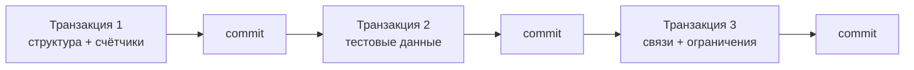

# 2. Транзакции: зачем и почему три

Задание требует **отдельную транзакцию** для каждого шага. Разберём, что это и
почему один `do $$ … $$` тут не подходит.

!!! abstract "Цель урока"
    Ты поймёшь, что такое транзакция и почему три шага домашки делают тремя
    отдельными транзакциями.

## Шаг 1 · Что такое транзакция

!!! note "Определение"
    **Транзакция** — группа команд, которая выполняется целиком: либо все команды
    сработали, либо ни одна.

Каркас в SQL:

```sql
begin;
-- команды
commit;
```

`commit` — «сохранить всё». Есть ещё `rollback` — «отменить всё».

!!! question "Сделай"
    Чем `commit` отличается от `rollback`?

??? success "Проверить"
    `commit` сохраняет изменения, `rollback` их отменяет и возвращает прежнее
    состояние.

## Шаг 2 · Зачем это нужно

Если в середине группы команд произошла ошибка, база осталась бы в половинчатом
состоянии. Транзакция так не даёт: ошибка — и всё откатывается.

```sql
begin;
insert into demo values (2, 'вторая');
insert into demo values (1, 'дубль');  -- ошибка: id 1 уже есть
commit;
```

Вторая вставка падает → **весь** блок откатывается, `'вторая'` тоже не попадёт.

!!! question "Сделай"
    Почему `'вторая'` не сохранилась, хотя она корректная?

??? success "Проверить"
    Потому что она в одной транзакции с ошибочной командой. Ошибка откатывает
    всю транзакцию.

## Шаг 3 · Блок `do $$` — это одна транзакция

Важно: **один `do $$ … $$` всегда выполняется в одной транзакции**. Внутри него
нельзя сделать `commit` и начать новую. Значит, чтобы получить **три** транзакции,
нужно **три** отдельных блока, каждый в своём `begin … commit`:

```sql
begin;
do $$ begin -- шаг 1
end $$;
commit;

begin;
do $$ begin -- шаг 2
end $$;
commit;

begin;
do $$ begin -- шаг 3
end $$;
commit;
```

!!! question "Сделай"
    Сколько здесь транзакций и сколько блоков `do $$`?

??? success "Проверить"
    Три транзакции и три блока. Каждый `begin…commit` — отдельная транзакция.

## Шаг 4 · Зачем разносить шаги

Три части домашки — разная ответственность:

1. **структура** — создать таблицы и счётчики;
2. **данные** — наполнить тестовыми данными;
3. **связи** — добавить ключи, связи и ограничения.

Если структура упала — не нужны данные. Если данные некорректны — лучше не
закреплять связи. Отдельные транзакции дают контроль над каждым этапом.

!!! question "Сделай"
    Назови три шага домашки по порядку.

??? success "Проверить"
    Структура и счётчики → тестовые данные → связи и ограничения.

!!! tip "Правило"
    Отдельная транзакция = `begin; … commit;`. Один `do $$ … $$` — внутри одной
    транзакции, поэтому шаги разносят отдельными парами `begin/commit`.



## Откуда числа

«Три» — из задания: ровно три части (структура, данные, связи). Порядок важен:
сначала таблицы, потом данные, в конце ограничения.

## Наивные вопросы

!!! question "Можно всё в одной транзакции?"
    Технически да, но задание просит отдельную для каждого шага — и это удобнее:
    упал один шаг — остальные не тронуты.

!!! question "`begin` в SQL и `begin` в PL/pgSQL — одно и то же?"
    Нет. `begin; … commit;` — начало транзакции. `begin … end` внутри `$$` —
    границы тела блока. Слова одинаковые, смысл разный.

## Чекпоинт

!!! question "Проверка"
    1. **Предскажи:** сколько транзакций в скрипте с тремя `begin…commit`?
    2. **Объясни**, почему нельзя сделать три транзакции внутри одного `do $$`.
    3. **Напиши** каркас одной транзакции с блоком внутри.

??? success "Проверить"
    1. Три.
    2. `do $$` всегда выполняется в одной транзакции — commit внутри запрещён.
    3. `begin; do $$ begin end $$; commit;`

## Что дальше

Переходим к первой транзакции — созданию структуры таблиц и счётчиков.
